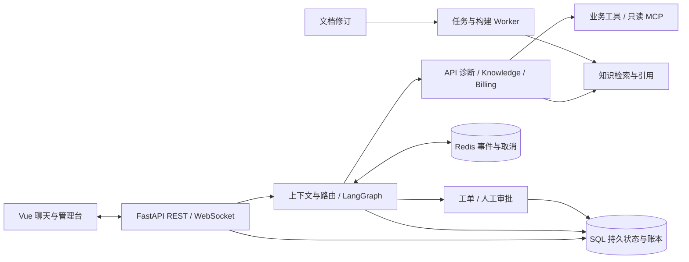

# API 助手

面向 API 开发者的 AI 客服系统，把文档问答、调用故障诊断、账单核实与人工处理放在同一条会话中。用户可以询问接口接入和计费规则，也可以围绕一次失败请求继续补充信息；系统检索文档、调用获授权的业务工具，并用可追溯的证据回答，必要时创建工单交由客服或管理员处理。

项目包含 Vue 客户端与管理台、FastAPI / WebSocket 服务，以及基于 LangGraph 的多 Agent 运行时。当前已完成源码候选验收，可用于本地演示、开发和进一步接入真实业务系统。

## 核心能力

| 能力 | 当前实现 |
| --- | --- |
| 文档问答 | 上传与维护知识文档，检索片段并展示引用；保留产品、地域、时间与表格单位等适用条件，支持跨地域对比 |
| API 故障诊断 | 围绕鉴权、限流等问题收集请求范围和工具证据，持久保存诊断进度，用户补充信息后继续核查 |
| 账单核实 | 通过只读 Billing MCP 查询当前账号的套餐、用量和账单，区分文档规则与实际业务记录 |
| 人工交接与审批 | 创建可追溯工单；客服处理状态与结论，管理员审批合成退款或关闭原工单，中断后按原决定恢复 |
| 会话与流式交互 | 多会话历史、流式回答、停止与重连；显式绑定会话，按生成任务隔离事件，支持跨副本续流和取消 |
| 管理与审计 | 用户与角色管理、知识构建状态、用量记录、工单变更与审批审计；供应商未知消耗支持凭收据逐笔对账 |

典型流程是：**用户提问 → 确定业务范围 → 查询文档或业务工具 → 汇总证据并答复 → 继续诊断或转入工单与审批**。只有持久化的业务回执才能支持“已建单”“已完成”等结果说明。

## 系统架构



- **前端**：Vue 3、TypeScript、Naive UI，提供聊天、引用预览、知识库和管理页面。
- **后端**：Python、FastAPI、SQLAlchemy、Alembic、LangGraph，承载认证、业务流程、任务恢复和审计。
- **知识链路**：解析、切分、Embedding、检索与引用校验；SQL 保存文档修订和活动构建，构建失败时保留旧活动版本。
- **运行依赖**：最小开发模式使用 SQLite、本地存储、后台任务和数据库检索；完整 Compose 使用 MySQL、Redis、MinIO、Elasticsearch、Kafka 与独立 Worker。
- **模型接入**：LLM 与 Embedding 分别配置。当前验证使用 DeepSeek 与千问 `text-embedding-v4`；文档和查询的编码模型及维度必须一致。

生成状态、额度预留与结算、诊断、工单及审批检查点保存在 SQL。Redis 提供跨副本实时事件与取消，故障时通过 SQL 快照恢复。审批执行使用持久队列、租约与重试，恢复时保留原审批人和决定。

## 快速开始

### 完整 Docker 演示

需要 Docker Engine 与 Compose v2。从仓库根目录执行，首次创建配置时复制模板；已有 `.env` 则保留并补齐所需项。

```powershell
if (!(Test-Path backend/.env)) { Copy-Item backend/.env.example backend/.env }
# 编辑 backend/.env，填写 LLM 与 Embedding 配置
# 不使用宿主机代理时，关闭 Compose 的默认 Embedding 代理
$env:DOCKER_EMBEDDING_HTTP_PROXY = ""
docker compose config --quiet
docker compose up --build -d
docker compose ps -a
```

Linux / macOS 首次复制配置使用 `cp -n backend/.env.example backend/.env`，直连编码服务时使用 `export DOCKER_EMBEDDING_HTTP_PROXY=`；其余 Docker 命令相同。有代理需求时填写容器可达的代理地址。

编排会执行数据库迁移与演示初始化，并启动前端、API、Worker、Billing MCP 及基础设施。首次构建和知识编码需要等待；真实问答及文档编码会产生供应商用量。

| 入口 | 默认地址 |
| --- | --- |
| 前端 | http://localhost:9527 |
| API 文档 | http://localhost:8000/docs |
| 健康检查 | http://localhost:8000/health |

开发模板默认初始化管理员 `admin / admin123`，用于本地演示。生产部署需替换密码与 JWT Secret，并配置或关闭管理员初始化。停止并保留数据使用 `docker compose down`。

### 本机开发

建议使用 **Python 3.12、Node 20、pnpm 9.15.5**，与 CI 保持一致。在仓库根目录打开终端，准备后端：

```powershell
cd backend
python -m venv .venv
.\.venv\Scripts\Activate.ps1
python -m pip install -r requirements-dev.txt
if (!(Test-Path .env)) { Copy-Item .env.example .env }
# 编辑 .env，填写模型配置
python -m alembic upgrade head
python run.py
```

另开终端，从仓库根目录启动前端：

```powershell
cd frontend
pnpm install --frozen-lockfile
pnpm dev
```

Linux / macOS 使用 `source .venv/bin/activate` 激活环境，首次复制配置使用 `cp -n .env.example .env`。最小模式无需启动完整基础设施；实际问答、知识编码和检索仍需有效的模型配置。纯离线开发可运行测试夹具。

关键模型配置如下，密钥放在本机环境文件或部署秘密中：

```dotenv
LLM_BASE_URL=https://api.deepseek.com/v1
LLM_API_KEY=<your-llm-key>
LLM_MODEL=<provider-model>
EMBEDDING_BASE_URL=https://dashscope.aliyuncs.com/compatible-mode/v1
EMBEDDING_API_KEY=<your-embedding-key>
EMBEDDING_MODEL=text-embedding-v4
EMBEDDING_DIMENSION=256
```

文字 PDF / DOCX 解析需要独立 Docling 环境与模型缓存，接入这些格式前按运维手册准备。

## 验证与当前范围

本轮源码验收：完整本地后端 **441 项通过、2 项跳过**；真实 MySQL / Elasticsearch / Redis 集成 **81 项通过**；原 P1 的 MySQL 专项和 Billing MCP 协议另行通过。前端全量 ESLint 零错误、零警告，类型、流式重放、生产构建及两项浏览器流程通过。四题真实 LLM / Embedding 复测 **4/4 通过**，请求台账与用量回执一致。成绩对应本轮候选代码和记录的测试配置。

常用本地检查分别在对应目录执行：

```powershell
# backend
python -m pytest tests -q
python scripts/check_docs.py --checkout
python scripts/check_phase4_inputs.py

# frontend
pnpm lint
pnpm typecheck
pnpm test:stream
pnpm build
```

CI 自动执行离线检查、前端与浏览器验收；隔离集成连接临时 MySQL、Elasticsearch、Redis 和 Billing MCP。真实模型评测通过显式命令运行，日常 CI 使用离线夹具。

当前已登记的技术债已关闭。**退款仍是合成支付沙箱**，API 细分诊断使用独立 Demo 业务数据；真实支付渠道、扫描 OCR、截图理解及更大规模负载属于后续接入和验收范围。已有环境升级需执行 `0021_close_runtime_debts` 迁移，目标环境的备份、配置、回滚和放量按发布流程签验。

## 代码与文档

```text
frontend/                 聊天、知识库与管理界面
backend/app/              API、Agent、知识流水线、诊断、工单与账本
backend/alembic/          数据库迁移
backend/tests/            单元、回归与集成测试
backend/eval/             评测题集与历史题目候选
backend/vendor_knowledge/ 官方知识快照及来源清单
deploy/                  隔离测试与部署编排
docs/                    日常手册和必要验收记录
```

需要深入某一部分时再查阅对应手册：[开发](docs/DEVELOPMENT.md)、[架构](docs/ARCHITECTURE.md)、[运维](docs/OPERATIONS.md)、[测试](docs/TESTING.md)、[发布](docs/RELEASING.md)、[维护台账](docs/MAINTENANCE.md)。完整目录见[文档索引](docs/README.md)，本轮测试范围见[候选验收记录](docs/archive/reports/RELEASE_CANDIDATE_ACCEPTANCE_2026-11-19.md)。

内部包、数据库与 Compose 中的 `PaiSmart` 为保留的技术标识。
