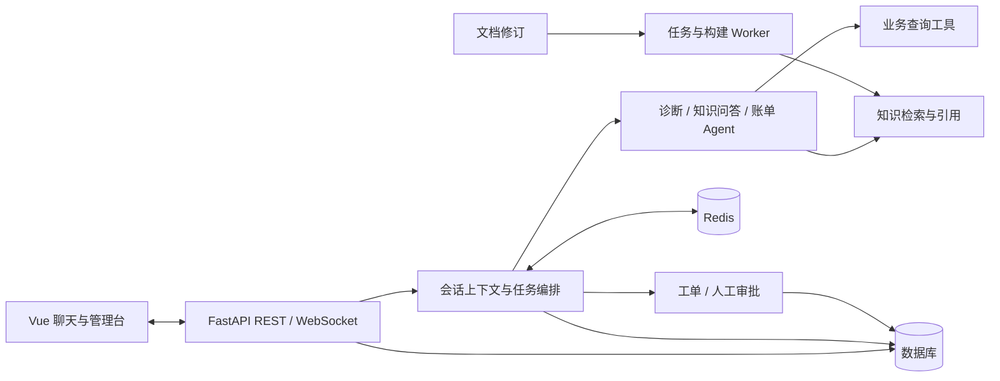

# API 助手

API 助手是面向 API 开发者的 AI 客服系统，用于回答接口接入问题、排查调用故障、查询账单，并将需要人工处理的问题转成工单。

例如，开发者可以询问“这个接口在不同地域如何计费”，也可以描述“一次请求返回了 429”，随后补充请求号、时间和错误信息。系统结合知识库与业务查询结果回答，用户可以打开引用查看原文，也可以在同一会话中继续排查。

这是一个围绕 API 客服场景展开的个人项目，提供聊天界面、客服工作台和管理员后台。设计重点是让回答有依据、诊断能续办、业务操作可恢复，并让会话、工单与用量记录保持一致。

## 技术亮点

| 解决的问题 | 实现方式 |
| --- | --- |
| **检索命中了文字，却用错地域、时间或单位** | 父子分块保留上下文，检索、原文读取和引用展示共同校验适用范围；跨地域提问可以同时检索相关地域 |
| **文档更新一半失败，知识库出现新旧内容混用** | 文档修订与索引构建分开记录，后台任务使用租约协调；新构建验证通过后切换活动版本，失败时继续使用旧版本 |
| **用户补充信息后，诊断又从头开始** | 将诊断作为独立业务对象，保存请求范围、候选原因和工具证据；补充信息与复查结果推进同一诊断 |
| **断线、跨实例停止和服务重启导致状态不一致** | SQL 保存生成状态，Redis Streams 共享正文与取消请求；通过心跳回收失联任务，用条件更新和事务协调终态与结算 |
| **审批中断后，接手人改写决定或重复执行** | 原决定、检查点和执行任务持久化；租约约束执行者，恢复时读取原审批人及决定，核对幂等回执 |
| **调用超时后，把未知消耗误记为零** | 每次实际请求发送前记录尝试，分别保存已返回和未知用量；管理员凭供应商收据对账，校验收据重复并保留审计 |

### 从检索片段到有依据的答复

知识、诊断和账单 Agent 分别获取本领域事实，再汇总证据生成回答。文档用于解释规则，经过权限校验的业务工具用于核实账号状态，两类证据承担不同职责。回答经过脱敏和“主张—证据—范围”校验；引用可打开对应原文，工单与审批结果由持久化回执确认。

### 从一轮聊天到可继续的诊断

会话负责交互，诊断对象负责记录问题进展。例如，用户先描述 429 错误，再补充请求号和时间，系统沿用已有诊断查询证据；用户修正信息或切换请求时，会重新核对范围。模型调用和工具执行依据持久化业务状态选择后续动作。

### 从正常流程到中断恢复

生成任务独立于 WebSocket 连接运行，重连通过共享事件或 SQL 快照恢复显示；客户端按生成任务隔离事件，用完整正文校准重放。审批也独立保存决定与执行进度，接手管理员可以继续原流程。普通用户、客服、管理员各有权限范围，工单状态变更和角色变更均保留审计。

## 主要功能

| 功能 | 使用方式 |
| --- | --- |
| 知识库问答 | 导入产品文档，询问接入方法、接口限制和计费规则；回答附带引用，支持查看原文及比较不同地域的规则 |
| 调用故障诊断 | 提供报错和请求信息，排查鉴权、限流等问题；补充信息后可继续原有诊断 |
| 套餐与账单查询 | 查询当前账号的套餐、用量和账单，将文档中的计费规则与账号实际记录结合说明 |
| 工单与人工处理 | 将问题转为工单，由客服记录处理进度和结论；管理员可审批演示退款或关闭工单 |
| 会话管理 | 创建和切换会话、查看历史记录、接收流式回答、停止生成，以及断线后重连 |
| 管理后台 | 管理用户权限和知识文档，查看文档处理状态、调用用量、工单和审批记录 |

系统提供三类角色：普通用户使用聊天与知识库功能，客服处理工单，管理员负责用户管理、审批和用量对账。

## 建议体验路线

启动环境后，可以用下面这条路线了解项目：

1. **问文档**：导入相关产品文档，询问“不同地域的计费规则有什么区别？”，打开引用核对原文。
2. **查故障**：使用演示请求数据，描述鉴权失败或限流错误，再补充请求号，观察诊断如何继续。任意编造的请求号无法查到业务记录。
3. **转人工**：将需要人工跟进的问题提交工单，切换客服账号查看并填写处理结论。
4. **看审批**：在启用退款演示的环境中发起申请，由管理员审批，再回到原会话查看结果。

想先体验无需模型密钥的业务流程，可在安装后端依赖后，从 `backend` 运行：

```powershell
python scripts/run_refund_sandbox_demo.py
```

脚本自动启动临时 API 和合成支付服务，使用隔离数据演示退款审批、重复请求与原工单关闭，并输出回执。它不提供聊天界面；交互界面和其他演示入口见[测试手册](docs/TESTING.md#demos)。

## 使用范围

项目自带演示业务数据和合成支付沙箱，便于体验诊断、账单查询及退款审批流程。演示退款不会产生真实资金交易；面向实际客户使用时，需要接入对应的业务数据与支付渠道。

知识库支持文本以及文字 PDF / DOCX 的解析，后两种格式需要配置 Docling 解析环境。扫描 OCR 和截图理解尚未提供。

## 系统架构



后端通过 LangGraph 编排诊断、知识问答和账单三类 Agent。Agent 分别查询文档或业务数据，再汇总成面向用户的回答。账单查询通过 MCP（模型上下文协议）连接独立的只读服务。

| 部分 | 技术与职责 |
| --- | --- |
| 前端 | Vue 3、TypeScript、Naive UI；聊天、引用预览、知识库和管理页面 |
| 应用服务 | Python、FastAPI、WebSocket；认证、接口和流式交互 |
| 业务与数据 | SQLAlchemy、Alembic、LangGraph；会话、诊断、审批、用量及数据库迁移 |
| 知识处理 | 文档解析、切分、Embedding（向量编码）、检索与引用；独立 Worker 执行后台构建 |
| 完整运行环境 | MySQL、Redis、MinIO、Elasticsearch、Kafka；分别用于业务数据、缓存与实时事件、文件存储、检索及任务通知 |

会话、诊断和审批进度保存在数据库中，支持中断恢复；Redis 共享多个服务实例之间的实时事件。知识文档更新后由后台构建新版本，构建失败时仍可查询原有版本。

## 架构取舍

| 选择 | 收益 | 成本 |
| --- | --- | --- |
| 按知识、诊断和账单划分 Agent | 分开工具权限与证据职责，便于独立验证 | 增加编排、上下文传递与模型调用开销 |
| SQL 保存业务状态，Redis 共享实时事件 | 业务流程可追溯，连接与服务实例可切换 | 需要维护事务、租约、事件重放和故障恢复 |
| 文档修订、后台构建和活动版本分离 | 更新失败时保留可查询版本 | 增加版本记录、任务协调和旧产物清理 |
| 同时提供最小模式与完整基础设施 | 本机易于开发，也能探索异步任务与多实例协作 | 两种配置及对应行为都需要维护 |

本机演示可以使用 SQLite 与本地存储；完整模式使用独立 Worker、MySQL、Redis、Elasticsearch、MinIO 和 Kafka。模块职责见[架构](docs/ARCHITECTURE.md)，关键行为可从[会话与结算回归](backend/tests/e2e/test_release_p1_regressions.py)、[跨实例事件回归](backend/tests/e2e/test_shared_generation_events.py)和[审批、对账与权限回归](backend/tests/e2e/test_debt_closure.py)查看。

## 快速开始

先选择运行方式：Docker 启动完整演示环境；本机开发模式使用 SQLite 和本地文件存储，便于修改代码。两种方式都需要配置语言模型与 Embedding 服务。

### 模型配置

在 `backend/.env` 中配置两个服务：语言模型负责理解问题和生成回答，Embedding 将文档与问题编码为检索向量。例如：

```dotenv
LLM_BASE_URL=https://api.deepseek.com/v1
LLM_API_KEY=<your-llm-key>
LLM_MODEL=<provider-model>
EMBEDDING_BASE_URL=https://dashscope.aliyuncs.com/compatible-mode/v1
EMBEDDING_API_KEY=<your-embedding-key>
EMBEDDING_MODEL=text-embedding-v4
EMBEDDING_DIMENSION=256
```

将占位符替换为服务商提供的密钥和模型名称。文档入库与问题检索须使用相同的 Embedding 模型和维度；调用模型服务会产生对应供应商的用量。

### Docker 启动

需要 Docker Engine 与 Compose v2。从仓库根目录执行，首次创建配置时复制模板；已有 `.env` 则保留并补齐所需项。

```powershell
if (!(Test-Path backend/.env)) { Copy-Item backend/.env.example backend/.env }
# 编辑 backend/.env，填写 LLM 与 Embedding 配置
# 不使用宿主机代理时，关闭 Compose 的默认 Embedding 代理
$env:DOCKER_EMBEDDING_HTTP_PROXY = ""
docker compose config --quiet
docker compose up --build -d
docker compose ps -a
```

Linux / macOS 首次复制配置使用 `cp -n backend/.env.example backend/.env`，直连编码服务时使用 `export DOCKER_EMBEDDING_HTTP_PROXY=`；其余 Docker 命令相同。有代理需求时填写容器可达的代理地址。

编排会执行数据库迁移与演示初始化，并启动前端、API、Worker、Billing MCP 及基础设施。首次启动需要下载镜像、构建服务并初始化数据，可通过 `docker compose logs --tail 100 api worker` 查看运行日志。

| 入口 | 默认地址 |
| --- | --- |
| 前端 | http://localhost:9527 |
| API 文档 | http://localhost:8000/docs |
| 健康检查 | http://localhost:8000/health |

开发模板默认初始化管理员 `admin / admin123`，用于本地演示。生产部署需替换密码与 JWT Secret，并配置或关闭管理员初始化。停止并保留数据使用 `docker compose down`。

### 本机开发

使用 **Python 3.12、Node 20、pnpm 9.15.5**。在仓库根目录打开终端，准备后端：

```powershell
cd backend
python -m venv .venv
.\.venv\Scripts\Activate.ps1
python -m pip install -r requirements-dev.txt
if (!(Test-Path .env)) { Copy-Item .env.example .env }
# 编辑 .env，填写模型配置
python -m alembic upgrade head
python run.py
```

另开终端，从仓库根目录启动前端：

```powershell
cd frontend
pnpm install --frozen-lockfile
pnpm dev
```

Linux / macOS 使用 `source .venv/bin/activate` 激活环境，首次复制配置使用 `cp -n .env.example .env`。后端默认在 `8000` 端口运行，前端地址见开发服务器启动输出。

启动后登录界面，进入知识库导入文档，等待文档处理完成，再创建会话提问。处理文档和检索问题需要可用的 Embedding 服务；生成回答需要可用的语言模型服务。PDF / DOCX 的解析环境配置见运维手册。

## 测试与检查

测试覆盖会话隔离、生成与结算、知识构建、诊断恢复、审批、权限和用量对账，并包含 HTTP 接口和浏览器流程测试。

常用本地检查分别在对应目录执行：

```powershell
# backend
python -m pytest tests -q
python scripts/check_docs.py --checkout
python scripts/check_phase4_inputs.py

# frontend
pnpm lint
pnpm typecheck
pnpm test:stream
pnpm build
```

CI 自动执行代码检查、前端构建和浏览器测试，并使用临时 MySQL、Elasticsearch、Redis 和 Billing MCP 运行集成测试。日常 CI 使用模拟模型响应，无需供应商密钥；真实模型评测单独运行。

## 代码与文档

```text
frontend/                 聊天、知识库与管理界面
backend/app/              API、Agent、知识流水线、诊断、工单与账本
backend/alembic/          数据库迁移
backend/tests/            单元、回归与集成测试
backend/eval/             评测题集与历史题目候选
backend/vendor_knowledge/ 官方知识快照及来源清单
deploy/                  隔离测试与部署编排
docs/                    开发、架构、运维等项目文档
```

需要深入某一部分时再查阅对应手册：[开发](docs/DEVELOPMENT.md)、[架构](docs/ARCHITECTURE.md)、[运维](docs/OPERATIONS.md)、[测试](docs/TESTING.md)、[发布](docs/RELEASING.md)、[维护台账](docs/MAINTENANCE.md)。完整目录见[文档索引](docs/README.md)。
