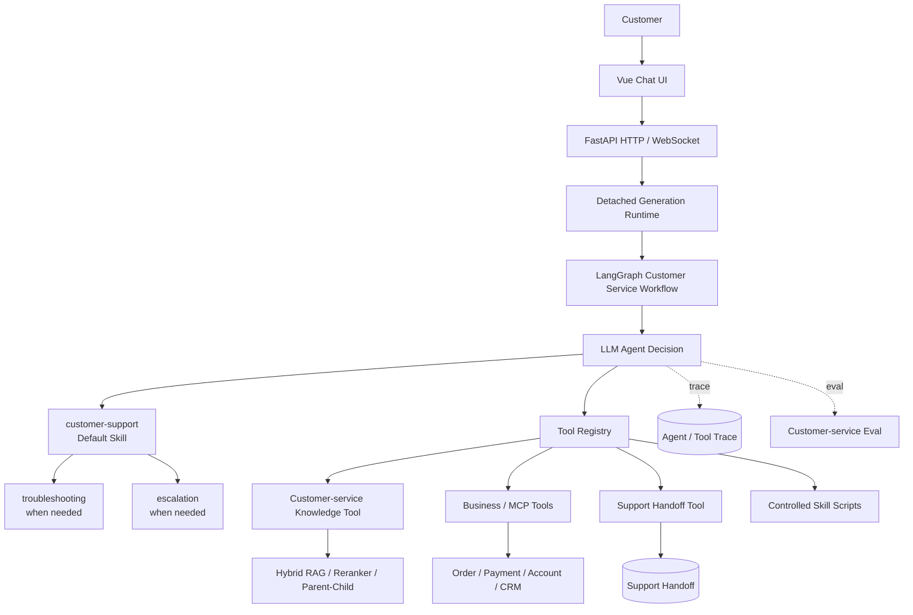

# PaiSmart

PaiSmart 是一个面向企业业务场景的 **AI 客服 Agent**。它的核心目标不是做通用研究，而是围绕客服闭环完成三件事：**准确回答客户问题、结构化排查故障、在需要时可靠转交人工客服**。

系统使用 **LangGraph StateGraph** 编排客服工作流，Skill 驱动客服行为，LLM 通过统一 Tool Runtime 调用客服知识库、本地业务能力和外部 MCP 系统；同一轮中无依赖且安全的 Tool 会并行执行。RAG 用于回答企业政策、产品说明、FAQ 和排障知识，MCP Client 用于连接订单、支付、账户、CRM 等真实业务系统，人工升级则通过持久化客服工单闭环。

> 当前代码版本：`0.14.0`。仓库文档只描述当前 AI 客服架构，不保留历史版本说明。

## 先看什么

第一次阅读项目建议按这个顺序：

1. [架构与职责边界](docs/ARCHITECTURE.md)
2. [本地启动](docs/GETTING_STARTED.md)
3. [客服 Agent、Skill、Tool 与 MCP](docs/AGENT_AND_SKILLS.md)
4. [客服知识库与 RAG](docs/KNOWLEDGE_PIPELINE.md)
5. [客服质量评测](docs/EVALUATION.md)
6. [生产部署](docs/PRODUCTION.md)

完整文档导航见 [docs/README.md](docs/README.md)。

## 产品主链路



## 客服 Skill

当前只保留与 AI 客服直接相关的三个 Skill：

```text
customer-support   默认客服应答：理解诉求、查知识、区分政策与个人账户事实、给下一步
troubleshooting    故障排查：结构化症状、最短诊断路径、避免高风险操作、判断停止排障
escalation         人工升级：判断升级、整理上下文、创建真实工单、返回 handoffId
```

其中 `customer-support` 是默认 Skill。普通客服消息不需要“命中关键词”才能使用 Skill；只有故障或人工升级场景才叠加 specialist Skill。

例如：

```text
“退款政策是什么？”
customer-support
    -> search_knowledge
    -> grounded answer

“登录一直报 E401”
customer-support + troubleshooting
    -> classify failure
    -> search_knowledge
    -> diagnostic plan

“别排查了，直接转人工”
customer-support + escalation
    -> build handoff summary
    -> create_support_handoff
    -> return real handoffId
```


## LangGraph 客服工作流

当前主执行路径使用真实 `StateGraph`，不是仅保留依赖或示例文件：

```text
START
  -> load_context
  -> skill_route
  -> agent_decide
       |
       |-- tool_calls ------> execute_tools --┐
       |-- handoff tool ---> handoff ---------┤
       |                                      |
       └<-------------------------------------┘
       |
       |-- max steps ------> force_finalize
       |-- final answer ---> safety
                              -> emit_final
                              -> persist_trace
                              -> END
```

LangGraph 负责**状态与阶段路由**；Tool Runtime 继续负责 Schema、权限、Scope、超时、并发和部分失败。RAG、MCP、Skill Script 都不会被拆成大量图节点，避免工作流图过度复杂。

同一轮 LLM 返回多个独立 Tool Call 时，`execute_tools` 节点内部仍通过异步执行器并行处理；需要前序结果的 Tool 由下一轮 `agent_decide` 自然形成动态依赖。

## Tool 与 MCP

当前核心本地 Tool 包括：

- `search_knowledge`：查询客服知识库（原 `doc_rag` 能力已经升级到 Hybrid RAG Tool）。
- `query_call_log` / `query_api_key_status` / `query_recent_call_stats` / `query_error_code`：API 技术支持诊断能力。
- `query_plan` / `query_usage` / `query_bill`：客户套餐、调用量和账单真实数据查询。
- `create_support_handoff` / `get_support_handoff`：真实人工客服工单闭环。
- `list_documents` / `get_document`：知识文档访问能力。
- `activate_skill` / `read_skill_reference` / `run_skill_script`：Skill Runtime 能力。

原始 AI-DevSupport 的三个专业 Agent 没有以旧式子 Agent 文件重新引入，而是按当前职责重构：

```text
API Diagnostic Agent -> troubleshooting Skill + 4 API diagnostic Tools
Billing Agent        -> customer-support Skill + 3 billing Tools
Doc RAG Agent        -> search_knowledge + Hybrid RAG
```

因此 LangGraph 仍负责编排客服工作流，专业能力由 Skill 决定“怎么做”，Tool 负责查询真实数据。

真实订单、支付、账户、物流、CRM 等**客户特定数据不应该由知识库猜测**。推荐通过外部 MCP Server 或本地业务 Tool 接入。V14 增加稳定 Business MCP Adapter：Agent 始终调用 `query_call_log / query_plan / query_bill` 等固定 Tool 名，部署时只需把 `BUSINESS_TOOL_BACKEND` 从 `local` 切到 `mcp` 并配置映射，无需修改 LangGraph、Skill 或 Prompt。


```text
PaiSmart Agent
   -> MCP Client Adapter
      -> Order MCP
      -> Payment MCP
      -> Account MCP
      -> CRM MCP
```

LLM 能看到 Tool Schema，但看不到数据库凭据、JWT Secret、MCP Secret 或 Tool 内部实现。Tool Runtime 统一执行参数校验、权限、Scope、超时、错误处理和 Trace。

## 无依赖 Tool 并行

客服场景中互不依赖的查询可以同轮并行。例如处理“钱扣了但会员没到账”时，未来接入对应业务 MCP 后可以同时执行：

```text
search_knowledge(payment policy) ─┐
get_payment_record(customer) ─────┼─ parallel
get_subscription_status(customer) ┘
                 ↓
            LLM 综合判断
```

并行调度发生在 LangGraph 的 `execute_tools` / `handoff` 执行阶段内部，不依赖 Skill Prompt，也不会因为 MCP 化而丢失。

## 客服知识库

知识库服务于：

```text
产品说明
FAQ
退款/会员/售后政策
使用流程
错误码与排障手册
客服 SOP 中可公开给模型的知识
```

RAG 链路：

```text
Document + Customer-service Metadata
 -> Parse
 -> Parent / Child Chunking
 -> Child Embedding
 -> Versioned DB + Elasticsearch Index
 -> ACL + Metadata Filter
 -> BM25 + Vector KNN Hybrid Recall
 -> RRF
 -> Reranker
 -> Parent Expansion
 -> Context Budget
 -> Agent Tool Result
```

当前知识元数据支持 `category / product / region / channel / effective_date / version / error_code / plan`。`search_knowledge` 可以把这些条件在召回前下推到 Elasticsearch，例如先限定 `category=rate_limit + product=API Platform + channel=api`，再执行 BM25/KNN，避免无关产品或过期政策进入候选集。

知识库只能回答通用或文档事实。诸如“我的订单是否发货”“我的退款是否到账”必须由业务 Tool/MCP 验证；没有工具时 Agent 要明确说明无法核实，不能用 RAG 猜测个人状态。

## 内置 Demo 客服知识库

为了让项目 Clone 后不必先准备 PDF，仓库自带一套小型但可真实建库的 AI 客服知识：

```text
backend/demo_knowledge/
├── api-getting-started.md
├── authentication.md
├── rate-limit.md
├── billing-policy.md
├── refund-policy.md
├── error-codes.md
├── troubleshooting-faq.md
└── manifest.json
```

这些文档不是 Prompt 占位文本，而是通过现有 `DocumentParser -> Parent-Child -> Embedding -> Versioned DB/Elasticsearch` 链路建立索引。

```bash
cd backend
python scripts/seed_demo_knowledge.py --username admin --reset
```

只验证文档能否被当前 Parser/Chunker 正常处理：

```bash
python scripts/seed_demo_knowledge.py --validate-only
```

建库后可以直接执行随仓库提供的 RAG Benchmark：

```bash
python scripts/evaluate_rag.py eval/demo_knowledge_rag.jsonl --username admin -k 6
```

Demo 知识覆盖 API 入门、认证、429/QPS、套餐计费、退款边界、错误码和排障 FAQ。客户实时调用日志、API Key 状态、实际用量与账单仍由业务 Tool 查询，RAG 不会替代这些事实源。

## 人工客服闭环

`escalation` Skill 可以调用真实写操作：

```text
create_support_handoff
```

工单持久化到 `support_handoffs`，支持：

```text
Customer: 查看自己的 handoff
Admin:    查看、接手、更新状态、填写 resolution note
```

只有 Tool 真正返回 `SUCCESS + handoffId` 后，Agent 才允许告诉客户“已创建人工工单”。

## 后端目录

```text
backend/
├── app/
│   ├── api/             # HTTP / WebSocket 边界
│   ├── agent/           # LangGraph 工作流、LLM、并行 Tool Runtime、Generation、Trace
│   ├── skill_runtime/   # Skill 发现、路由、加载
│   ├── tools/           # Tool Schema、Registry、Local/MCP Adapter
│   ├── support/         # 人工客服 handoff 领域逻辑
│   ├── knowledge/       # 客服 RAG、Embedding、Indexer、Reranker
│   ├── documents/       # 客服知识文档上传与处理
│   ├── accounting/      # Token、Usage、Rate Limit
│   ├── evaluation/      # 六层客服 Eval：RAG / Tool / Decision / Answer / Safety / Performance
│   ├── db/              # SQLAlchemy persistence
│   ├── core/            # Config / Security / Observability
│   └── workers/         # Kafka/background worker
├── skills/              # AI 客服 Skill 内容包
├── demo_knowledge/      # 可一键建库的内置客服知识
├── eval/                # Demo RAG / 客服 Benchmark 数据
├── scripts/             # Seed / Eval CLI
├── tests/               # 自动化测试
├── alembic/             # 数据库迁移
├── run.py
└── mcp_server.py
```

`app/skill_runtime/` 是 Skill 引擎；`backend/skills/` 是真正由 Agent 使用的客服 Skill 内容，两者刻意分开。

## 最快启动

要求 Python 3.11+、Node.js、pnpm。

后端：

```bash
cd backend
python -m venv .venv
# Windows: .venv\Scripts\activate
# macOS/Linux: source .venv/bin/activate
pip install -r requirements.txt
cp .env.example .env
python run.py
```

另开终端可一键准备完整 Demo 数据：

```bash
cd backend
python scripts/seed_support_demo.py --username admin --reset
python scripts/seed_demo_knowledge.py --username admin --reset
```

前者写入 API/Billing 结构化业务数据，后者通过真实 RAG 建库链路写入 7 份客服知识文档。

默认开发地址：

```text
API      http://localhost:8000
Swagger  http://localhost:8000/docs
Health   http://localhost:8000/health
WebSocket ws://localhost:8000/chat
```

前端：

```bash
cd frontend
pnpm install
pnpm dev
```

完整基础设施：

```bash
docker compose -f deploy/compose.infra.yml up -d
cd backend
cp .env.full.example .env
alembic upgrade head
python run.py
```

Kafka Worker：

```bash
python -m app.workers.file_processor
```

## Eval

PaiSmart 现在使用 **六层 AI 客服 Benchmark**，最终目标不是“Agent 调了几个 Tool”，而是衡量客户问题是否被正确、安全、有效地解决。

```text
1. RAG Retrieval     Recall@K / MRR / nDCG / Hit Rate
2. Tool Calling      Tool Selection / Argument Accuracy / Success Rate
3. Agent Decision    Decision Accuracy / Unnecessary Tool Rate / Escalation Precision & Recall
4. Answer Quality    Correctness / Groundedness / Completeness / Instruction Following
5. Safety            Hallucination / Unauthorized Claim / Prompt Injection
6. Performance       P50/P95 Latency / Token Cost / Tool Failure / Recovery / Parallel Speedup
```

统一客服 Benchmark：

```bash
cd backend
python scripts/evaluate_customer_service.py
```

仓库保留 `24` 条 canonical smoke cases，并新增 `120` 条 extended benchmark（24 个客服场景 × 5 种真实问法变体），覆盖 FAQ、订单/支付、API 401/429 诊断、API Key 状态、套餐/用量/账单、故障排查、转人工、部分失败、越权请求和 Prompt Injection。扩展集不预填任何模型成绩；真实指标必须在配置 LLM/RAG 后运行得到。

快速契约回归：

```bash
python scripts/evaluate_customer_service.py
```

完整 120 条 Benchmark：

```bash
python scripts/evaluate_customer_service.py --dataset eval/customer_service/benchmark_extended.jsonl
```

配置真实 LLM 后可运行：

```bash
python scripts/evaluate_customer_service.py --live --compare-no-skill --output eval/customer-service-report.json
```

真实 RAG 仍单独对实际知识索引评测，再合并到六层报告：

```bash
python scripts/evaluate_rag.py eval/my_dataset.jsonl --username admin -k 6 --output eval/rag-report.json
python scripts/evaluate_customer_service.py --rag-report eval/rag-report.json
```

核心业务指标是 **Customer Resolution Rate**：只有 Tool、决策、最终回答、安全边界以及必要的人工交接都正确，才算成功解决。

详细见 [docs/EVALUATION.md](docs/EVALUATION.md)。

## 开发原则

所有新增功能都先问：**它是否直接服务 AI 客服？**

```text
客服对话决策/调度       -> app/agent/
客服工作方法            -> backend/skills/
客户/人工交接领域能力   -> app/support/
LLM 可调用业务能力      -> app/tools/
政策/FAQ/排障知识       -> app/knowledge/
知识文档生命周期        -> app/documents/
订单/支付/账户/CRM 接入 -> Tool 或 MCP Adapter
质量验证                 -> app/evaluation/
```

不要再加入与客服主链路无关的通用 Skill，也不要重新创建万能 `services/` 目录。
