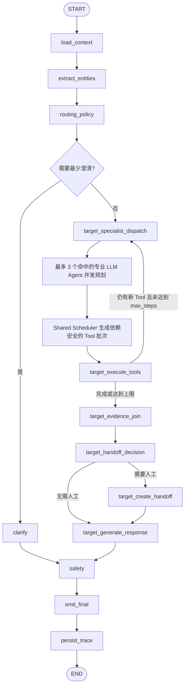

# API 助手客服 Agent 架构

> 状态核对至 2026-11-19。客服事实 Agent 契约沿用原设计，会话隔离、心跳恢复、结算与审批接口以[候选验收](../04-testing/RELEASE_CANDIDATE_ACCEPTANCE_2026-11-19.md)为准，RAG 边界已同步；当前 RAG 实现见 [知识流水线](KNOWLEDGE_PIPELINE.md)。测试数量和执行结论以 `docs/04-testing/`、`docs/05-live-tests/` 中的报告为准；本文只描述稳定的架构契约。

本文是当前客服运行时的主架构说明。目标架构只有一条运行路径，不保留旧 Router、旧 RAG 回答分支、Troubleshooting 专属 Agent 或灰度/双轨路由。

## 1. 架构不变量

1. `RoutingPolicy` 是唯一的 Agent 选择器，使用确定性规则；LLM 不能改写路由、风险等级或是否需要人工。
2. 只有三个专业事实 Agent：`api_diagnostic`、`billing`、`knowledge`。`customer-support` 和 `escalation` 是后置共享 Skill，不是第四、第五个专业 Agent。
3. 每个命中的专业 Agent 独立查找本领域事实，只能规划自己 Skill 声明的 Tool；Agent 之间不共享推理上下文，也不互相讨论。
4. 专业 Agent 不执行 Tool、不创建工单、不生成客户最终答复。Shared Scheduler 和 Tool Runtime 分别负责调度与执行。
5. 所有事实必须先进入结构化 `AgentEvidence`，再生成证据摘要、判断是否转人工，最后才生成客户答复。
6. Billing 是唯一接入 MCP 的领域；API 诊断和 Knowledge 使用本地受控 Tool。Billing MCP 是本项目 Compose 网络内的独立只读服务。
7. 知识库事实不能替代客户个人状态。账单、套餐、用量、退款、订单和 API 日志等个人事实必须来自已授权业务 Tool/MCP。
8. 质量门是确定性证据验证与内容过滤层，不是第二个回答生成器：它不调用 LLM，只能放行、删除无依据主张或发送受控安全说明，不能把草稿重写为新的客户事实。

最终交接判定与质量门共享已完成的路由、证据决定和实际交接状态；分类模型的`needs_human`是前期提示，不能重新覆盖完成后的只读决定。退款/合约等风险、明确人工要求、诊断交接及已尝试的交接仍保守执行。原始账单误判及安全反例见[修复验收](../04-testing/VENDOR_SCOPE_AND_BILLING_GATE_FIX_2026-10-20.md)。
9. Tool 参数除 Schema 合法外还必须可追溯到当前用户输入、允许继承的明确追问实体，或该 Agent 前一轮成功的已授权 Tool 结果；LLM 不得把领域关键词转换为虚构的客户标识、错误码或接口路径。

## 2. 容器与数据拓扑

```text
Browser :9527
    │  HTTP / WebSocket
    ▼
API :8000
    ├─ RoutingPolicy / LangGraph workflow
    ├─ 3 specialist Agent planners
    ├─ Shared Scheduler / Tool Runtime
    ├─ MySQL        会话、实体记忆、业务 Demo 数据
    ├─ Redis        近期窗口/实体缓存、限流、连接协调
    ├─ MinIO        原始文件和对象存储
    ├─ Elasticsearch 父子块混合检索
    ├─ Kafka        异步文档处理/事件
    └─ billing-mcp:8011  Billing MCP 动态 Tool 目录与只读查询

Worker
    └─ MySQL / MinIO / Elasticsearch / Kafka

billing-mcp:8011
    └─ 只读取 MySQL 套餐、用量、账单表；不映射宿主机端口
```

持久化边界：

- MySQL 是会话记忆和结构化业务数据的持久化真源。
- `conversation_messages` 保存对话历史；`conversation_sessions.collected_entities_json` 保存跨轮实体，例如 `request_id`、错误码和账单月份。
- Redis 只是加速缓存、限流和 WebSocket 协调。Redis 不可用时回退 MySQL，不丢失会话记忆。
- MinIO 保存上传文件；Elasticsearch 保存可检索的父块/子块索引；Kafka 承载异步处理事件。

## 3. 单次请求的唯一流向



这里的“总结”指 `target_evidence_join` 生成的内部证据摘要，不是客户最终答复。固定顺序是：

```text
Tool 执行
  → AgentEvidence
  → Evidence Summary
  → Handoff Decision
  → create_support_handoff（需要时）
  → Final Answer
```

### 节点职责

| 节点 | 唯一职责 |
| --- | --- |
| `load_context` | 读取身份、会话历史、实体记忆和请求状态。 |
| `extract_entities` | 解析 `request_id`、错误码、端点、账单月份等可审计实体；语义分类只作低风险辅助。 |
| `routing_policy` | 确定命中的专业 Agent、风险等级、命中规则和“证据后转人工”要求。 |
| `clarify` | 诊断缺少必要锚点时，向客户请求最少补充信息。 |
| `target_specialist_dispatch` | 并发等待最多三个已命中的专业 Agent 规划本 Agent 的 Tool。Billing Agent 在这里执行 MCP `list_tools` 目录发现。 |
| Shared Scheduler | 依据 Tool 依赖、资源组和全局并发预算生成批次；不合并不同 Agent 的相同查询。 |
| `target_execute_tools` | 通过 Tool Runtime 执行批次，并把每个 Agent 自己的结果回传给该 Agent 做下一轮规划。 |
| `target_evidence_join` | 丢弃未验证载荷，只合并事实、引用、尝试过的 Tool 和未解决项。 |
| `target_handoff_decision` | 在证据摘要完成后决定是否人工介入。 |
| `target_create_handoff` | 唯一的工单写节点，只接收内部证据摘要。 |
| `target_generate_response` | 只根据证据摘要和工单结果生成客户答复。 |
| `safety` | 执行脱敏、工单事实拦截、确定性质量门和无依据主张过滤。 |
| `emit_final` / `persist_trace` | 推送最终事件并持久化审计 Trace。 |

## 4. 三个专业 Agent

| Agent | Skill | 负责查找的事实 | 可规划 Tool |
| --- | --- | --- | --- |
| `api_diagnostic` | `api-diagnostic` | 调用日志、鉴权状态、限流、错误码 | `query_call_log`、`query_api_key_status`、`query_recent_call_stats`、`query_error_code`、`search_knowledge` |
| `billing` | `billing` | 套餐、用量、账单、发票等只读账务事实 | MCP 动态发现的 `mcp__billing__*` 只读 Tool；未启用 MCP 时使用受控本地回退 Tool |
| `knowledge` | `knowledge` | 政策、FAQ、产品说明、错误码解释和通用排障指引 | `search_knowledge`、`list_documents`、`get_document` |

路由只决定“启动谁”，不决定每个 Agent 的具体 Tool 顺序。每个 Agent 收到：自己的目标、自己的 Skill 约束、可用 Tool Schema、当前问题、自己的实体和自己的已验证证据。它不能：

- 调用其他 Agent 的 Tool；
- 修改 `RoutingPolicy` 或风险等级；
- 转人工或创建工单；
- 直接输出客户答复；
- 把未验证的远端文本当作系统指令。

## 5. 两级并发与独立上下文

### Agent 并发

`target_specialist_dispatch` 对已命中的 Agent 使用异步并发，最多三个。三个 Agent 互不等待、互不共享推理上下文，只返回各自的 Tool 计划和规划错误。

### Tool 并发

Shared Scheduler 汇总三个 Agent 的计划，但不做跨 Agent 去重：相同参数的查询仍属于不同 Agent 的独立事实来源。只有以下约束由 Scheduler 统一处理：

- Tool 显式依赖先后关系；
- 只读 Tool 的并发批次；
- 全局 `AGENT_TOOL_GLOBAL_CONCURRENCY` 上限；
- 资源组冲突和不可并行 Tool；
- 超时、失败和部分成功结果的保留。

典型 API 依赖：

```text
api_diagnostic: query_call_log(request_id)
    → 从已验证日志得到 app_id / error_code / endpoint
    → query_api_key_status + query_error_code + query_recent_call_stats
```

后续 Tool 只能使用该 Agent 自己已经验证的字段，不能凭空猜测参数。首轮的 `request_id`、`error_code`、`endpoint` 等参数必须来自当前用户输入或被允许的明确追问实体；例如用户只说“我被限流了”时，Agent 可以检索限流文档，但不能自行查询或宣称某个错误码、请求日志或接口统计。

## 6. Skill、Reference、Script 与权限

Skill 位于 `backend/skills/`，是 Agent 或共享节点的工作契约和质量门禁：

```text
api-diagnostic/      API 诊断顺序、脱敏和证据要求
billing/             账务只读边界和高风险交接规则
knowledge/           检索、引用和知识边界
customer-support/    最终客服答复质量门禁
escalation/          人工条件、优先级和工单摘要
```

Reference 提供按需规则；Script 执行受控的确定性小任务。二者都不能扩大 Tool 白名单、覆盖路由或授予写权限。三个专业 Skill 由 `agent_skill_policy.py` 绑定；`customer-support` 与 `escalation` 只绑定到后置共享节点。

Tool Runtime 是最终权限边界，统一负责 Schema 校验、用户/Scope 校验、Skill 所有权、超时、脱敏、并发和 Trace。LLM 提议的 Tool Call 即使出现在 prompt 中，也必须再次经过 Runtime 校验。API 诊断在规划阶段另有参数来源校验：`query_call_log`、`query_error_code`、`query_recent_call_stats` 的参数必须与当前实体或成功调用日志的字段一致。

## 7. Billing MCP：唯一 MCP 领域

Billing MCP 是本地 Docker 服务，不是外部计费平台。标准发现和调用链如下：

```text
Billing Agent
  → MCP Client
  → list_tools（实时 Tool 名与 JSON Schema）
  → 只读 Tool 计划
  → call_tool
  → billing-mcp
  → MySQL 套餐 / 用量 / 账单表
```

关键边界：

- MCP 动态发现只发生在已经选中的 Billing Agent 内，不能改变路由。
- 当前目录只允许 `get_plan`、`get_usage`、`get_invoice` 三个只读 Tool。
- 不开放退款、改价、套餐变更、退订、支付或工单写操作。
- `customer_id` 在执行边界由已认证用户上下文注入，不交给 LLM 自由填写。
- 发现失败、目录包含非只读 Tool 或 Schema 不合法时，Billing 只能返回“无法核实”，不能静默回退为未经授权的个人事实。

Compose 中使用：

```env
BILLING_MCP_ENABLED=true
BILLING_MCP_URL=http://billing-mcp:8011/mcp
BILLING_MCP_TIMEOUT_SECONDS=30
BILLING_MCP_BEARER_TOKEN_ENV=BILLING_MCP_TOKEN
```

`billing-mcp` 不映射宿主机端口，只在 Compose 内部访问。详细 Docker 配置见 [DOCKER_AND_LOCAL_BILLING_MCP_PLAN.md](../03-operations/DOCKER_AND_LOCAL_BILLING_MCP_PLAN.md)。

## 8. Knowledge RAG

Knowledge 使用父子切分：

```text
原始文档
  → 父块（上下文和引用边界）
  → 子块（向量/关键词召回）
  → 命中子块
  → 补回 parent_chunk_id 对应的父块上下文
  → 引用文件、页码、父子块标识
```

RAG 负责企业政策、FAQ、产品说明和通用排障知识，不负责判断客户个人账单、订单、退款或 API 日志状态。实际建库与查询使用千问 Embedding，必须配置 `EMBEDDING_API_KEY`；缺少配置或远端失败会明确报错。离线单测使用显式测试替身，不提供运行时本地向量降级。

## 9. 记忆、缓存与事实可信度

```text
对话历史 / 跨轮实体
  → MySQL 持久化真源
  → Redis 近期窗口和实体缓存（可失效）
  → 当前请求 load_context
```

缓存命中不能提升事实可信度。个人状态必须重新经过当前用户权限下的业务 Tool/MCP 核验；RAG 文档、旧 Trace 或缓存都不能直接证明实时账务状态。

## 10. 证据、人工和答复

每个 Agent 只能产生自己的 `AgentEvidence`：

- 已验证事实；
- 来源 Tool 和引用；
- 已尝试 Tool；
- Tool 失败/超时；
- 未解决项和是否建议人工。

`EvidenceComposer` 生成内部证据摘要和工单摘要。原始 Tool 载荷、完整文档、API Key、Bearer Token 和 MCP 自由文本不能直接进入客户答复。

只有 `create_support_handoff` 成功返回真实 `handoffId`，答复才可以声明“已创建人工工单”。失败时必须诚实说明未确认创建成功。

## 11. 质量门：主张、证据与过滤

质量门在两个时点执行：`target_generate_response` 在供应商持续生成期间，将完整短句或完整代码块加入累计前缀，对前缀预审，通过后立即发送增量；生成结束后，原有 `safety` 节点对完整草稿再次审计，随后进入 `emit_final`。它读取草稿、结构化 `verifiedFacts`、知识引用、工单结果和当前实体；每个活动 Skill 运行其仓库内的确定性审计 Script。预审不写最终质量门检查点；质量门不调用 LLM，也不将任意 Tool 原始载荷直接提供给客户。

这是生成期间的实时分段交付。未结束的句子与代码块会暂存，避免拆开的密钥或主张绕过检查；过大的未结束单元会失败关闭。供应商已经交付增量后发生异常，禁止自动重试或切换供应商，以免重复、拼接两个回答。若整篇审计改变已经显示的正文，`answer_replace` 替换全文，`completion.content` 再与持久化正文对齐。前端按 `generationId` 关联事件，并在正文之前显示实际工作流阶段。详见[流式输出验收](../04-testing/LIVE_STREAMING_ACCEPTANCE_2026-10-20.md)。

```text
Evidence Summary + Draft Answer
  → active Skill quality-gate scripts
  → 事实范围 / 引用 / 工单 / 凭据校验
  → passed | filtered_unsupported_claims | fail_closed
  → emit_final + Langfuse
```

### 证据类型与可声明范围

| 证据 | 可支持的客户答复 | 不能支持的客户答复 |
| --- | --- | --- |
| `query_call_log` 中当前用户请求的 `HTTP 429` | “该请求返回 429” | “月额度已经耗尽” |
| `query_recent_call_stats` 中当前用户、指定 endpoint、指定窗口的限流统计 | “该接口近期出现过限流” | “某个未找到的请求触发了限流” |
| `query_error_code` | 错误码的通用含义 | “你的本次请求已核验为该错误码” |
| 授权知识库文档 | 通用规则、排障建议和产品说明 | 用户实时账户、订单、调用或账单状态 |
| 用户自述 | 待排查现象和上下文 | 已核验的系统事实 |

因此，客户首次问“我被限流了，怎么回事”且没有诊断锚点时，合格答复应保留文档支持的 429/QPS/重试建议，明确尚不能确认个人原因，并请求 `request_id`、HTTP 状态/错误码、endpoint 或发生时间。不得写“已核验 429”或“已核验 RATE_LIMIT_EXCEEDED”。

### 质量门的动作边界

- `passed`：草稿中的客户事实具有相应的证据和范围，直接发送。
- `filtered_unsupported_claims` 适用于无依据的个人限流断言和无诊断锚点的查询断言。删除触发断言的句子或分句，保留有引用支撑的通用建议，重跑诊断门通过后发送。只剩引用时发送固定的补充信息提示。
- `fail_closed`：凭据泄露、未确认写操作、工单状态矛盾或其他不可安全过滤的失败，发送受控安全说明并记录失败原因。

“已确认文档说明”可用于通用文档答复。确认某次请求返回 HTTP 429 需要该请求的日志，近期统计只支持汇总范围内的观察。有其他硬性失败、过滤无法删除触发内容或复查失败时，使用受控说明。

Langfuse 记录 `qualityGateAction`、过滤状态和白名单内的规则编号，便于核对触发了哪项校验。

质量门的架构契约在本文维护；首次限流问答的具体过程和历史验收记录见 [QUALITY_GATE_REDESIGN_2026-09-09.md](../04-testing/history/QUALITY_GATE_REDESIGN_2026-09-09.md)。

## 12. 验证状态

架构层面当前已具备：

- Docker Compose 完整服务拓扑和本地启动入口；
- 单一 LangGraph 目标工作流、确定性路由、专业 Agent 并发和共享 Tool 调度；
- `AgentEvidence` → `EvidenceSummary` → Handoff → Final Answer 的事实链；
- 质量门的 `passed`、`filtered_unsupported_claims`、`fail_closed` 三类动作和审计字段；
- Billing 只读 MCP、Knowledge 父子 Chunk、管理员工单台和 API 权限隔离。

验证结果不在这里复制，按主题查看：

| 主题 | 测试入口 |
|---|---|
| 完整项目与 Agent 工作流 | [PROJECT_E2E_TEST_REPORT.md](../04-testing/history/PROJECT_E2E_TEST_REPORT.md) |
| 质量门与限流问答 | [QUALITY_GATE_REDESIGN_2026-09-09.md](../04-testing/history/QUALITY_GATE_REDESIGN_2026-09-09.md) |
| RAG 检索和隔离 | [RAG_BLIND_TEST_REPORT.md](../04-testing/history/RAG_BLIND_TEST_REPORT.md) |
| 管理员工单台 | [ADMIN_TICKET_CONSOLE_TEST_REPORT.md](../04-testing/history/ADMIN_TICKET_CONSOLE_TEST_REPORT.md) |
| 真实模型和 Provider 网络 | [DEEPSEEK_LIVE_TEST_REPORT.md](../05-live-tests/DEEPSEEK_LIVE_TEST_REPORT.md) |

## 13. 实现映射与变更边界

第三阶段在现有路由之后加入持久诊断预核查，证据汇总时提交受执行权保护的候选原因与复查决定，再进入真实工单节点及答复。可判定诊断由受验证决定生成有范围的答复，质量门继续审计；未知情况不补造结论。后台仅恢复结构化工具任务。数据契约、租约、预算与复查范围见[诊断闭环](DIAGNOSIS_LOOP.md)。

| 架构契约 | 主要实现 |
|---|---|
| 工作流节点和状态转换 | `backend/app/agent/graph/workflow.py`、`backend/app/agent/graph/state.py` |
| 路由、实体和历史追问 | `backend/app/agent/routing_policy.py`、`backend/app/agent/entities.py`、`backend/app/agent/memory.py` |
| Agent/Skill 绑定 | `backend/app/agent/agent_skill_policy.py`、`backend/skills/**/SKILL.md` |
| 证据与工单决策 | `backend/app/agent/evidence.py`、`backend/app/agent/types.py` |
| 质量门执行与审计 | `backend/app/agent/graph/workflow.py:safety`、`backend/skills/**/scripts/audit_*.py` |
| Tool 权限和参数校验 | `backend/app/tools/registry.py`、`backend/app/tools/validation.py`、`backend/app/agent/dependencies.py` |
| Trace 和 WebSocket 事件 | `backend/app/core/langfuse_observability.py`、`backend/app/agent/generation.py`、`backend/app/skill_runtime/trace.py` |

修改任一架构契约时，必须同时更新本目录对应文档，并在 `docs/04-testing/` 或 `docs/05-live-tests/` 增加/关联测试记录。测试报告中的历史事实保留，不用架构文档覆盖或删除。
# 简单文档分流补充（2026-10-20）

最终模型输入现按“固定系统提示词 → 已选证据稳定排序/编号 → 当前问题”组装。先完成相关性和限制条件选材，再按文档身份、版本及位置排序；完整引用映射和最终证据同步重编号。相同证据集合的编号稳定，集合变化可重新编号，签名不进入模型侧前缀。见[稳定前缀实现与实测](../04-testing/STABLE_PREFIX_OPTIMIZATION_2026-10-20.md)。

文档短路径现在通过 `app/agent/document_context.py` 组装模型上下文：同文档同版本去重、保留限制及相邻解释、精简引用字段、按保守字节代理预算回退；完整授权引用映射仍保留。缺失声明过滤防止由检索片段推断整份文档缺少信息。见[上下文优化验收](../04-testing/EVIDENCE_BUDGET_OPTIMIZATION_2026-10-20.md)。

新会话、明确单一厂商的白名单配置题可通过 `app/agent/complexity.py` 进入有界知识检索，再调用一次模型回答；共享权限、引用和最终质量门保持生效。证据缺失或冲突自动退回 specialist 规划。诊断、复查、跨厂商比较、账单及账户操作、有历史的会话继续完整链路。实现和限制见[配对验收报告](../04-testing/COMPLEXITY_CHAIN_OPTIMIZATION_2026-10-20.md)。
