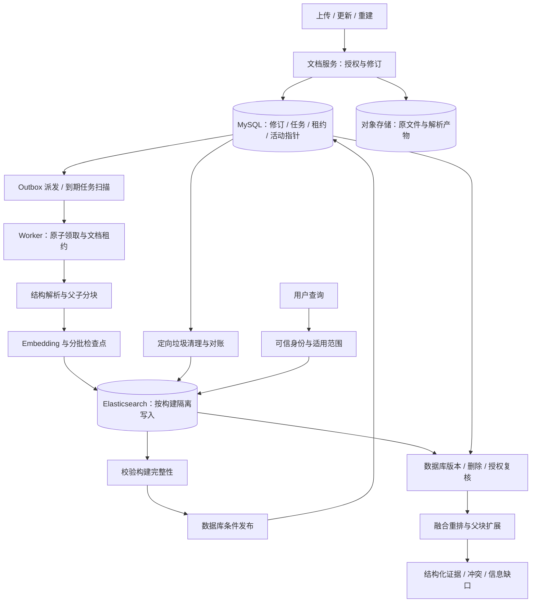

# API 助手 RAG 演进设计

本文保留 RAG 演进设计与实施前缺口。当前实现以[知识流水线](KNOWLEDGE_PIPELINE.md)为准，阶段结果见[RAG 验收](../04-testing/RAG_PHASE_ONE_ACCEPTANCE.md)，后续工作由[债务台账](../MAINTENANCE.md)跟踪。

制定日期：2026-10-19  
状态：第一阶段 A～D 已落地；实际实现、案例与边界以 [验收报告](../04-testing/RAG_PHASE_ONE_ACCEPTANCE.md) 为准，其余契约作为演进目标。  
适用范围：[四阶段迭代计划](../FOUR_PHASE_ITERATION_PLAN.md)第一阶段，并作为后续诊断证据接入的设计依据。

## 1. 要构建什么

构建服务于 API 故障诊断的知识系统：文档能够安全更新，检索能够选择适用材料，回答能够定位依据，失败能够恢复和解释。

优先解决四类问题：

1. 同文档重复提交、任务重放和多个 Worker 并发处理，不能覆盖新结果或误删活动版本。
2. 更新、删除、权限撤回后，检索与正文读取不能继续使用失效知识。
3. 检索返回的材料必须适用于产品、API 版本和时间；证据不足或冲突时明确输出缺口。
4. 每次构建与查询都能关联状态、成本、失败原因和评测记录。

首期沿用 MySQL、Elasticsearch、对象存储、现有 Worker 和父子分块。Redis 用于缓存与调度优化；Kafka 或后台任务用于唤醒执行，不作为文档状态的唯一依据。首期不增加新的向量数据库、通用工作流平台或知识图谱。

## 2. 从开源项目借鉴什么

下表将已观察的上游实现与本项目的设计决定分开。借鉴机制，不把某个项目的整体可靠性当成已验证结论。

| 项目 | 官方资料中观察到的机制 | 本项目采用方式 | 需要自行验证的边界 |
| --- | --- | --- | --- |
| Onyx | 索引尝试协调；文档索引适配器提供文档锁上下文 | 将任务领取与文档写入协调分开；以数据库状态判断执行权 | MySQL 锁与约束行为、过期执行者、DB/ES 跨存储失败 |
| Dify | 租户隔离队列；先提交解析状态，再执行慢速索引操作 | 按用户/组织设置并发额度，慢速解析与 Embedding 不长期占用数据库事务 | 队列重放、丢失唤醒、租户公平性；排队本身不等于文档互斥 |
| RAGFlow | 复杂文档解析、模板分块、分块检查、可追踪引用和混合检索 | 根据文档结构保留标题/代码/表格，以父子分块返回可定位证据 | 本地文档集上的解析质量、引用准确性与检索收益 |

资料核对日期为 2026-10-19。以下为官方动态分支入口，实施调研时需保存实际读取的 commit SHA 和永久链接；本文不虚构已固定的上游版本。

- Onyx：[索引协调](https://github.com/onyx-dot-app/onyx/blob/main/backend/onyx/db/indexing_coordination.py)、[文档索引适配器](https://github.com/onyx-dot-app/onyx/blob/main/backend/onyx/indexing/adapters/document_indexing_adapter.py)。
- Dify：[索引任务](https://github.com/langgenius/dify/blob/main/api/tasks/document_indexing_task.py)、[租户隔离队列](https://github.com/langgenius/dify/blob/main/api/core/rag/pipeline/queue.py)。
- RAGFlow：[官方能力与项目说明](https://github.com/infiniflow/ragflow)。本次未完整核实其当前并发发布与清理机制，不将其作为本项目并发正确性的依据。

## 3. 改造前基础与缺口（执行起点）

| 环节 | 当前基础 | 本次设计补充 |
| --- | --- | --- |
| 文档身份 | `FileUpload.id`，用户与文件 MD5 唯一 | 稳定逻辑文档身份与不可变修订；同名不自动视为同文档 |
| 处理任务 | `ProcessingJob`、后台/Kafka、重试与 DLQ | 原子领取、执行租约、过期接管、可靠投递 |
| 索引构建 | UUID 构建版本，DB/ES 写入后验证 | 持久化构建清单、分批检查点、校验后条件发布 |
| 并发写入 | 读取状态后设置 `RUNNING` | 任务级抢占与文档级发布资格校验 |
| 版本清理 | 发布后删除非本次版本 | 仅清理明确废弃的构建，禁止误删活动/在途版本 |
| 检索 | 混合召回、重排、父子扩展、活动版本过滤 | 当前授权复核、候选补取、冲突/不足状态与引用校验 |
| 元数据 | 产品、地区、生效日期、知识版本等过滤 | 独立 API 适用版本、失效时间、替代关系与快照 |

当前 `rag.py` 的活动版本过滤主要核对版本号；目标实现必须额外检查文档存在、未删除、当前授权。缺少文档行不能默认按 `legacy` 放行。ES 中的授权字段可能滞后，不能只依赖索引中的旧权限。

## 4. 总体结构与职责



MySQL 是逻辑状态来源：哪份修订应生效、谁有执行权、哪个构建可发布。ES 是可重建的查询投影，对象存储保存不可变输入；三者没有共同事务。

本方案提供“原子切换活动指针 + 检索校验 + 后台补偿”，不声称实现跨存储事务或所有操作恰好执行一次。

## 5. 核心数据模型

### 5.1 四种身份必须分清

| 名称 | 含义 | 更新规则 |
| --- | --- | --- |
| `document_id` | 同一逻辑文档的稳定身份 | 内容变化不改变身份；不同租户/文档不混用 |
| `revision_id` | 一次不可变内容与知识元数据快照 | 更新内容、API 适用版本或有效时间时创建新修订 |
| `pipeline_profile_id` | 解析、切分、Embedding 模型与维度等配置 | 配置变化形成新 Profile |
| `build_id` | 某个修订在某套配置下的一次执行产物 | 租约接管后使用新 build，不让新旧执行者共享写入空间 |

`content_hash` 用于完整性与去重，不作为唯一的逻辑文档身份。现有 MD5 上传协议先兼容；目标修订记录增加 SHA-256。相同内容不能跨用户直接共享引用或授权。

现有上传接口可继续创建独立文档；明确更新必须指定 `document_id` 与预期修订，不能仅凭同名或相同内容覆盖已有逻辑文档。

### 5.2 表与关键字段

| 对象 | 建议关键字段与约束 |
| --- | --- |
| `KnowledgeDocument` | `id`、`owner_user_id`、可选 `org_tag`、`desired_revision_id`、`desired_profile_id`、`active_build_id`、`write_epoch`、`lease_owner`、`lease_until`、`acl_revision`、`deleted_at`；可先由现有 `FileUpload` 扩展承接 |
| `DocumentRevision` | `id`、`document_id`、递增修订号、`content_hash`、不可变 `storage_key`、知识元数据快照、`created_at`；唯一 `(document_id, revision_no)` |
| `IndexRequest` | 逻辑构建请求：文档、修订、Profile、幂等键、状态、重试时间；等价在途请求合并。可扩展 `ProcessingJob` 承接 |
| `IndexBuild` | `build_id`、`request_id`、`revision_id`、`profile_id`、`write_epoch`、状态、manifest、进度与错误；每次被接管执行创建新记录 |
| Chunk / Parent | `document_id`、`revision_id`、`build_id`、块序号、父块序号、文本、位置、校验摘要；唯一 `(build_id, chunk_no)`，父块类似 |
| `OutboxEvent` | 事件 ID、请求 ID、待派发时间、派发状态；和任务创建在同一数据库事务提交 |
| `EmbeddingUsage` | 构建、批次、调用尝试标识、Provider 请求号、Tokens、结算状态；相同已记录调用结算唯一 |

权限是当前授权状态，不冻结为历史修订的永久授权。知识适用范围属于修订快照；ACL 撤回单独更新 `acl_revision`，立即影响后续读取。

显式强制重建使用新的请求幂等键；不强制时复用仍有效的等价构建。任务幂等与一次执行中的批次幂等分别定义。

## 6. 写入链路：领取、构建、发布与恢复

### 6.1 提交请求

1. 验证可信身份、文档权限和 `expected_revision_id`，冲突时返回 409。
2. 保存原文为不可变对象，验证大小、摘要和允许的格式；对象先写成功但数据库失败时由孤儿对象清理回收。
3. 在一个短数据库事务内更新期望修订/Profile，合并或创建 `IndexRequest`，写入 Outbox。
4. 返回 202 和请求 ID；客户端查询状态，不等待 Embedding 完成。
5. 派发器发送消息后标记 Outbox。发送成功但标记失败可能重复投递，由领取逻辑处理；扫描器补派遗漏和到期重试。

### 6.2 原子领取与文档级租约

首期选择 MySQL 行状态租约，避免同时维护 Redis 锁与数据库发布权两套真相。

- 在短事务中按固定顺序锁定目标文档、请求；核对未删除、请求仍是当前期望输入、重试时间已到。
- 文档被健康执行占用时本次不执行，保留等待；任务行已终态则返回，不重复计算。
- 对可领取文档递增 `write_epoch`，设置随机 `lease_owner` 和基于数据库时间的 `lease_until`，创建新 `build_id`，提交后再进行慢速工作。
- 心跳只能在相同 owner/epoch 且租约尚未失效时续期。续期失败后停止发起新步骤，不能恢复旧发布权。
- 启动恢复只接管已过期租约；不能把所有 `RUNNING` 任务统一重置，其他实例可能仍在执行。

租约时长和心跳间隔配置化，根据最长不可中断步骤与观测数据设置；所有超时比较使用数据库时间。SQLite 可做功能测试，实际多 Worker 竞争必须在 MySQL 验收。

### 6.3 分批构建

解析、切分、Embedding、ES 网络调用均在短事务之外执行；状态与批次检查点单独提交。

```text
IndexRequest：QUEUED → RUNNING → SUCCEEDED
                              → RETRY_WAIT → RUNNING
                              → FAILED / SUPERSEDED / CANCELLED

IndexBuild：BUILDING → READY → ACTIVE → RETIRED → DELETING → DELETED
                 ↘ FAILED / ABANDONED ─────────→ DELETING
```

`ABANDONED` 表示失去租约或输入已过时的执行，不能再次发布；新执行创建新 build。任务状态和构建状态区分，输入过时不等于 Provider 故障。

块 ID 使用 `document_id:build_id:chunk_no`，批次重试写同一 build 的同一 ID。父子关系必须在同一 build 内，禁止新子块读取旧父块。

失效执行者仍可能完成在途 HTTP 请求，但只能写自己的废弃 build；新执行使用不同 build，故不会覆盖新产物。写入前后检查租约是节约资源的措施，真正阻止线上覆盖的是发布事务的 epoch 校验。

### 6.4 构建完整性与条件发布

构建清单至少记录：输入修订摘要、Profile、预期父子块 ID/摘要、维度、批次完成情况、DB/ES 数量、验证时间。不能只核对“总数相同”，还要验证块 ID 范围、摘要及父子归属。

ES 验证前完成必要 refresh；任一 bulk item 失败均不进入 READY。DB 与 ES 已提交的 staging 数据暂不可检索为有效知识。

发布在短数据库事务内锁定文档、请求和 build，验证：

```text
document 未删除
desired_revision/profile == build 的 revision/profile
lease_owner == 当前执行者，write_epoch == build.write_epoch
lease_until > 数据库当前时间
build.state == READY 且完整性校验完成
```

通过后，原活动 build 标为 RETIRED、新 build 标为 ACTIVE，更新 `active_build_id` 与兼容期 `active_vector_version`、任务成功状态，并写入后续事件，同事务提交。任一条件不满足就拒绝发布，不能无条件更新活动指针。

若发布结果因断线不明，重新查询活动指针与请求状态确认，不能直接按失败删除新 ES 版本。计费失败也不能把已发布文档回滚为不可读。

### 6.5 计费与租户公平性

- 用户/组织并发额度与文档互斥分别控制，限制活跃任务、批次大小与输入量，轮询不同租户待办；额度领取/释放必须原子且能回收过期占用。
- Redis 可用于调度加速，失效时以数据库租约确认，不允许绕过发布校验。
- 已落账 Provider 调用使用唯一调用尝试标识防重复结算；余额与流水在同一事务更新。
- Provider 超时可能已产生费用；没有 Provider 幂等/查询能力时标记用量待对账，不能承诺外部调用或费用恰好一次。
- 内容/配置一致时复用有效产物；首期不在不同 build 之间复用部分产物，降低恢复复杂度。

## 7. 清理与删除：只删除确定废弃的构建

禁止继续使用“删除所有不等于本 build 的数据”作为通用清理策略。

清理流程：

1. 在短事务中锁定文档与候选 build；只允许超过保留期的 RETIRED、FAILED、ABANDONED 进入 DELETING。
2. 确认该 build 不是活动指针、不属于健康在途构建，发布逻辑不允许 DELETING/DELETED 再激活。
3. 提交 DELETING 后，按精确 `build_id` 删除 ES 与 DB staging/Chunk；物理删除分批、幂等执行。
4. 两侧确认后标为 DELETED。ES/DB 部分失败保留进度继续重试，不影响其他 build。
5. 扫描废弃 build 的迟到写入并再次清除；在途旧 Worker 未完全退出时，不声称物理数据已永久清空。

删除文档先写 tombstone、递增 epoch、清空活动指针并取消待办，同事务提交；检索立即拒绝该文档。物理数据异步回收，避免 Worker 在删除后重新发布。

旧版本保留短暂回退窗口，但不开放任意重新激活；需要回退时创建显式请求并重新验证输入、权限和 Profile。正在查询的请求可能与切换并发，正文缺失或活动指针变化时有界重取；不能声称单次查询具有跨存储快照隔离。

## 8. 文档解析与分块设计

沿用现有父子分块，PDF / DOCX 解析选用 Docling，安排在第一阶段批次 C；先完成 A/B 的写入保护与生命周期，再接入新格式。Docling 已接入，8 份解析样本与同内容三格式真实 RAG 链路已验收，详见 C 批次报告。

选型依据：[Docling 项目](https://github.com/docling-project/docling)、[支持格式](https://github.com/docling-project/docling/blob/main/docs/usage/supported_formats.md)、[快速开始](https://docling-project.github.io/docling/getting_started/quickstart/)。首期支持文字型 PDF 和 `.docx`，扫描 PDF 的 OCR 单独列为后续扩展；旧 `.doc` 暂不纳入首期验收。

| 文档类型 | 首期策略 | 保留的位置 |
| --- | --- | --- |
| Markdown / HTML API 文档 | 按标题层级、端点和错误码划分父块；代码块保持完整；长块再切子块 | 标题路径、端点、字符范围、原始对象与修订 |
| 错误码表 / FAQ | 错误码与原因/处理步骤保持同一语义单元；表格携带表头 | 表名、行标识、错误码 |
| 文字型 PDF | Docling 提取正文、阅读顺序和表格，统一转换为内容块；空白、加密或异常文档明确失败 | PDF 页码、可用坐标、块标识、解析器版本 |
| Word `.docx` | Docling 提取标题、段落、列表与表格，统一转换为内容块 | 标题路径、块顺序、原始对象与修订；不承诺固定页码 |
| 扫描 PDF / 图片 | 后续按实际样本接入 OCR / 视觉理解，首期识别并提示待处理，不能把空结果发布为成功 | PDF 页码、图片引用及后续 OCR 配置 |

### 8.1 Docling 接入约定

1. 在现有解析入口增加适配层，MD / HTML 保持现有路径，PDF / DOCX 进入 Docling；文件扩展名与实际类型校验不一致时拒绝处理。
2. 输出统一内容块：`block_id`、类型、正文、标题路径、顺序、可用页码/坐标、图片引用、原始文档与修订标识。保留原文件、结构化 JSON 和可查看的 Markdown，不能只保存扁平 Markdown 后丢失定位。
3. 统一内容块进入现有父子分块，父子位置映射贯穿检索与引用。仍只编码 Child，Parent 用于上下文扩展；不因新增 Markdown / JSON 两种产物而重复编码同一内容。
4. 将 Docling 版本、解析选项、模型/OCR 配置及切分配置纳入 Profile；配置变化经新 build 校验后发布，复用产物必须匹配修订和 Profile。
5. 解析在 Worker 的数据库事务外执行，设置文件大小、页数、执行超时及资源上限；按文件记录错误类别，失败沿用既有恢复策略，不能破坏当前活动索引。
6. 固定依赖和模型版本，记录首次模型下载、CPU / 内存与耗时；部署说明提供预下载或缓存步骤，避免每次任务重复初始化和下载。是否需要独立解析进程依据样本资源测量决定。

### 8.2 解析质量验收

准备至少 8 份可提交的小型样本：4 份文字型 PDF（单栏、双栏、跨页表格、代码/参数说明），2 份 DOCX（标题/列表、表格/图片），1 份扫描 PDF 和 1 份损坏文件。人工标注关键字段、预期阅读顺序及位置，不只检查是否生成 `.md`。

首期验收要求：支持样本的关键参数名、错误码及表格字段和值对应正确；代码示例可完整定位；引用回到正确章节/PDF 页；扫描件明确提示暂不支持，损坏文件明确失败。对同内容的 MD / PDF / DOCX 做固定查询比较，报告漏提取、引用准确性、检索效果、耗时、资源及编码 Tokens；测试替身验证工程链路，真实千问查询另行记录用量。

Parent 用于完整上下文，Child 用于精确召回，命中的 Child 位置始终保留。超出预算时按相关性选父块片段并标记截断，不能因父块很长挤掉其他必要证据。

人工检查页展示原文、分块、标题、位置及错误；不直接修改已发布 Chunk。人工修正形成新修订并重新构建，保证审计可追踪。

## 9. 检索设计：先限定范围，再找证据

```text
可信身份 + 用户问题 + 显式/已确认诊断上下文
→ 构造产品、API 版本、时间范围等过滤条件
→ BM25 与向量召回（两路都带 ACL 与适用性过滤）
→ 融合候选
→ MySQL 复核存在、未删除、当前授权、活动 build 与适用范围
→ 必要时有界补取候选
→ 重排 → 同 build 父块扩展 → 去重与上下文预算
→ 返回前再次验证授权/活动版本
→ 证据、冲突或待补信息
```

### 9.1 身份与适用版本

- 用户/组织范围来自认证与服务器侧成员关系，不能接受模型传入的 tenant/user 值扩大权限。
- 首期复用现有用户/组织授权模型；调度上的“租户”只代表可信资源预算范围，不自动构成数据库独立租户隔离。
- 产品、API 版本和有效时间是硬约束；允许多个可能版本时按版本分组返回，不能混合成一条确定规则。
- 错误码可做精确召回增强，不能在没有版本证据时假定不同服务的同名错误码语义相同。
- 查询缺少必要版本且材料存在实质差异时返回 `NEEDS_CLARIFICATION`；仅有通用材料时明确其范围。
- 当前问题默认当前时间；历史事故使用明确事件时间。有效范围采用半开区间 `[effective_from, effective_to)`，未设结束时间表示开放区间。

### 9.2 权限与活动版本复核

ES ACL 过滤减少无权候选，但因投影可能延迟，候选进入重排器、模型和用户输出前必须用当前数据库授权复核。被删除、找不到文档、未知 build、缺少必要身份字段的候选一律丢弃。

重排后父块与引用正文读取也复核，禁止从旧对话/缓存绕过授权。定义撤权语义为“授权校验点之后的新读取被拒绝”；已经发送的内容无法撤回，严格中断在途回答需要额外取消机制。

活动版本过滤可能导致候选不足。保留预算内扩大召回或翻页的补取策略，记录丢弃原因；达到上限仍不足就返回不足，不无限循环，也不退回过期版本凑数。

### 9.3 排序与降级

沿用现有融合与重排实现，在固定评测集上调整候选数、权重、父块预算。学习型重排器需要独立证明收益后启用，记录模型与参数版本。

| 故障 | 行为 |
| --- | --- |
| 查询 Embedding 超时 | 若配置允许，使用相同过滤条件的 BM25，返回降级标记 |
| 重排失败 | 使用融合排序，保留排序降级记录 |
| ES 不可用 | 仅在明确启用且规模受控时使用现有 DB fallback；否则返回后端不可用 |
| 无有效证据 / 版本冲突 | 返回不足/冲突和可补充信息，不把系统故障伪装成“没有文档” |

不同 Embedding 模型即使维度相同也不能默认混搜。Profile 保存检索兼容信息；模型迁移建立独立兼容索引与查询路由，验证后切换知识库查询 Profile，旧 Profile 留回退窗口。

## 10. 返回契约、引用与缓存

将现有只返回列表的内部检索结果扩展为结构化包，工具兼容层负责旧字段过渡。

```json
{
  "status": "OK",
  "queryId": "q_123",
  "scope": {"product": "API Platform", "apiVersion": "v2", "effectiveAt": "2026-10-19"},
  "degraded": false,
  "evidence": [{
    "documentId": "doc_1",
    "revisionId": "rev_3",
    "buildId": "build_7",
    "childChunkId": 12,
    "parentChunkId": 4,
    "titlePath": ["认证", "401"],
    "pageNumber": null,
    "matchedText": "命中的原文片段",
    "contextText": "受预算限制的父块上下文",
    "evidenceType": "DOCUMENT_RULE",
    "citationId": "cite_1"
  }],
  "missingFields": [],
  "conflicts": [],
  "warnings": []
}
```

状态至少区分 `OK`、`NO_EVIDENCE`、`NEEDS_CLARIFICATION`、`CONFLICT`、`BACKEND_UNAVAILABLE`；降级可与有结果并存。排序分数是相关性信号，不是结论正确概率。

引用解析接口根据 `citationId` 查结构化身份并重新授权，不把任意存储地址交给客户端。历史引用失效/文档被删时返回明确状态，不能悄悄替换为新版文本。

文档证据只能支持规则说明；确认个人 Key、请求或配额仍需业务工具。检索正文始终视为不可信数据，不能执行其中的指令或扩展工具权限。

首期优先缓存查询向量、解析产物与兼容配置下的 Embedding；避免缓存跨用户的最终正文或答案。后续检索缓存需包含可信权限范围及其修订、知识库发布代次、查询、过滤与 Profile；命中后仍进行当前授权/版本复核，TTL 不替代失效机制。

## 11. 接口与代码落点

以下接口名为建议，实施时复用现有路由并保持兼容。

| 操作 | 契约 |
| --- | --- |
| 创建/更新文档 | 返回稳定文档 ID、新修订 ID；更新携带预期修订，冲突返回 409 |
| 提交索引 | 接受幂等键和 Profile，返回 202、请求 ID；等价请求可合并 |
| 查询处理状态 | 分开返回活动 build 与最新请求状态，重建失败不等于旧版不可读 |
| 取消处理 | 原子取消、使执行权失效；不自动删除仍有效的活动 build |
| 删除文档 | 先逻辑删除，物理清理由后台跟踪 |
| 搜索 / 读取引用 | 结构化检索结果；每次读取执行授权与适用性验证 |

| 现有位置 | 改造职责 |
| --- | --- |
| `backend/app/db/models.py` + Alembic | 修订、构建、租约、Outbox、使用记录与唯一约束 |
| `backend/app/documents/jobs.py` | 请求合并、领取、租约续期、过期接管与状态机 |
| `backend/app/workers/file_processor.py` | 通知消费、重试和 DLQ；旧 `fileId` 入口也先进入统一请求协调 |
| `backend/app/knowledge/indexer.py` | 分离准备、构建、验证、发布；异常不能无条件删除已发布版本 |
| `backend/app/knowledge/elasticsearch.py` | 精确 build 写入/删除、校验、过滤和召回降级 |
| `backend/app/knowledge/rag.py` | 当前状态复核、补取、父块扩展与结构化结果 |
| `backend/app/knowledge/parser.py`、`metadata.py` | 结构化位置、适用版本、有效区间和 Profile |
| API / Tool / 前端 | 状态与引用适配、进度展示、分块检查、信息缺口展示 |

可新增 `knowledge/coordination.py`、`publication.py`、`gc.py` 与 `documents/outbox.py` 拆分职责，避免把所有逻辑继续塞入 indexer。

## 12. 增量迁移与实施顺序

这四个批次属于总计划的第一阶段，不额外增加项目阶段。

### 12.1 开始方式与服务启动时机

当前推进状态：以下任务已实施并完成本地及隔离环境验收；具体支持范围、未覆盖的规模场景和证据见验收报告。

可以直接检查与修改代码，不需要先启动完整项目。先检查本地运行时、依赖和现有测试入口，冻结能取得的基线，复现问题，再修改实现；依赖缺失或数据库不可用时如实记录，不能把“尚未执行”记为通过。

| 工作步骤 | 是否先启动项目 | 验证范围 |
| --- | --- | --- |
| 阅读代码、梳理所有写入口、编写复现案例、设计迁移 | 不需要 | 状态流转、身份与版本契约、受影响范围 |
| 确定性回归与局部修改 | 不需要完整服务；按测试需要提供最小依赖 | 用测试替身控制 Embedding、ES 响应和执行顺序，先验证关键分支 |
| 任务争抢、租约、条件发布和数据库迁移验收 | 启动隔离测试 MySQL；按案例增加必要依赖 | 真实数据库事务、约束、多连接/多 Worker 竞争；SQLite 结果不能代替 |
| 写入、校验、清理与失败恢复集成验收 | 启动 MySQL、Elasticsearch 和实际采用的存储；Kafka/Redis 按相关用例启动 | 真实 DB/ES 部分失败、版本切换、任务重放和恢复 |
| 上传、重建、检索与界面验收 | 核心集成通过后再启动 API、Worker、前端及其必要依赖 | 完整用户流程、状态展示与引用 |

前期使用确定性 Embedding 或测试替身，不依赖付费模型即可验证并发与一致性。真实 Provider 效果和成本单独验收，不能用替身结果声称真实模型效果通过。

首次启动集成环境时，先在旧实现与隔离数据快照上记录可取得的基线，再执行迁移；不能用改造后的数据库和索引补造“改造前基线”。迁移或故障测试使用专用测试库、索引与存储前缀，服务启动不意味着允许清理现有用户数据。

### 12.2 批次任务与完成条件

| 批次 | 任务 | 完成条件 |
| --- | --- | --- |
| A：先保护已有索引 | 冻结基线；任务原子领取；文档租约/epoch；build 登记；条件发布；停用宽泛版本清理；所有入口统一 | 重复消费、过期执行者、A/B 清理竞争通过 |
| B：补生命周期与恢复 | 修订快照、Outbox、检查点、定向 GC、tombstone、计费防重与对账 | 中断恢复、投递重放、删除不复活、费用记录可追踪 |
| C：补适用性与质量 | API 版本/有效区间、ACL 复核、Docling PDF/DOCX 解析、结构分块、候选补取、冲突与引用契约 | 版本/权限/引用、解析样本及固定检索案例通过 |
| D：完成观测与交付 | 状态界面、MySQL/ES 集成故障注入、性能对照、运维说明 | 第一阶段验收报告完成，后续诊断可直接消费证据 |

#### 批次 A：先保护已有索引

按 A-01 → A-02 → A-03 → A-04 → A-05 → A-06 执行；数据库迁移、领取与发布改造在同一批次闭环，不能只加锁就宣告完成。

- [x] **A-01 基线与复现**：检查运行时、依赖、现有测试入口；保存提交、配置及检索样本；梳理后台、Kafka、重建、元数据更新和脚本入口。以屏障/事件构造同 job 争抢、同文档不同 job、旧任务晚完成及清理交错案例，对应 R01～R04。
- [x] **A-02 最小数据迁移**：增加 owner、lease、epoch 和构建记录等必要字段/约束，明确兼容旧 `active_vector_version` 的映射；定义原子领取与发布条件。完整修订/Profile 能力在 B/C 补齐，A 期间仍必须保存并校验输入快照标识。
- [x] **A-03 任务协调**：在 `documents/jobs.py` 实现原子领取、同文档协调、续租、失锁停止与过期接管；所有索引入口统一调用，健康 Worker 不被启动恢复误接管。
- [x] **A-04 构建与条件发布**：拆分 `knowledge/indexer.py` 的构建、校验和发布；每次接管使用新 build，旧执行者不能发布；处理发布结果不明和 bulk 部分失败，对应 R03、R05、R06。
- [x] **A-05 先停用危险清理**：禁用无条件“删除所有非本版本”路径，失败清理仅针对确定未发布的自身 build。暂留废弃版本并记录存储占用，完整定向 GC 在 B 实施，不能因临时停清理声称完整 GC 已验收。
- [x] **A-06 分层验收**：先跑受影响的确定性回归，再启动测试 MySQL/ES 验证 R01～R06 的适用部分；核对活动指针、实际块、旧版可读性与不同文档并行。记录缺失验证项，关键并发行为通过后再进入 B。

交付：必要迁移、统一任务入口、任务/文档协调、条件发布、临时清理策略及 A 批次报告。R04 在 A 证明危险清理已停用且失败分支不误删，B 再证明定向 GC 的并发安全。

#### 批次 B：补生命周期与恢复

- [x] **B-01 修订与投递**：建立不可变修订、Profile 身份与等价请求合并，增加 Outbox 与扫描补派；处理发送成功但标记失败的重放，对应 R07。
- [x] **B-02 检查点与恢复**：保存批次进度，验证仅过期执行被接管；旧 Worker 的迟到写入仍隔离，失败原因与重试预算可追踪，对应 R03、R09。
- [x] **B-03 删除与定向 GC**：实现 tombstone、epoch 失效、待办取消、DELETING 状态及精确 build 清理；在并发发布和迟到写入条件下验收后再启用自动物理清理，对应 R04、R08、R09。
- [x] **B-04 使用记录与结算**：实现调用尝试唯一标识、结算防重及未知 Provider 用量对账，区分重复结算与真实新增消耗，对应 R15。
- [x] **B-05 集成验收**：验证重复通知、丢失唤醒、构建中删除、重启接管、DB/ES 清理部分失败；报告状态、数据与费用记录是否最终一致，保留可复现输入及操作步骤。

交付：修订与投递链路、恢复机制、可启用的定向 GC、删除防复活、计费/对账实现及 B 批次报告。

#### 批次 C：补适用性与质量

执行依赖：C-06 解析适配 → C-07 产物与位置映射 → C-03 分块与召回 → C-08 格式专项验收 → C-05 综合质量回归；C-01、C-02、C-04 按接口依赖同步完成。编号保留已有任务，新增任务不代表已实施。

- [x] **C-01 适用版本**：补全产品/API 版本、有效区间、替代关系与 Profile 兼容路由；缺少关键版本时追问，冲突材料保留分组与依据，对应 R12、R14。
- [x] **C-02 当前授权与失效复核**：检索、重排前、父块扩展、引用读取及缓存命中都执行对应的当前授权/活动版本校验，关闭缺失文档的 legacy 放行路径，对应 R10、R11、R16。
- [x] **C-03 解析与召回**：保留标题、代码块、表格与位置；实现候选不足的有界补取、父子预算及必要降级，在固定检索集上比较收益，对应 R13、R17。
- [x] **C-04 证据接口与安全**：接入结构化检索状态、引用和信息缺口，区分无证据与后端故障，验证文档指令不能改变权限，对应 R16～R18。
- [x] **C-05 质量回归**：记录检索指标、错误适用版本、引用定位与授权结果；自然查询和预置过滤分别报告，不把相同问题的措辞变化当成新增故障机制。
- [x] **C-06 Docling 解析适配**：固定版本和模型配置，增加 PDF / DOCX 适配及统一内容块契约；验证类型、大小、页数和超时，扫描件及损坏文件返回明确状态；保留 MD / HTML 原路径。
- [x] **C-07 解析产物与引用映射**：保存原文件、JSON、Markdown 和块位置映射；将解析配置纳入 Profile，Child 与 Parent 共用同一修订/build；仅 Child 进入千问编码，不对导出的多种格式重复编码。
- [x] **C-08 格式专项验收**：执行第 8.2 节至少 8 份固定样本及同内容跨格式检索对照；验证失败不切换活动版本、重试产物身份一致；记录关键字段、表格、代码、引用位置、资源与 Tokens，交付解析验收报告及模型缓存部署说明。

交付：适用性过滤、当前授权复核、Docling 适配器与固定解析样本、结构分块、候选补取、证据/引用契约、解析部署说明及 C 批次质量报告。

#### 批次 D：集成验收与交付

- [x] **D-01 状态与观测**：展示活动版本、最新构建、进度与失败；记录队列、租约、各阶段耗时、废弃/清理、检索丢弃与成本指标。
- [x] **D-02 综合故障验收**：复核 R01～R18，按实际依赖启动 MySQL、ES、存储和消息组件，保存实现与运行环境版本；测试替身和真实服务结果分别标记。
- [x] **D-03 完整用户流程**：核心集成通过后启动 API、Worker 和前端，验收上传 → 建库 → 检索 → 更新 → 删除，以及失败状态和引用展示。
- [x] **D-04 对照与文档交付**：使用冻结基线比较正确性、检索效果、耗时和消耗，整理部署、迁移、恢复与限制说明；同步总计划勾选状态，并将结构化知识证据交给第二阶段诊断状态接入。

交付：完整演示、综合验收报告、性能/成本对照及可执行运维说明。关键安全或并发案例失败时先修复，不用正常路径演示替代。

### 12.3 数据迁移顺序

迁移采用扩展、回填、切换、收缩：

1. 增加可空字段和新表，为每个现有 `FileUpload.id` 建立稳定文档映射，回填旧修订与活动 build。
2. 清点现有 `(user_id, file_md5)` 到 Chunk/引用的映射；内容更新创建新修订，兼容旧上传协议，禁止静默合并不同逻辑文档。
3. 新 Worker 使用统一协调与发布，兼容读旧字段；升级时停止或隔离旧写入 Worker，避免旧逻辑绕过校验。
4. 校验回填与查询结果后切换读取；初期关闭物理 GC 或采用较长保留期，确认无误再启用。
5. 最后移除旧写路径。应用回退不得重新放开不带 fencing 的旧发布者；兼容窗口内保留必要列和映射。

### 12.4 每批次的验收记录

每批建立独立报告，放在 `docs/04-testing/`，记录提交与环境版本、数据库迁移、执行命令、数据/索引范围、案例结果、失败原因、未执行项和剩余限制；真实 Provider 与费用记录按现有 `docs/05-live-tests/` 约定保存。

完成顺序统一为：必要迁移 → 实现 → 针对性回归 → 真实服务集成验收 → 更新文档与任务勾选。第一阶段结果已归档；下一步是总计划 P2-01，第二阶段未在本次提前实施。

## 13. 验收矩阵

并发测试用屏障/事件精确控制顺序，不依赖随机 sleep 碰运气；测试框架执行者与实际 MySQL/ES 分开标注。

| ID | 场景 | 必须观察到的结果 |
| --- | --- | --- |
| R01 | 同 job 被两个 Worker 同时领取 | 仅一个有效执行者，另一方不启动 Embedding |
| R02 | 不同 job 同时处理同文档 | 合并/等待符合策略，不同文档仍可并行 |
| R03 | A 暂停，租约过期，B 接管并发布，A 恢复 | A 写入隔离在自己的 build，续租与发布均被拒绝 |
| R04 | A 清理与 B 发布交错 | 不删除 B 的活动或合法在途数据 |
| R05 | ES 部分 bulk 失败 / DB 提交失败 | 新 build 不激活，原活动 build 可读 |
| R06 | 发布事务已提交但响应丢失 | 重查确认成功，不把已发布 ES 数据当失败产物删除 |
| R07 | Outbox 重放 / 消息重复 / 通知丢失 | 重复通知不重复发布，扫描器能补派待办 |
| R08 | 构建过程中更新修订或删除文档 | 旧 build 不能发布，删除后不复活 |
| R09 | 构建/清理中进程退出 | 仅过期执行被接管，清理可重试，最终状态可对账 |
| R10 | ES 中权限陈旧、成员被移除、缓存仍命中 | 重排/模型/新读取之前复核并拒绝无权材料 |
| R11 | 文档行不存在，ES 仍残留 legacy Chunk | 丢弃，不走 legacy 默认放行 |
| R12 | 新旧 API 文档冲突 / 生效时间不同 | 正确过滤或返回冲突/待补信息，不混用规则 |
| R13 | 活动版本过滤后候选不足 | 有界补取，预算内结束，不用失效结果补数 |
| R14 | 模型 Profile 变化 | 不混用不兼容向量，查询路由与文档 Profile 一致 |
| R15 | 同批次重试 / 计费重放 / Provider 超时 | 稳定块 ID、结算不重复；外部未知用量标为待对账 |
| R16 | 父子扩展 / 历史引用 / 文档切换 | 同 build 关联，引用准确，失效引用明确返回不可用 |
| R17 | Embedding、重排或 ES 故障 | 按配置降级并标记，与正常无结果区分 |
| R18 | 检索文档包含越权工具指令 | 仅作为数据，不改变权限或触发越权调用 |

检索质量使用固定文档快照和保留验收集，记录 Hit Rate/Recall@K、MRR、nDCG、引用位置准确性、适用版本与授权违规数量。自然查询与人为给定过滤的结果分别报告。

性能记录构建各阶段耗时、排队时间、重试与废弃率、待清理数量、用量、查询 P50/P95、候选丢弃与补取原因。先测基线再固定改进目标，不预先填造收益比例。

## 14. 完成清单与设计边界

完成状态依据本轮本地与隔离验收；支持范围和限制见总报告。

- [x] 上游学习记录保存 commit、函数链、保护范围、失败边界及本地采用理由。
- [x] 写入并发、任务恢复、发布与清理关键案例在实际 MySQL/ES 环境通过。
- [x] 检索与引用采用当前授权，版本失效、删除与证据不足均有明确行为。
- [x] 所有入口复用统一协调，迁移期不残留可绕过发布校验的旧 Worker。
- [x] 有固定评测与故障报告、状态界面、恢复操作和已知限制说明。

首期有意接受重试时重新计算部分内容、ES 投影短暂滞后和后台物理清理延迟；通过构建隔离、条件发布、读取复核与补偿保证逻辑结果。更复杂的跨 build 产物复用、全知识库快照查询和严格撤销在途输出，需在实际需求与评测支持下另行设计。
