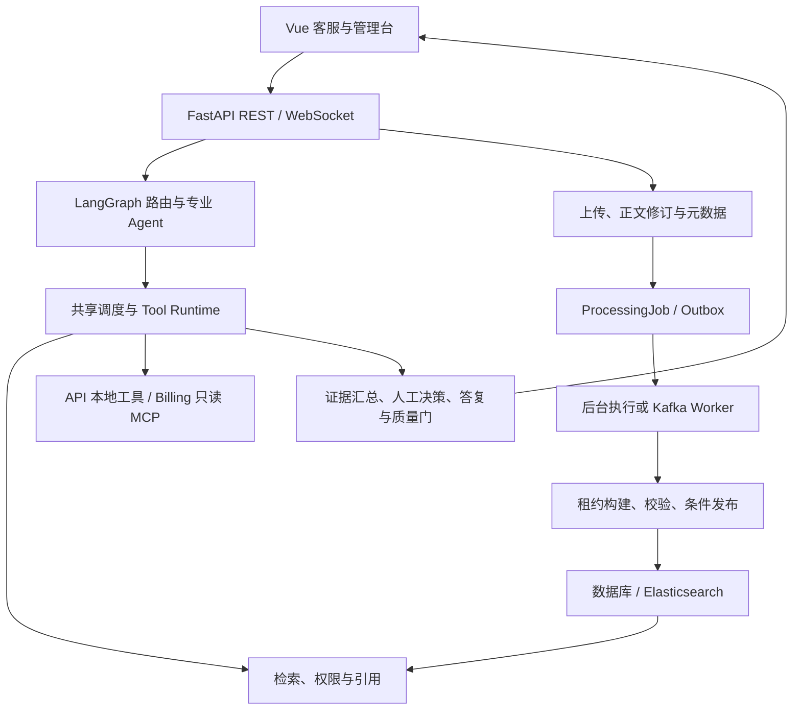

# 项目架构总览

状态核对日期为 2026-11-19。当前候选包括持久化上下文、会话显式绑定、生成心跳回收、结算保护和人工审批恢复，见[候选验收](../04-testing/RELEASE_CANDIDATE_ACCEPTANCE_2026-11-19.md)。四阶段核心范围均已验收，分层评测与规划开销优化见[最终报告](../04-testing/FINAL_PROJECT_ACCEPTANCE.md)；部署环境是否运行该源码须单独确认。内部包名、数据库和 Compose 中的 PaiSmart 是保留的技术标识。

## 两条主链路

## 代码边界

| 模块 | 职责与入口 | 依赖约束 |
| --- | --- | --- |
| `frontend/src` | 页面、状态、REST/WS 客户端、版本引用展示 | 通过服务端接口访问业务数据 |
| `backend/app/api` | `router.py`、`v1/`、`websocket/`：认证、参数和传输 | 不在路由内直接构建索引 |
| `app/agent` | `graph/workflow.py` 编排路由、专业 Agent、证据汇总与流式发送。 `graph/answer_content.py` 构造答复提示、检索降级文案和引用。 `graph/answer_safety.py` 统一审查流式预览和最终答复。 | 通过受控 Tool 获取事实 |
| `app/tools`、`app/skill_runtime` | Tool 注册、权限上下文、Skill 执行；Billing MCP | 文档内容不能扩展工具权限 |
| `app/diagnosis` | 跨 generation 的诊断、来源/时效、状态变更 | 不替代原有 Agent 编排；客户端不能直接确认已解决 |
| `app/documents` | 上传存储、正文修订、任务、租约、删除与清理 | 管文档和任务生命周期 |
| `app/knowledge` | 解析、分块、编码、构建发布、检索与引用 | 检索只使用有效且授权的活动构建 |
| `app/accounting` | Provider 用量记录与结算 | 已知用量防重，未知用量待对账 |
| `app/db`、`backend/alembic` | 模型、会话和版本化迁移 | Alembic 管升级；create_all 不能替代升级 |
| `app/support`、`app/privacy` | 工单交接、隐私维护 | 保持身份与数据范围约束 |
| `app/core` | 配置、安全、访问控制、脱敏与观测 | 不承载具体诊断或建库流程 |
| `backend/scripts`、`backend/tests` | 显式运维命令、验收与测试 | 不被应用导入作为运行时依赖 |

`documents/jobs.py`、`knowledge/indexer.py` 保留为兼容入口，实际实现分别在 `job_runtime.py`、`build_pipeline.py`。新逻辑写入实现模块，避免再次形成两个执行流程。

## 必须保持的契约

1. RoutingPolicy 决定 Agent 范围；专业 Agent 找事实，最终答复由证据汇总和质量门约束。
2. RAG 证明通用知识；用户调用、Key、账单等个人事实由当前身份的业务工具证明。
3. 写索引走持久任务及受租约保护的构建；失去执行权或输入修订变化的任务不得发布。
4. 新版本通过校验后切换活动指针。失败保留旧版；GC 只清理明确目标，墓碑阻止删除后复活。
5. 候选检索、父块展开和引用读取均复核当前权限、活动版本；不能仅依赖 ES 中的旧标签。
6. 文档和查询使用一致的千问模型与维度。只编码子块；没有 Key 或 Provider 失败明确报错。

## 运行拓扑与存储职责

本地开发可使用 SQLite、本地文件、后台任务、数据库检索；完整 Compose 使用 MySQL、MinIO、Kafka/Worker、Elasticsearch、Redis 和 Billing MCP。两种模式共享应用入口；配置不能混用容器地址与宿主机地址。

| 存储 | 保存内容 |
| --- | --- |
| SQL | 身份权限、文档输入修订、任务、构建与活动指针、父子块、用量、工单 |
| 本地文件 / MinIO | 原始正文修订、解析产物 |
| Elasticsearch | 可重建的检索索引，不能代替 SQL 中的发布和权限真相 |
| Kafka | 任务通知，重复投递由任务领取防重；漏通知由扫描恢复 |
| Redis | 应用配置启用的共享缓存/限流等基础能力，不承担文档发布锁 |

Docling 在独立 Python 子进程中运行，固定模型缓存，PDF/DOCX 不静默退回旧解析器。扫描 OCR 尚未纳入首期。

## 进一步阅读

[诊断状态](DIAGNOSIS_STATE.md) · [客服 Agent](CUSTOMER_SERVICE_ARCHITECTURE.md) · [RAG 流水线](KNOWLEDGE_PIPELINE.md) · [工单台](ADMIN_TICKET_CONSOLE.md) · [运行手册](../03-operations/RAG_OPERATIONS.md) · [当前验收](../04-testing/RAG_PHASE_ONE_ACCEPTANCE.md) · [生产边界](../03-operations/PRODUCTION.md)
