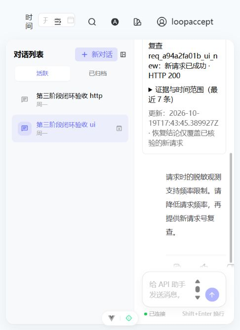

# 第三阶段：诊断闭环与执行恢复验收

日期：2026-10-20。范围：P3-01～P3-11；实现与检查点见[诊断闭环](../02-architecture/DIAGNOSIS_LOOP.md)、[执行进度](PHASE_THREE_PROGRESS.md)，复现见[运行手册](../03-operations/DIAGNOSIS_OPERATIONS.md)。

## 交付内容

已接入现有 LangGraph 聊天链路：请求日志 → 请求时观测 → 候选原因和证据 → 最小处理建议 → 新请求复查 → 限定范围解决或真实人工交接。请求时观测覆盖401五种原因和429频率/并发/配额；当前 Key 或错误码不能替代历史事实。

执行以 generation、owner、租约和 epoch 保护；逐步骤保存脱敏结果和尝试预算。有限重试、过期重查、健康任务不接管、旧执行者不发布。工单按诊断唯一，保留待交接意图，处理提交成功但确认丢失。前端展示原因、建议和复查，提交时检查 revision 与幂等键。

## 环境与结果

Windows / Python3.12.14 / SQLite；专用 MySQL8.4 验收库 `diagnosis_loop_acceptance_20261020`，端口13316。原 Docker Demo 与当前知识库不用于故障注入。以下日志位于 `backend/data/checkpoints/`。

| 门禁 | 结果 | 证据 |
| --- | --- | --- |
| 全后端回归 | 223 passed，2 skipped | phase3-delivery-tests.log |
| 第三阶段 MySQL 专项 | 35 passed | phase3-mysql-final.log |
| HTTP 真实端口 | 9项通过 | phase3-http-report.json |
| 实际浏览器 | 候选/建议 → 提交新请求 → 自动刷新为已解决 | phase3-ui-resolved.png |
| 前端类型与生产构建 | 通过 | phase3-typecheck-delivery.log、phase3-build-delivery.log |
| SQLite 副本升级/回退/再升级 | 通过，知识指纹不变 | phase3-migration-final.log |
| MySQL 新库升级/回退0014/再升级 | 通过 | phase3-mysql-migration.log |
| 静态致命规则与文档检查 | 通过 | Ruff E9/F63/F7/F82；phase3-docs.log |

全后端有一个既有 Starlette/AnyIO 弃用警告。两项跳过沿用外部依赖条件，不能作为通过的集成场景。第三阶段 MySQL 专项单独完整执行，未跳过。

## 场景覆盖

- 八种可判定原因，以及缺观测、未知规则版本、计数不一致、未知状态、错误类型字段、用户与日志冲突；无证据不确认细分根因。
- 用户口述恢复不会标解决；同用户/应用/接口、诊断开始后的近期新成功请求才解决；他人、异应用、异接口、过时请求均拒绝关联。
- 修正仍失败保留新原因与旧历史；两轮无进展、预算耗尽、权限条件与明确要求有真实交接路径。
- 超时有限重试，参数错误、未找到与权限拒绝不重试；预算跨重启保留。
- 调用后落库前、步骤落库后、交接意图落库后中断；缓存复用/到期；租约接管后旧 Worker 不得覆盖。
- 工单提交成功但确认丢失、跨 generation 重复创建均复用同一诊断工单。
- HTTP revision冲突、同键重放、同键不同请求、跨用户复查/继续拒绝；完整 AgentRuntime 聊天诊断与新请求复查。
- 诊断中文档版本更新与组织撤权后，引用不再暴露原来源；恢复步骤不重放文档原文，Demo 业务观测与撤权资料分开判断。

## 问题修复记录

MySQL 首次建库发现 TEXT 常量默认值不兼容，改为数据库支持的表达式默认值后，新库与升降级通过。完整聊天测试发现质量门将程序诊断答复误判为必须引用文档；现依据受验证诊断决定限定回答范围，保留知识引用审计，不虚构 knowledge_verified。未知枚举和字符串布尔值已收紧为无法判定。

HTTP 验收最初使用 revision=0，触发参数校验422；改用合法过时 revision验证409。原始失败日志保留，不作为最终成绩。

## 数据与费用保护

起点归档：`backend/data/checkpoints/phase3-start/`。应用升级前备份：`before-phase3-application-f28c1e48df774c1e9be5c0ea3d796f9d.sqlite`；实际应用库已升级0015。交付源码、数据库副本和保护检查结果在 `phase3-delivery/`。

保留60份文档、5,888子块向量、1,531父块；知识 SHA256 为 `6a1b2f0d7ba0c033c60f7542ad0c1e40bcea580ccafc57820b46797569c419d2`，实际 `.env` 摘要与起点一致。没有重新编码、导入或删除当前知识，也未改实际模型配置。本轮真实 Provider 调用0，模型与编码费用0；确定性夹具和模拟服务测试不等同于真实模型效果评测。

## 完成边界

第三阶段按固定场景验收完成；第四阶段综合评测、真实模型对照、性能与成本优化尚未开始。原因矩阵只适用于独立 Demo API，不证明三家厂商真实账户状态。历史日志未记录请求时观测时保留不确定性，不推造回填。

恢复只覆盖结构化工具与交接任务，不自动续跑付费模型或模型内部推理。没有执行生产滚动发布、高可用/负载测试或原 Docker Demo 重建。验收服务及专用 MySQL 在验证后停止，数据与证据保留。

