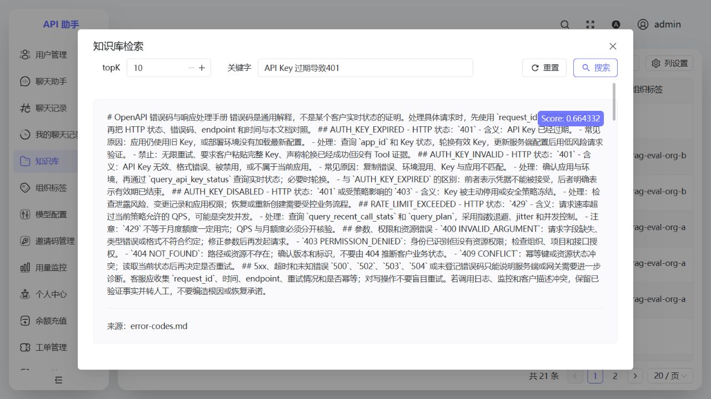

# Docker Demo 原地升级与完整验收

日期：2026-10-20。目标：最新四阶段源码更新至现有 `paismart-demo`，保留当前知识库、模型/代理配置和持久数据卷。

后续状态：本报告记录升级时保留21份旧知识的历史结果。随后用户明确要求替换语料，现已迁移为三家各20份官方正文，见[后续迁移验收](DOCKER_VENDOR_KNOWLEDGE_MIGRATION_2026-10-20.md)；当前数量以该报告为准。

| 检查点 | 状态 | 证据 |
| --- | --- | --- |
| D0 现状与保护 | 已完成 | MySQL逻辑备份、六卷静态备份、旧容器文件系统、配置摘要与回滚镜像 |
| D1 镜像与副本迁移 | 已完成 | 恢复副本0006→0015成功，三组知识摘要相同；独立Linux CPU Docling环境 |
| D2 正式迁移与启动 | 已完成 | 原MySQL升至0015；migrate/demo-seed退出0，跳过已有21文档导入和编码 |
| D3 功能与界面验收 | 已完成 | 13项真实HTTP/WS检查、原库UI检索、228项容器回归通过 |
| D4 保护复核与交付 | 已完成 | 临时夹具清理；21/41/22知识摘要和配置一致，9个长期服务运行、重启0 |

## 升级前状态

API/前端仍运行；MinIO、ES、Kafka已停止，Worker因Kafka不可达重启。Docker数据库是0006，包含21文档/41条真实Qwen-v4向量/22父块；与本地开发库60文档不同，不以本地库覆盖Docker数据。

升级前知识摘要：

- 文件：`8fc6872bdcf7f2866ce72231c94f5a3d112e40afee426d025f474c31b365cadb`
- 向量：`278713234d39d8e61b2cbc89ebb878c7540b89739ebe241c9e682e25a064fa21`
- 父块：`9a096ce5dc8551ca4972f39a67d271e5029166d755775fca0b942d00afbaae45`

备份位于 `backend/data/checkpoints/docker-demo-20261020/`。`private/` 含数据库、有效容器配置和密钥备份，不可公开。原API/Worker镜像内容引用已缺失，普通tag/commit失败；已导出原容器文件系统并导入本地 `paismart-rollback:api-20261020` / `worker-20261020`。前端与Billing也保留回滚标签。回滚应用必须同时匹配备份schema和配置，不能仅切换旧镜像连接新schema。

## 打包与启动修复

- `.dockerignore` 原先排除了运行时Skill Markdown，现保留Skills/Reference/官方文档，排除本地venv和数据缓存。
- Docker加入独立CPU Docling环境、固定Docling2.58与transformers版本，使用现有固定模型缓存只读挂载；不下载模型main或重编现有库。
- 首次副本迁移暴露SQLAlchemy新版本不自动安装greenlet；依赖改为 `sqlalchemy[asyncio]`，不靠开发机偶然已有的包。
- `bootstrap_demo.py` 只为空知识库导入资料；已有21文档跳过导入与编码，保护行为有针对性测试。
- 保留容器原有效代理 `host.docker.internal:7897`；实际backend/.env不改。Compose允许用 `DOCKER_EMBEDDING_HTTP_PROXY` 显式覆盖，设空表示直连。
- 当前deepseek-chat已以32输出Token上限实测200，Provider响应model为deepseek-flash，实际用量9 Token。保留原配置，不需要修改模型名。

## 兼容问题与修复

真实旧库检索发现：41条旧ES文档没有`embeddingModel`、`embeddingDimension`，新版严格过滤后结果为空。采用`repair_legacy_embedding_metadata.py`先核对每条活动DB版本、ES身份、正文及256维真实向量，再仅补缺失字段。预检41条匹配，修复41条，再次预检缺失0条。使用ES序号/任期条件防并发覆盖；未修改向量、正文、权限或DB，也没有重新编码。证据：`es-profile-dry-run.log`、`es-profile-repair.log`、`es-profile-after.log`。

打包时还修复了缺少`pyproject.toml`导致异步pytest未启用的问题；最终测试镜像直接`pytest tests -q`即可通过，无需临时覆盖`asyncio_mode`。初始化脚本显式关闭数据库池，避免退出时的事件循环关闭警告。

## 实际验收结果

| 范围 | 结果与证据 |
| --- | --- |
| Linux后端全量回归 | `228 passed, 2 skipped`，246.82秒；`container-tests-final.log`。使用独立SQLite/本地存储，禁用Provider与Billing外部调用，不连接Demo业务库 |
| 真实Nginx与认证 | 9527登录成功，匿名拒绝；`http-acceptance.json` |
| 诊断闭环 | 401新请求复查变为RESOLVED；429重新识别QUOTA并保持待操作；跨用户404；相同幂等键重放同一generation |
| 人工与恢复 | 已交接案例重复恢复不重复建工单；他人不能读取案例 |
| WebSocket与模型 | 真实`/proxy-ws/chat`鉴权、流式事件、完成事件和持久generation一致；过期Key证据与候选原因吻合 |
| Billing MCP | 真实发现并执行get_plan/get_usage/get_invoice，生成内容对应夹具账单12；`ws-billing.json` |
| 文档流水线 | 临时MD、文字PDF、DOCX经MinIO→Kafka Worker→Docling/分块→真实千问→ES全部完成 |
| 检索及生命周期 | 找到临时文档，引用可读、跨用户404；内容修订完成后旧引用410；删除后不再检索到 |
| 原知识库 | 管理员页面仍显示21份；真实检索返回error-codes、authentication等6份来源；原引用与MinIO原文读取200 |
| 最终启动 | migrate/demo-seed均退出0；初始化明确输出“Preserving 21 existing knowledge documents; import and encoding skipped” |
| 服务稳定性 | API/Worker/Billing/前端及五个基础设施共9个长期服务运行，全部重启次数0；已配置健康检查的服务全部healthy |

真实HTTP脚本首次把可恢复的Tool参数校验错误误当成整个生成失败；服务实际拒绝无效参数并完成生成。验收现以generation级错误与完成状态判定，同时核查实际诊断与工具结果，保留`ws-diagnostic.json`中的原事件，不删除失败记录。此结果不表示模型永远不会产生无效参数。

DOCX是ZIP容器，36KB夹具的上传字节数预检要求约9K余额；初始3K临时余额触发402。仅把该临时账号的预检余额补到20K后继续，未修改真实用户余额或配置。当前字节数预估较粗，是保留的产品限制。

临时账号台账：LLM共3次生成、17,608 Token（包括首次验收端提前退出后服务完成的那次）；文档索引共4次记账、88 Embedding Token。另有9 Token模型预检及少量查询编码，不包含在该账号入库台账中，不能将88当成整个部署的Provider总账。未对旧21份知识重编码。

## 最终数据与镜像

`after.json`与`before.json`三组摘要完全一致，分别为21文档、41向量、22父块，模型仍为`text-embedding-v4`、256维。临时2个账号、3份上传文档、修订、诊断与工单夹具已定向清理；原配置文件逐字节一致，原容器有效环境逐项一致。新增的环境键仅为Docling解释器、固定模型路径和HF缓存目录。

API/Worker/Billing共同运行后端镜像：

```text
sha256:9ce4ba247e15c6b607f058555a4332faa6a6c352d67d78ae882abd496aea235e
```

前端镜像：

```text
sha256:6d2bf6742f556ff16d287a08ebbde64c52a164119437dce4c4e0f2c48de0dcf3
```

最终只读审计为`delivery-audit.json`；完整检查点位于`backend/data/checkpoints/docker-demo-20261020/`。该目录含私有备份，不能整体上传。新的源码归档另存`backend/data/checkpoints/docker-demo-delivery/`，排除实际`.env`与依赖目录，并核对本地60份知识未被Docker数据覆盖。

本地库仍为60文档/5888向量/1531父块，知识摘要`6a1b2f0d7ba0c033c60f7542ad0c1e40bcea580ccafc57820b46797569c419d2`与第四阶段起点一致；归档833份源码文件。容器内384份运行时代码/Skill/语料文件与当前工作区逐文件匹配（`runtime-source-match.json`）；Markdown检查通过60份文档、281个本地链接，Compose配置语法检查通过。

## 访问与回滚

访问 [Docker Demo](http://localhost:9527)，健康检查为`http://localhost:8000/health`。宿主机其他本地开发端口与Docker数据是两套环境；本次没有将本地60份资料导入或覆盖到Docker的21份旧库。

回滚前停止API、Worker、Billing及其他写入者；恢复检查点中的MySQL逻辑备份及匹配的六卷静态备份，再使用`paismart-rollback:api-20261020`、`paismart-rollback:worker-20261020`、`paismart-rollback:billing-mcp-20261020`、`paismart-rollback:frontend-20261020`对应镜像、原有效配置与原挂载。恢复旧schema时禁用新版migrate/demo-seed自动执行，应用以`--no-deps`方式启动，防止再次升级。回滚镜像、备份均已保存；本次演练的是向前迁移，未对正式服务执行破坏性的回滚恢复。

本次验收范围是本机Demo、文字型PDF和DOCX；不据此宣称扫描OCR、复杂版面、高可用或生产负载已经验收。


