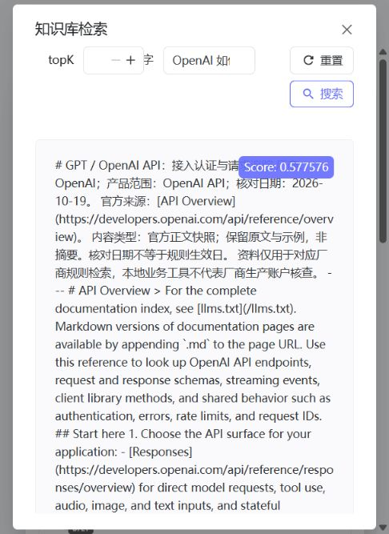

# 厂商召回与账单安全门修复验收

日期：2026-10-20。修复已部署至Docker Demo，官方知识库及配置保留。此次不更新正文、不重分块、不重新编码60份官方资料。

| 检查点 | 状态 | 证据 |
| --- | --- | --- |
| F0 复现与保护 | 已完成 | 原镜像标签、MySQL及MinIO/ES备份、知识/配置指纹；原代码9个回归失败 |
| F1 实现及定向回归 | 已完成 | 48项定向回归通过；产品约束、改写保护、统一交接判定及高风险反例 |
| F2 Linux与ES验收 | 已完成 | 254通过/2跳过；同一真实ES、相同120条冻结千问查询对照 |
| F3 部署与真实业务 | 已完成 | 原账单问法首次通过；13项真实HTTP/WS链路、普通用户三家原始中文查询通过 |
| F4 保护复核与交付 | 已完成 | 两个临时账号清理；官方库/配置摘要一致，387份运行时文件匹配，最终镜像48项定向复验通过 |

## 厂商召回修复

`knowledge/product_scope.py`将问题中明确的OpenAI/GPT、Qwen/千问/百炼、DeepSeek/深度求索映射到官方资料的规范产品值。单厂商限制到该产品，明确多家问题限制到这些产品；未指明厂商时保留澄清契约。已提供的产品过滤与问题矛盾时返回NEEDS_CLARIFICATION，不调用编码接口，也不放宽过滤。

“Qwen使用OpenAI SDK”“DeepSeek的OpenAI兼容接口”中的OpenAI指协议或SDK，不自动作为OpenAI托管服务；真实比较问题保留多厂商范围。该规则覆盖当前三家明确别名及已测试表述，不宣称理解所有自然语言歧义。

范围在ES召回及数据库检索前生效；数据库在候选、重排和父块展开后复核当前权限、活动版本及产品。回归中故意让ES返回别家和未授权私有文档，最终结果仍拒绝它们。知识Agent以原用户问题确定范围，LLM的查询改写或工具参数不能换掉厂商；丢失或改错厂商的改写退回原问题，调用指纹仍参与去重。

## 账单安全门修复

先前证据汇总的handoffDecision=false、路由LOW，但最终安全门再次用分类模型needs_human=true要求工单，导致正常只读答案被挡。现在统一通过`_handoff_required`读取已完成的路由/证据决策及实际执行状态，安全门和失败说明不再让原始分类提示覆盖完成后的决定。没有完成决策时保留保守后备判定。

高风险路由、明确要求交接、诊断要求交接和已尝试的交接仍生效；退款、升套餐、明确转人工即使被模型提示为低风险，也必须先汇总证据再创建工单。语义识别为退款争议、支付争议、合约变更等的请求继续按高风险进入人工。`explicit_handoff`来自确定性规则命中，不再把任意needs_human提示误当作客户明确要求。

## 修复前后同条件证据

修复前使用交付归档中的原app代码执行新回归，9项全部失败（8项数据库/ES范围用例及1项账单原始问题）。修复后定向48项通过。完整Linux容器回归为**254 passed, 2 skipped**，237.24秒，较原228项新增26项；测试数据库及存储隔离，禁用Provider，未使用真实业务库跑单元夹具。

末次格式整理及移除无用变量后的最终镜像，再跑48项定向回归通过（23.13秒），见`final-image-regression.log`。新增厂商模块及测试Ruff检查通过；存量文件的历史静态告警未作为本次“全量lint通过”的结论。

相同官方60文档/5888向量/1531父块、同一ES、相同120条回归问题与冻结真实Qwen-v4-256查询向量。前后评测均0次Provider调用。

| 指标 | 修复前 | 修复后 |
| --- | ---: | ---: |
| 全部Top-6目标文档命中 | 107/120，89.17% | 117/120，97.50% |
| 未手工指定过滤 | 48/60，80.00% | 58/60，96.67%（自动产品约束） |
| 手工产品+分类过滤 | 59/60，98.33% | 59/60，98.33% |
| 119条具有可确定产品范围的查询，结果含范围外厂商 | 35/119 | 0/119 |

剩余未命中为Qwen quickstart未手工过滤、Qwen提示工程的两种查询；返回仍属Qwen，是同厂商文档排序问题，未修改期望或把它们记作命中。一个不含厂商词且未手工过滤的问题保持未限定范围，因此不计入119条厂商边界断言。结果是既有回归集，不是新盲测或生产压测。

## 部署后的真实验收

- 原始账单问题“请核实2026-10的套餐、用量和账单金额。”直接通过，无改问法、无重试：Billing MCP三项只读查询成功，输出夹具账单12，billing/customer-support两道安全门通过，未要求人工工单。
- 定向AgentRuntime回归强制给同一句话注入needs_human=true，仍按已完成的只读决策放行；退款、升套餐、明确人工的三个反例均实际调用交接工具且顺序正确。
- 普通USER账户重测原始中文问题：OpenAI Bearer认证、Qwen安装OpenAI/DashScope SDK、DeepSeek配置OpenAI兼容base URL。各6条结果全部属于目标厂商，引用200，下载原文SHA与官方清单一致。
- 13项HTTP/WS链路覆盖认证、401/429复查、跨用户隔离、交接幂等、流式完成、Billing MCP、MD/PDF/DOCX入库、真实千问检索、引用权限、修订后旧引用410及删除后不召回。
- 临时账号共2次真实生成、15,116个LLM Token；4次临时入库记账、90个Embedding Token。另有三家真实查询编码，不计入入库台账；60份官方知识没有重新编码。

## 保护与证据目录

检查点为`backend/data/checkpoints/vendor-billing-fix-20261020/`；`private/`含有效配置、MySQL及临时凭据，`volumes/`包含MinIO/ES静态备份，不能整体公开上传。回滚镜像标签为`paismart-rollback:vendor-billing-fix-20261020`。本次无schema变更，必要时可停写后切回旧镜像；恢复数据须同时匹配MySQL与MinIO/ES备份，不能仅恢复一处。

关键证据：

| 文件 | 作用 |
| --- | --- |
| `baseline-red.log` | 原归档代码上9个回归失败 |
| `regression-tests.log`、`container-tests.log` | 定向48及完整254项回归 |
| `baseline-corpus.json`、`baseline-scope.json`、`final-corpus.json` | 同条件检索与119条厂商边界对照 |
| `http-acceptance.json`、`ws-billing.json`、`vendor-http.json` | 原账单问法及真实链路、来源与引用 |
| `before.json`、`after-cleanup.json` | 全部文档、向量、父块摘要一致，含历史删除标记 |

最终文件表81条记录包含60有效文档和21历史删除标记；有效知识库仍是三家各20份。临时资料清理后，5888向量、1531父块及全部知识摘要与修复前一致；配置文件及原有效容器环境保持不变。本地开发库另与第四阶段起点复核，源码交付放在`backend/data/checkpoints/vendor-billing-fix-delivery/`。

最终后端镜像为`sha256:9d8a33ec9ed79e3da268a800b0d89c979de173900e46ad4412ac8fac4f83b7ed`，API/Worker/Billing共用。`delivery-audit.json`确认387份运行时源码/Skill/资料与当前工作区逐文件一致、配置及三组知识摘要未变；9个长期服务运行且重启次数0，配置健康检查的服务均healthy，migrate/demo-seed退出0。

