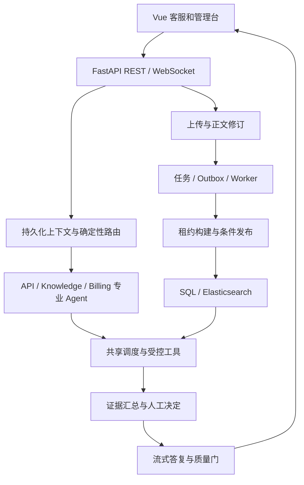

# 架构

API 助手有聊天和文档入库两条主链路。内部包名、数据库与 Compose 项目中的 `PaiSmart` 为保留的技术标识。



## 代码地图

| 入口 | 职责 |
| --- | --- |
| [frontend/src](../frontend/src) | 页面、状态管理、REST / WebSocket 客户端 |
| [app/api](../backend/app/api) | 身份、参数、传输与业务接口 |
| [app/agent](../backend/app/agent) | 上下文、路由、事实 Agent、答复与质量门 |
| [app/tools](../backend/app/tools) · [skill_runtime](../backend/app/skill_runtime) | 工具注册、调度、安全上下文和运行时 Skill |
| [app/diagnosis](../backend/app/diagnosis) | 跨生成的诊断状态、证据、租约和恢复 |
| [app/documents](../backend/app/documents) | 存储、修订、任务协调、删除及清理 |
| [app/knowledge](../backend/app/knowledge) | 解析、切分、编码、构建发布、检索和引用 |
| [app/accounting](../backend/app/accounting) | 调用用量、额度预留、结算与释放 |
| [app/support](../backend/app/support) | 账单读取、工单、审批及合成支付适配 |
| [app/db](../backend/app/db) · [alembic](../backend/alembic) | 业务记录、数据库连接和连续迁移 |
| [app/core](../backend/app/core) | 配置、认证、权限、脱敏和可观测性 |

`documents/jobs.py` 和 `knowledge/indexer.py` 保留兼容入口，实际实现位于 `job_runtime.py` 与 `build_pipeline.py`。维护时复用现有实现。

<a id="chat"></a>

## 聊天与生成

`RoutingPolicy` 是专业 Agent 的选择入口，最多选择 API 诊断、Knowledge、Billing 三类。专业 Agent 查找本领域事实，共享调度执行工具，证据汇总后才决定是否转人工并生成客户答复。

WebSocket 先发送 `auth` 帧。新版发问使用以下结构。

```json
{"type":"message","conversationId":"<owned-active-conversation>","question":"问题正文"}
```

服务端校验会话属主和活动状态，历史读取、用户消息及生成答复绑定同一会话。旧纯文本客户端沿用账号最近活动会话选择，多标签页客户端应使用结构化消息。前端按 `generationId` 关联增量，完成事件携带权威正文校准。

生成任务与 WebSocket 订阅解耦，连接断开后任务继续。活动任务每 10 秒续心跳，启动及每 30 秒的恢复扫描仅回收超过 120 秒无更新的活动任务。完成、取消和回收通过条件更新争用终态，迟到完成无法覆盖已取消或中断的状态。额度预留、结算和释放由持久记录保护，成功答复和结算同事务提交。

Redis Streams 共享已检查的实时事件及正文，副本间可接收取消请求。增量附带完整正文，流截断或重放不会重复追加；Redis 不可用时使用 SQL 生成快照恢复。未启用 Redis 的开发环境保留进程内模式。

<a id="context"></a>

## 上下文与事实

原始消息和权威续办状态保存在 SQL。续办字段记录用户、会话、业务范围、来源和消息 ID，用户纠正替代旧值，迟到轮次按版本条件拒绝覆盖。Redis 缓存以客户、会话和版本号定位。

近期历史和按需回查受消息数与字符预算约束。请求、工单和账期的切换先确定范围，歧义时澄清。进度摘录由原消息引用组成，默认通过 `CONTEXT_PROGRESS_ENABLED` 显式启用。当前业务状态需要本轮获授权的工具核实。

质量门区分文档规则、用户口述和业务工具事实。完整短句或代码块通过预审后流式推送，结束时再审计全文，必要时发送替换事件。凭据脱敏、引用及主张范围校验同时作用于公开片段与最终正文。

<a id="knowledge"></a>

## 知识流水线

SQL 保存逻辑文档、输入修订、任务、构建与活动指针，本地存储或 MinIO 保存正文及解析产物。Elasticsearch 是可重建检索索引，Kafka 承载任务通知，Redis 用于缓存与限流。

文档任务通过原子领取及文档租约协调。发布前核对 owner、epoch、租约、输入修订和构建产物，校验通过才切换活动指针。失败保留旧活动版本，删除先落墓碑，GC 只处理明确目标。Outbox、维护扫描及幂等领取承接重复或遗漏通知。

文档与查询统一使用千问 `text-embedding-v4` 和匹配维度。只编码子块，父块提供有界上下文。候选、重排、父块展开及引用读取均复核当前权限、活动版本与适用范围。Provider 失败明确返回状态，未知外部消耗保留对账记录。

PDF/DOCX 由独立 Docling 进程解析，使用固定模型缓存。扫描 OCR 与截图属于后续功能范围。官方快照清单位于 [vendor_knowledge](../backend/vendor_knowledge/README.md)，历史测试夹具位于 `backend/demo_knowledge`。

<a id="diagnosis"></a>

## 诊断与人工交接

诊断对象独立于单次生成，持久保存请求范围、候选原因、观测、证据及状态变化。工具数据只支持对应用户、应用、接口和时间窗口。修正后的新请求经过属主及范围核对，再决定已解决、仍失败或继续等待。

执行记录通过租约和 epoch 约束恢复，待确认工单按原诊断或生成的唯一身份查询和补齐。只有持久化工单回执能够支持“已创建工单”的答复。当前细分诊断规则适用于独立 Demo API，厂商文档用于通用解释。

<a id="approvals"></a>

## 账单与审批

Billing Agent 通过独立只读 MCP 读取套餐、用量和账单。管理员维护工单，审批接口负责合成退款或关闭原工单。LangGraph 审批检查点与执行队列保存在共享 SQL，按业务行串行推进。后台租约领取、退避重试及回执核对承接中断，12 次后交管理员核查。恢复时读取原持久决定，接手管理员不能改写原决定。

审批操作、配置及适用边界见[发布与审批](RELEASING.md#approvals)。工单由状态机约束，每次修改记录操作者与前后值。独立 SUPPORT 角色可处理工单，审批、Provider 对账和角色授予保持管理员权限。供应商请求尝试与对账分开于用户额度账本，未知消耗不视作零。真实支付接入范围见[维护](MAINTENANCE.md)。

实现细节以本页列出的代码入口为准，必要的验收与原失败证据见[验收索引](archive/README.md)。
