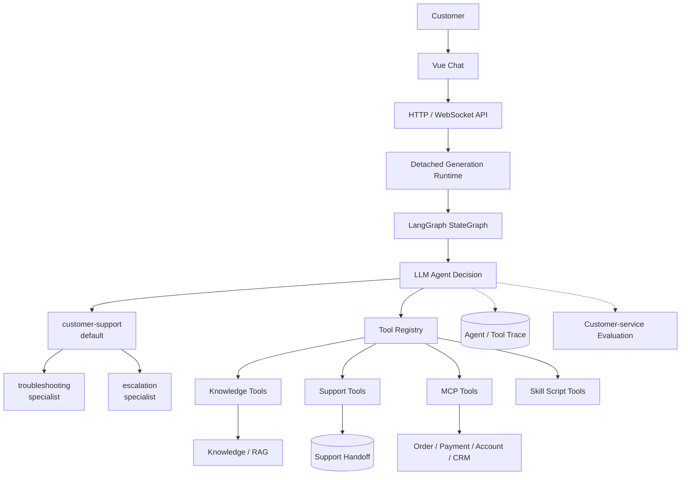
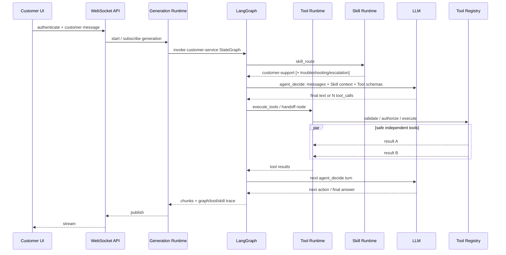

# AI 客服架构与职责边界

## 1. 产品目标

PaiSmart 不是通用研究 Agent。所有核心模块围绕客服闭环服务：

```text
理解客户诉求
   -> 回答政策/产品问题
   -> 读取真实业务状态（有 Tool/MCP 时）
   -> 排查故障
   -> 必要时转人工
   -> 留下可审计 Trace 与质量数据
```

最重要的安全边界是：

```text
知识库事实 != 客户个人事实
```

FAQ、政策、产品说明可以由 RAG 提供；订单、支付、退款到账、账户状态必须由可信业务 Tool/MCP 验证。

## 2. 运行时架构



## 3. 后端目录职责

```text
backend/app/
├── api/
│   ├── v1/                  REST API，包括 support handoff API
│   └── websocket/           客服聊天 WebSocket 边界
│
├── agent/
│   ├── graph/                LangGraph State / Nodes / Routes / Workflow
│   ├── runtime.py           Tool 并行执行器与 Tool 可见性策略
│   ├── generation.py        与 WebSocket 解耦的 generation runtime
│   ├── chat.py              一次客服回答的业务编排
│   ├── llm.py               AI 客服 System Prompt / LLM adapter
│   └── trace_store.py       Agent / Tool durable trace
│
├── skill_runtime/
│   ├── loader.py            解析 SKILL.md
│   ├── registry.py          Skill 注册
│   └── router.py            default Skill + specialist routing
│
├── tools/
│   ├── registry.py          Tool schema / validation / permission / execution
│   ├── local/
│   │   ├── knowledge.py     客服知识能力 Adapter
│   │   ├── api_support.py   调用日志 / API Key / 429 / 错误码诊断 Tool
│   │   ├── billing.py       套餐 / 用量 / 账单 Tool
│   │   ├── support.py       人工 handoff Tool
│   │   └── skill.py         Skill Reference / Script Tool
│   └── mcp/                 外部业务 MCP Client + PaiSmart MCP Server
│
├── support/
│   ├── api_diagnostics.py   API 技术支持真实业务查询
│   ├── billing.py           套餐/用量/账单领域查询
│   └── handoff.py           人工客服工单领域逻辑
│
├── knowledge/               客服知识库、RAG、索引、Embedding、Reranker
├── documents/               知识文档上传、存储、处理任务
├── accounting/              Token / Usage / Rate Limit
├── evaluation/              六层客服 Eval：RAG / Tool / Decision / Answer / Safety / Performance
├── db/                      SQLAlchemy models / session
├── core/                    config / security / observability
└── workers/                 Kafka processing worker
```

Skill 内容独立于引擎：

```text
backend/skills/
├── customer-support/
├── troubleshooting/
└── escalation/
```

`app/skill_runtime` 负责“怎么加载和路由 Skill”；`backend/skills` 负责“客服应该怎么工作”。

## 4. 依赖方向

推荐保持：

```text
API
 ↓
LangGraph Agent Workflow
 ├─ Skill Runtime
 └─ Tool Runtime
       ↓
Support / Knowledge / External MCP
       ↓
DB / ES / Storage / Business Systems
```

规则：

1. `api/` 只承担协议、鉴权和序列化，不写客服决策算法。
2. `agent/` 负责决策和调度，不直接实现订单、支付或 RAG 算法。
3. `skill_runtime/` 只负责 Skill 机制，不包含具体客服知识。
4. `tools/` 是 LLM 与真实能力之间的安全边界，Tool Adapter 应保持薄。
5. `support/` 保存人工交接领域逻辑；未来 Ticket/CRM 规则也应优先进入明确领域模块。
6. `knowledge/` 只处理客服知识，不反向依赖 Agent/Skill。
7. `evaluation/` 是旁路评测，生产回答不依赖 Eval 分数才能运行。
8. 不重新创建万能 `services/`。

## 5. 客服消息主链路



WebSocket 断线只取消订阅，不取消 Generation。重连后先读 durable snapshot，再订阅后续事件。

## 6. 客服 Skill 组合

`customer-support` 是默认 Skill：

```text
任何正常客服消息
   -> customer-support
```

Specialist 只在必要时叠加：

```text
报错 / 功能失败
   -> customer-support + troubleshooting

明确人工 / 投诉 / 重复失败
   -> customer-support + escalation
```

默认最多激活有限数量 Skill，避免上下文污染和 Tool 权限过宽。

## 7. 客户事实边界

一个关键例子：

```text
“退款一般多久到账？”
 -> search_knowledge 可以回答公司政策

“我的退款到账了吗？”
 -> 必须调用 Refund/Payment/Order Tool 或 MCP
 -> 没有 Tool 就明确无法核实
```

不能让模型用“政策 + 猜测”冒充账户查询。

## 8. 人工升级闭环

```text
escalation Skill
   -> assess escalation
   -> build handoff summary
   -> create_support_handoff
   -> support_handoffs DB row
   -> customer receives real handoffId
   -> admin can process status / assignment / resolution
```

只有真实 Tool 成功后，前端和模型才能声称工单已创建。


## 9. LangGraph 工作流边界

主图只保留客服决策层级的节点：

```text
load_context -> skill_route -> agent_decide
                                  |
                                  +-> execute_tools -> agent_decide
                                  +-> handoff       -> agent_decide
                                  +-> force_finalize -> safety
                                  +-> safety -> emit_final -> persist_trace -> END
```

不把 `BM25 / KNN / RRF / Reranker` 拆成 LangGraph 节点；它们属于 `search_knowledge` 背后的 Knowledge 实现。也不把每个 MCP Tool 拆成节点；它们统一由 ToolRegistry 管理。这样图只描述客服工作流，而不是复刻所有内部调用细节。


## 10. 原 AI-DevSupport 专业 Agent 如何迁移

当前版本没有重新复制旧的 `api_diagnostic.py / billing.py / doc_rag.py` 三套子 Agent，而是把专业能力放到更清晰的层次：

```text
LangGraph       = 客服阶段编排
Skill           = 专业客服处理策略
Tool            = 真实数据/动作
Domain Service  = SQL/RAG 业务实现
```

对应关系：

```text
API Diagnostic
  troubleshooting
    -> query_call_log
    -> query_api_key_status
    -> query_recent_call_stats
    -> query_error_code
    -> search_knowledge

Billing
  customer-support
    -> query_plan
    -> query_usage
    -> query_bill
    -> search_knowledge (计费规则)

Doc RAG
  search_knowledge
    -> BM25 + Vector KNN -> RRF -> Reranker -> Parent Context
```

这种迁移保留了原项目的专业技术支持能力，同时避免“Agent 调 Agent”带来的重复 LLM 调用与职责混乱。
