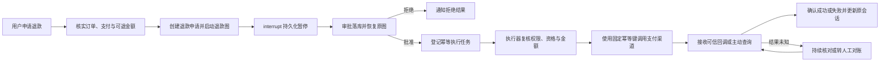

# 客服 Agent 退款审批与执行方案

**状态：支付沙箱演示已实现。** 用户提交合成发票后，LangGraph 暂停等待管理员审批。批准后，独立支付模拟服务落库一笔退款，业务端通过查询接口核对金额、币种和退款编号后返回 `SANDBOX_REFUNDED`。正式支付渠道接入仍按下文里程碑推进。

## 在浏览器里演示

客服聊天中的「发起业务申请」支持两种动作。客户选择当前账号的已支付账单申请退款，或选择当前会话的工单申请关闭。业务请求绑定会话 ID。管理员在「工单管理 → 业务审批」查看原因和目标，填写说明并批准或拒绝。客户回到原会话刷新申请状态即可看到退款回执或工单关闭状态，页面重新加载后仍能取得记录。

关闭工单复用退款的 LangGraph 暂停、审批恢复及决定记录。获批后只更新原工单，关闭状态与执行结果在同一事务保存。重复审批返回已保存结果。支付模拟服务仅承接退款。

从干净源码目录安装依赖并启动自动化浏览器演示：

```powershell
cd backend
uv sync --locked --extra dev
$env:REFUND_DEMO_PYTHON = (Resolve-Path .venv/Scripts/python.exe).Path
cd ../frontend
pnpm install --frozen-lockfile
pnpm exec playwright install chromium
pnpm exec playwright test -c approval-demo.playwright.config.ts
```

Linux 或 macOS 将 Python 环境变量指向 `backend/.venv/bin/python` 的绝对路径。使用 Node 20 与兼容的 pnpm 版本。Playwright 会启动本机回环的临时 API、支付模拟服务和 Vite，准备合成的客户、管理员、会话、发票与工单。Fast CI 包含同一场景及无浏览器的 HTTP 演示，浏览器失败时保存追踪。常规部署需启用 `REFUND_PREVIEW_ENABLED` 并迁移至 `0019_support_approval_actions` 后才显示业务入口。[浏览器场景](../frontend/playwright-approval-demo.spec.ts) · [CI 配置](../.github/workflows/ci-fast.yml)

2026-11-19 本机从隔离 Git 快照 `ae82dbe` 干净克隆，按锁文件重新安装依赖。HTTP 演示和双账号浏览器场景均通过。确认管理员批准后，原会话刷新及重新加载都显示同一个退款编号，支付模拟账本只写入一笔退款，工单最终为 `CLOSED`。远端 CI 记录及独立复核人签验待补充。

## 一条命令运行退款演示

从 `backend` 运行 `python scripts/run_refund_sandbox_demo.py`。脚本在本机回环启动两个 HTTP 服务，用临时数据库和合成账号走正式登录、申请、管理员审批和用户查询接口。支付模拟服务使用自己的账本，在第一次提交落库后故意返回 503。业务端通过查单恢复同一个 `rf_demo_…` 编号。脚本核对独立查单、重复审批与用户查询取得相同回执，支付账本只有一行。运行结束后清理临时数据。[演示脚本](../backend/scripts/run_refund_sandbox_demo.py) · [支付模拟服务](../backend/app/support/refund_sandbox_server.py)

已有隔离环境可以将 `REFUND_SANDBOX_URL` 指向该模拟服务的 `/sandbox`，并迁移至 `0018_refund_sandbox_intent`。沙箱目前只识别 `sandbox-paid-1` 和人民币 15.00 元的合成支付。未配置沙箱，或申请建立时没有启用沙箱，继续返回审批预览结果。沙箱拒绝返回 `SANDBOX_REJECTED`，未核验的结果返回 `REFUND_RECONCILING`。管理员重交同一决定可重试核对。演示使用项目内模拟支付服务，真实渠道、凭据和真实账务均未接入。

## 当前预览怎么运行

在隔离后端启用 `REFUND_PREVIEW_ENABLED=true`，用 `python -m alembic upgrade head` 将业务库升级。设置 `REFUND_CHECKPOINT_PATH` 为独立的持久化 SQLite 文件，默认 `data/refund-checkpoints.sqlite`。重启后复用原业务库和同一个检查点文件。预览支持单机文件持久化，跨主机部署的检查点后端待选。

1. 用户登录后发送 `POST /api/v1/support/refund-requests`，请求体为 `{"invoiceId":"<本人已支付发票 ID>","requestKey":"preview-1","reason":"测试审批"}`。成功返回 `requestId` 和 `PENDING_APPROVAL`。
2. 关闭并重启后端，管理员登录后用 `GET /api/v1/support/admin/refund-requests/{id}` 核对申请，再发送 `POST /api/v1/support/admin/refund-requests/{id}/decision`，请求体为 `{"decision":"approve","note":"通过审批预览"}`。拒绝时将 `decision` 改为 `reject`。
3. 申请人用 `GET /api/v1/support/refund-requests/{id}` 查看结果。批准显示 `APPROVED_PREVIEW`，拒绝显示 `REJECTED`。相同请求键和载荷返回原申请。重复提交原审批可补做恢复，改写已存在审批会返回冲突。

预览把审批决定先持久化到业务库，再由审批请求通过原 `thread_id` 恢复 LangGraph。两步之间中断时，管理员重交原决定可继续。正式方案仍需补自动恢复队列、申请版本与金额快照、独立审批权限、支付渠道及账务对账。测试使用临时数据库，重新创建 API 和数据库连接，检查持久化暂停、并发审批、载荷冲突和跨账号隔离。[预览路由](../backend/app/api/v1/refund_preview.py) · [退款图](../backend/app/support/refund_preview.py) · [端到端测试](../backend/tests/e2e/test_refund_approval_preview.py)

## 1. 首期交付范围

首期选择一个实际支付渠道、一种原路退款方式和一套明确的退款政策。支持一笔原支付对应的单次退款，退款金额与币种必须来自权威支付记录和服务端政策计算。部分退款、多次退款、跨币种退款和人工改收款账户留待单独设计。渠道、审批角色、金额上限、适用订单类型和资格规则由业务负责人确定。

首期完成标准是跑通两类真实链路。支付沙箱验证供应商侧状态、主动查询和回调。获得业务授权后，使用指定测试订单完成一次受控的真实退款，并从支付侧查回同一个退款对象。两轮分别记录证据。

| 当前能力 | 新能力 | 权威记录 |
| --- | --- | --- |
| 读取账单与工单 | 查询订单、原支付、已退金额和可退余额 | 订单与支付服务 |
| 创建人工工单 | 提交结构化退款申请，关联会话与可选工单 | 退款申请 |
| 恢复原工单回执 | 审批、预约执行、查询与恢复同一笔退款 | 审批事件、执行记录、支付退款对象 |
| 输出客服答复 | 按退款阶段返回可核对状态与回执 | 退款状态投影及支付侧结果 |

原工单用于人工解释、补资料、处理例外和跟进。支付服务负责确认资金结果，普通工单的状态更新权限继续由工单模块管理。[现有工单写入边界](../backend/app/support/handoff.py) · [现有回执校验](../backend/app/agent/action_contracts.py) · [客服 Agent 工程改进计划](ERP_AGENT_PRACTICES_ADOPTION_PLAN.md)

## 2. 从用户申请到最终回执



1. **核实申请。** 通过当前登录账号和租户查询原支付。用户提供的订单号用于检索，用户描述的金额只作为诉求。遇到多笔匹配或归属不明时先澄清。
2. **展示申请内容。** 显示订单、原路退回方式、金额、币种和原因。用户确认后，由服务端计算并固化申请快照。客服此时可以回复「退款申请已提交，等待审批」。
3. **暂停与审批。** 退款图在审批节点调用 `interrupt()`，将等待状态保存到持久化检查点。审批员在后台查看申请版本、订单、金额、政策依据和风险标记。批准或拒绝均留下操作者、时间和理由。金额、币种、原支付或关键理由变化时，形成新版本并重新审批。
4. **恢复与执行。** 审批结果与恢复任务同事务落库。后台凭审批记录恢复原退款图。批准分支登记幂等执行任务，执行器复核权限、快照、有效期和可退余额后调用支付渠道。
5. **确认。** 只有支付渠道返回可信成功状态，并核对原支付、退款 ID、金额和币种一致后，才能告知用户「退款成功」。预计到账时间仅在渠道提供且适用时展示。
6. **查询与补救。** 用户可用申请编号查状态。提交超时、回执丢失或支付侧仍在处理时，显示「退款处理中，结果待确认」。人工对账和后台恢复复用原执行记录。

## 3. 模块和接口

| 模块 | 建议职责 |
| --- | --- |
| 客服 Agent 工具 | 查询可退事实、提交申请、读取退款结果。工具参数校验沿用现有运行时，提交授权绑定账号、目标和规范化参数。 |
| 退款领域服务 | 管理申请版本、权限、政策校验、金额预留、状态机与审计。HTTP、审批界面、执行器和恢复任务统一调用。 |
| LangGraph 退款子流程 | 用持久化检查点记录审批暂停和分支进度。通过稳定 `thread_id` 恢复指定申请版本。 |
| 审批后台 | 查待办、展示申请快照、记录批准与拒绝。沿用后台认证体系，为退款审批设置独立权限。 |
| 支付适配器 | 统一提交、按业务键查询和校验回调。隔离供应商凭据并转换供应商状态。 |
| 执行与对账任务 | 领取任务、调用支付适配器、有界重试、恢复超时任务及投递结果通知。 |

| 接口草案 | 输入与结果 |
| --- | --- |
| `POST /support/refund-requests` | 用户提交原支付标识、原因、确认版本、客户端请求键。返回申请 ID、金额、币种和待审批状态。 |
| `GET /support/refund-requests/{id}` | 按账号及租户读取申请状态、时间和可展示回执，供 Agent 与客服界面共用。 |
| `GET /support/admin/refund-requests` | 授权审批员读取其作用域内的待办，可按风险和状态筛选。 |
| `POST /support/admin/refund-requests/{id}/decision` | 审批员提交决定、申请版本、理由与操作请求键。并发或过期版本返回冲突。 |
| `POST /internal/payment-webhooks/{provider}` | 验证供应商签名、回调时间与事件 ID，再执行受控状态更新。 |
| 执行与恢复任务 | 以执行 ID 领取、查询、恢复和提交状态。后台恢复入口接受执行 ID，执行字段全部读自原快照。 |

首期把支付执行能力放在后台任务。模型可发起申请和查询结果。审批后可以由 Agent 发出受控执行信号，实际金额、原支付、币种、退款渠道和幂等键由执行器从批准记录读取。

### LangGraph 检查点与人工恢复

现有客服主图使用 `graph.compile()`，当前工单恢复由业务数据库驱动。首期新建独立退款图，通过 `compile(checkpointer=...)` 接入可跨进程重启、由工作进程共享的持久化后端。每个申请版本分配一个服务端生成的稳定 `thread_id`，业务库保存它与申请的对应关系。审批可以跨会话、跨请求、跨服务重启进行。[当前客服主图](../backend/app/agent/graph/workflow.py) · [LangGraph 中断与恢复](https://docs.langchain.com/oss/python/langgraph/interrupts)

1. **建立等待点。** 申请落库时登记启动任务，由后台启动退款图。审批节点用 `interrupt()` 暂停，检查点只保存申请 ID、版本等可序列化的标识。审批入口校验该版本已进入等待点。启动任务重试时先按 `thread_id` 检查原图状态。
2. **记录决定。** 审批接口验证审批人、作用域、申请版本和当前等待状态。批准时同事务写审批事件、预留金额和恢复任务。拒绝也写审批事件和恢复任务。恢复任务由后台重试，接口返回后无需维持原 WebSocket 连接。
3. **恢复原图。** 后台读取已落库的审批事件，以同一个 `thread_id` 调用 `Command(resume={"decision_id": ...})`。恢复值仅引用决定记录，金额、币种、原支付和授权均从业务库读取。过期审批或旧版本不能触发支付分支。
4. **处理重放。** 恢复会从审批节点开头重跑。暂停节点只读状态并等待，支付副作用放在下游后台执行器。同一申请版本只允许登记一条执行任务。恢复任务处理前校验当前检查点和业务状态，发现图已推进时核对并确认已有结果。支付侧继续使用同一幂等键查单和提交。

| 存储 | 用途 |
| --- | --- |
| LangGraph 检查点 | 记录退款图运行到哪个节点、正在等待哪次审批、批准或拒绝后走哪条分支。 |
| 退款业务库 | 保存申请版本、审批、金额预留、执行任务和已核验回执。授权判断、资金防重与对账依据这些记录。 |

若检查点或恢复任务暂时不可用，业务库保留审批与恢复任务，待后台核对后恢复。检查点与业务库状态不一致时，先对账，禁止凭检查点直接发起退款。原申请换版本后关闭旧等待点，旧恢复任务按版本拒绝继续。

## 4. 状态、存储和权限

### 状态机

| 状态 | 进入条件 | 用户可见状态 |
| --- | --- | --- |
| `PENDING_APPROVAL` | 申请版本已持久化 | 等待审批 |
| `REJECTED` | 审批员拒绝 | 申请未获批准，可展示面向用户的原因 |
| `APPROVED` | 批准、金额预留和执行任务已提交 | 已批准，等待处理 |
| `SUBMITTING` | 执行器持有效租约并已记录提交意图 | 处理中 |
| `PROCESSING` | 支付渠道已受理，尚未给出终态 | 支付渠道处理中 |
| `RECONCILING` | 网络失败、回调矛盾或供应商状态未知 | 结果待确认，正在核对 |
| `SUCCEEDED` | 支付侧成功结果与申请匹配 | 已退款，显示金额与回执 |
| `FAILED` | 渠道明确拒绝或服务端执行前明确拒绝 | 退款未完成，显示可公开的下一步 |

审批过期、用户撤回等在提交前关闭原申请并释放预留。已经提交且结果未知时保留预留，由对账确认是否释放。状态只能按允许的迁移前进。迟到回调和重复事件不得覆盖已确认的成功结果。

### 数据与事务

- **申请记录**保存租户、账号、会话、可选工单、业务原因、政策版本、原支付 ID、金额最小单位、币种和申请版本。用整数保存金额。
- **审批事件**保存申请版本、操作者、结果、快照摘要、批准时间与有效期。写入批准、预留退款金额和创建图恢复任务须处于同一数据库事务。批准分支恢复后按申请版本幂等登记支付执行任务。
- **执行记录**保存任务租约、尝试次数、渠道幂等键、供应商退款 ID、可信状态、失败类别和核对时间。外部 HTTP 调用在短数据库事务之外执行。
- **回调与审计记录**以渠道和事件 ID 去重，保留状态变更、请求关联 ID 和必要的脱敏字段。日志需要支持从会话定位到申请、审批、任务和回执。
- **金额并发控制**按原支付加锁或条件更新，核对已退金额与待处理预留之和。成功结转预留，明确失败释放预留。对账中保留余额占用。

### 授权边界

| 角色 | 可做操作 |
| --- | --- |
| 客户 | 提交和查看自己作用域内的申请，按政策撤回尚未执行的申请 |
| 客服或 Agent | 核实、提交、查询、转人工 |
| 审批员 | 在授权范围内批准或拒绝指定版本 |
| 执行器 | 处理已批准、有效且金额匹配的任务 |
| 对账人员 | 查看脱敏异常、发起查询与核对，记录人工处理结果 |

跨账号和跨租户请求在查询、审批、恢复和写入边界分别校验。审批记录不可用、审批过期或摘要不一致时，禁止发起支付写入。渠道凭据仅注入执行服务，日志和 Agent 上下文只能接触业务所需的脱敏结果。

## 5. 幂等、异常与回执

| 场景 | 处理 | 验收点 |
| --- | --- | --- |
| 用户重复提交 | 账号、作用域与客户端请求键定位原申请，校验规范化载荷 | 相同输入返回同一申请，载荷不同返回冲突 |
| 同一申请被并发批准 | 版本条件更新与唯一执行约束 | 一次有效批准，一条可执行任务 |
| 等待审批时服务重启 | 从共享检查点读取同一退款线程，批准后通过后台恢复 | 原线程继续执行，重启期间零支付写入 |
| 审批落库后恢复进程崩溃 | 重试持久化恢复任务，先核对图是否已经推进 | 原决定生效一次，只有一条支付执行任务 |
| 执行前崩溃 | 任务持续在队列中，租约到期后由其他执行器领取 | 权威记录可恢复，执行参数保持一致 |
| 渠道受理后响应丢失 | 使用原渠道业务键主动查单，确认渠道幂等契约后按原键重试 | 原退款对象唯一，用户未提前收到成功消息 |
| 回调重复、乱序或伪造 | 签名和事件去重，必要时按原支付主动查单 | 状态不回退，异常有审计 |
| 渠道明确拒绝 | 记录拒绝并释放预留，输出可理解的下一步 | 无成功回执且退款余额恢复正确 |
| 查询长期未知 | 保留核对状态并转人工，限制自动恢复节奏 | 无额外退款，处理人可定位原记录 |

接入前需要用渠道沙箱验证幂等键有效期、按键查单、支付成功的定义、回调签名与退款金额语义。渠道缺少可靠查单时，未知结果交由对账人员核实。回执至少包含申请 ID、原支付 ID、供应商退款 ID、金额、币种、确认状态与确认时间。用户界面只展示经授权且脱敏的字段。

## 6. 实施与验收顺序

| 里程碑 | 交付 | 通过条件 |
| --- | --- | --- |
| M1 业务契约 | 对象、状态、权限、政策接口、支付渠道选择 | 明确权威订单和支付接口、退款资格、审批人及金额边界 |
| M2 申请、审批与断点恢复 | 迁移、申请接口、审批待办、退款图、持久化检查点和恢复任务 | 等待审批期间重启后能从同一线程恢复。拒绝零支付写入，过期及旧版本拒绝执行，并发批准只有一条支付执行任务 |
| M3 沙箱执行与恢复 | 支付适配器、幂等提交、查单、回调、对账 | 全部故障演练通过，响应丢失能恢复原退款 |
| M4 客服端到端 | Agent 工具、用户状态查询、可见回执 | 用户通过正式入口完成申请，人工批准后能回查到账务结果 |
| M5 受控预发布 | 同一候选镜像、告警、停执行开关、回滚演练 | 授权测试订单完成实际退款并查回，负责人核对回执和账务 |

验收覆盖正常退款、拒绝、过期批准、旧版本、改金额、越权、额度不足、并发重复、提交前失败、受理后断连、重启、回调重复或篡改，以及长期未知。每轮对照申请版本、审批事件、执行任务、支付侧退款对象和用户所见回执。发布门槛为**无授权退款 0 次、重复退款 0 笔、虚报成功 0 次**，并记录审批等待、提交至确认和异常恢复耗时。

上线时先在合成账号和指定真实测试订单上验证完整链路。停执行开关应暂停新渠道写入，保留查询、回调处理和对账能力。回滚前逐笔核对已提交及结果未知的任务。已经发生的退款由财务流程处理，应用回滚不会改变支付侧交易。

## 7. 需要确认的接入条件

- 实际订单与支付系统、退款渠道及沙箱能力。指定支持的订单类型和可展示回执字段。
- 客户身份、租户映射、审批角色与金额规则。明确审批后多长时间内有效，以及金额变更如何处理。
- 渠道凭据管理、回调到达路径、账务核对方式、异常处理归属和测试订单名单。
- 如采用受控真实退款，确认测试资金、最大影响范围、验收责任人和证据保存位置。

这些条件确定后，按 M1 至 M5 推进即可把现有的客服交接能力扩展成一条完整的退款业务闭环。[预发布验收手册](03-operations/CONTEXT_STAGING_ACCEPTANCE_RUNBOOK.md)
