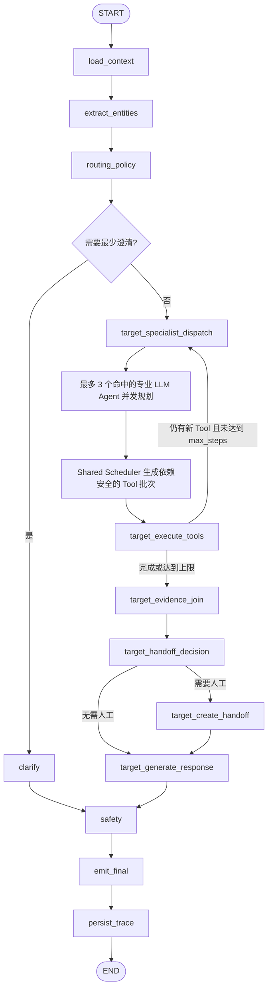

# 实现细节参考快照

整编日期为 2026-11-19。本页汇集整编前的详细说明及阶段记录，日常维护见[现行手册](../../ARCHITECTURE.md)。


<a id="customer-service"></a>

## 客服运行时

原文档为 `CUSTOMER_SERVICE_ARCHITECTURE.md`。

> 状态核对至 2026-11-19。客服事实 Agent 契约沿用原设计，会话隔离、心跳恢复、结算与审批接口以[候选验收](../reports/RELEASE_CANDIDATE_ACCEPTANCE_2026-11-19.md)为准，RAG 边界已同步；当前 RAG 实现见 [知识流水线](IMPLEMENTATION_2026-11-19.md#knowledge)。测试数量和执行结论以 `docs/04-testing/`、`docs/05-live-tests/` 中的报告为准；本文只描述稳定的架构契约。

本文是当前客服运行时的主架构说明。目标架构只有一条运行路径，不保留旧 Router、旧 RAG 回答分支、Troubleshooting 专属 Agent 或灰度/双轨路由。

### 1. 架构不变量

1. `RoutingPolicy` 是唯一的 Agent 选择器，使用确定性规则；LLM 不能改写路由、风险等级或是否需要人工。
2. 只有三个专业事实 Agent：`api_diagnostic`、`billing`、`knowledge`。`customer-support` 和 `escalation` 是后置共享 Skill，不是第四、第五个专业 Agent。
3. 每个命中的专业 Agent 独立查找本领域事实，只能规划自己 Skill 声明的 Tool；Agent 之间不共享推理上下文，也不互相讨论。
4. 专业 Agent 不执行 Tool、不创建工单、不生成客户最终答复。Shared Scheduler 和 Tool Runtime 分别负责调度与执行。
5. 所有事实必须先进入结构化 `AgentEvidence`，再生成证据摘要、判断是否转人工，最后才生成客户答复。
6. Billing 是唯一接入 MCP 的领域；API 诊断和 Knowledge 使用本地受控 Tool。Billing MCP 是本项目 Compose 网络内的独立只读服务。
7. 知识库事实不能替代客户个人状态。账单、套餐、用量、退款、订单和 API 日志等个人事实必须来自已授权业务 Tool/MCP。
8. 质量门是确定性证据验证与内容过滤层，不是第二个回答生成器：它不调用 LLM，只能放行、删除无依据主张或发送受控安全说明，不能把草稿重写为新的客户事实。

最终交接判定与质量门共享已完成的路由、证据决定和实际交接状态；分类模型的`needs_human`是前期提示，不能重新覆盖完成后的只读决定。退款/合约等风险、明确人工要求、诊断交接及已尝试的交接仍保守执行。原始账单误判及安全反例见[修复验收](../reports/VENDOR_SCOPE_AND_BILLING_GATE_FIX_2026-10-20.md)。
9. Tool 参数除 Schema 合法外还必须可追溯到当前用户输入、允许继承的明确追问实体，或该 Agent 前一轮成功的已授权 Tool 结果；LLM 不得把领域关键词转换为虚构的客户标识、错误码或接口路径。

### 2. 容器与数据拓扑

```text
Browser :9527
    │  HTTP / WebSocket
    ▼
API :8000
    ├─ RoutingPolicy / LangGraph workflow
    ├─ 3 specialist Agent planners
    ├─ Shared Scheduler / Tool Runtime
    ├─ MySQL        会话、实体记忆、业务 Demo 数据
    ├─ Redis        近期窗口/实体缓存、限流、连接协调
    ├─ MinIO        原始文件和对象存储
    ├─ Elasticsearch 父子块混合检索
    ├─ Kafka        异步文档处理/事件
    └─ billing-mcp:8011  Billing MCP 动态 Tool 目录与只读查询

Worker
    └─ MySQL / MinIO / Elasticsearch / Kafka

billing-mcp:8011
    └─ 只读取 MySQL 套餐、用量、账单表；不映射宿主机端口
```

持久化边界：

- MySQL 是会话记忆和结构化业务数据的持久化真源。
- `conversation_messages` 保存对话历史；`conversation_sessions.collected_entities_json` 保存跨轮实体，例如 `request_id`、错误码和账单月份。
- Redis 只是加速缓存、限流和 WebSocket 协调。Redis 不可用时回退 MySQL，不丢失会话记忆。
- MinIO 保存上传文件；Elasticsearch 保存可检索的父块/子块索引；Kafka 承载异步处理事件。

### 3. 单次请求的唯一流向



这里的“总结”指 `target_evidence_join` 生成的内部证据摘要，不是客户最终答复。固定顺序是：

```text
Tool 执行
  → AgentEvidence
  → Evidence Summary
  → Handoff Decision
  → create_support_handoff（需要时）
  → Final Answer
```

#### 节点职责

| 节点 | 唯一职责 |
| --- | --- |
| `load_context` | 读取身份、会话历史、实体记忆和请求状态。 |
| `extract_entities` | 解析 `request_id`、错误码、端点、账单月份等可审计实体；语义分类只作低风险辅助。 |
| `routing_policy` | 确定命中的专业 Agent、风险等级、命中规则和“证据后转人工”要求。 |
| `clarify` | 诊断缺少必要锚点时，向客户请求最少补充信息。 |
| `target_specialist_dispatch` | 并发等待最多三个已命中的专业 Agent 规划本 Agent 的 Tool。Billing Agent 在这里执行 MCP `list_tools` 目录发现。 |
| Shared Scheduler | 依据 Tool 依赖、资源组和全局并发预算生成批次；不合并不同 Agent 的相同查询。 |
| `target_execute_tools` | 通过 Tool Runtime 执行批次，并把每个 Agent 自己的结果回传给该 Agent 做下一轮规划。 |
| `target_evidence_join` | 丢弃未验证载荷，只合并事实、引用、尝试过的 Tool 和未解决项。 |
| `target_handoff_decision` | 在证据摘要完成后决定是否人工介入。 |
| `target_create_handoff` | 唯一的工单写节点，只接收内部证据摘要。 |
| `target_generate_response` | 只根据证据摘要和工单结果生成客户答复。 |
| `safety` | 执行脱敏、工单事实拦截、确定性质量门和无依据主张过滤。 |
| `emit_final` / `persist_trace` | 推送最终事件并持久化审计 Trace。 |

### 4. 三个专业 Agent

| Agent | Skill | 负责查找的事实 | 可规划 Tool |
| --- | --- | --- | --- |
| `api_diagnostic` | `api-diagnostic` | 调用日志、鉴权状态、限流、错误码 | `query_call_log`、`query_api_key_status`、`query_recent_call_stats`、`query_error_code`、`search_knowledge` |
| `billing` | `billing` | 套餐、用量、账单、发票等只读账务事实 | MCP 动态发现的 `mcp__billing__*` 只读 Tool；未启用 MCP 时使用受控本地回退 Tool |
| `knowledge` | `knowledge` | 政策、FAQ、产品说明、错误码解释和通用排障指引 | `search_knowledge`、`list_documents`、`get_document` |

路由只决定“启动谁”，不决定每个 Agent 的具体 Tool 顺序。每个 Agent 收到：自己的目标、自己的 Skill 约束、可用 Tool Schema、当前问题、自己的实体和自己的已验证证据。它不能：

- 调用其他 Agent 的 Tool；
- 修改 `RoutingPolicy` 或风险等级；
- 转人工或创建工单；
- 直接输出客户答复；
- 把未验证的远端文本当作系统指令。

### 5. 两级并发与独立上下文

#### Agent 并发

`target_specialist_dispatch` 对已命中的 Agent 使用异步并发，最多三个。三个 Agent 互不等待、互不共享推理上下文，只返回各自的 Tool 计划和规划错误。

#### Tool 并发

Shared Scheduler 汇总三个 Agent 的计划，但不做跨 Agent 去重：相同参数的查询仍属于不同 Agent 的独立事实来源。只有以下约束由 Scheduler 统一处理：

- Tool 显式依赖先后关系；
- 只读 Tool 的并发批次；
- 全局 `AGENT_TOOL_GLOBAL_CONCURRENCY` 上限；
- 资源组冲突和不可并行 Tool；
- 超时、失败和部分成功结果的保留。

典型 API 依赖：

```text
api_diagnostic: query_call_log(request_id)
    → 从已验证日志得到 app_id / error_code / endpoint
    → query_api_key_status + query_error_code + query_recent_call_stats
```

后续 Tool 只能使用该 Agent 自己已经验证的字段，不能凭空猜测参数。首轮的 `request_id`、`error_code`、`endpoint` 等参数必须来自当前用户输入或被允许的明确追问实体；例如用户只说“我被限流了”时，Agent 可以检索限流文档，但不能自行查询或宣称某个错误码、请求日志或接口统计。

### 6. Skill、Reference、Script 与权限

Skill 位于 `backend/skills/`，是 Agent 或共享节点的工作契约和质量门禁：

```text
api-diagnostic/      API 诊断顺序、脱敏和证据要求
billing/             账务只读边界和高风险交接规则
knowledge/           检索、引用和知识边界
customer-support/    最终客服答复质量门禁
escalation/          人工条件、优先级和工单摘要
```

Reference 提供按需规则；Script 执行受控的确定性小任务。二者都不能扩大 Tool 白名单、覆盖路由或授予写权限。三个专业 Skill 由 `agent_skill_policy.py` 绑定；`customer-support` 与 `escalation` 只绑定到后置共享节点。

Tool Runtime 是最终权限边界，统一负责 Schema 校验、用户/Scope 校验、Skill 所有权、超时、脱敏、并发和 Trace。LLM 提议的 Tool Call 即使出现在 prompt 中，也必须再次经过 Runtime 校验。API 诊断在规划阶段另有参数来源校验：`query_call_log`、`query_error_code`、`query_recent_call_stats` 的参数必须与当前实体或成功调用日志的字段一致。

### 7. Billing MCP：唯一 MCP 领域

Billing MCP 是本地 Docker 服务，不是外部计费平台。标准发现和调用链如下：

```text
Billing Agent
  → MCP Client
  → list_tools（实时 Tool 名与 JSON Schema）
  → 只读 Tool 计划
  → call_tool
  → billing-mcp
  → MySQL 套餐 / 用量 / 账单表
```

关键边界：

- MCP 动态发现只发生在已经选中的 Billing Agent 内，不能改变路由。
- 当前目录只允许 `get_plan`、`get_usage`、`get_invoice` 三个只读 Tool。
- 不开放退款、改价、套餐变更、退订、支付或工单写操作。
- `customer_id` 在执行边界由已认证用户上下文注入，不交给 LLM 自由填写。
- 发现失败、目录包含非只读 Tool 或 Schema 不合法时，Billing 只能返回“无法核实”，不能静默回退为未经授权的个人事实。

Compose 中使用：

```env
BILLING_MCP_ENABLED=true
BILLING_MCP_URL=http://billing-mcp:8011/mcp
BILLING_MCP_TIMEOUT_SECONDS=30
BILLING_MCP_BEARER_TOKEN_ENV=BILLING_MCP_TOKEN
```

`billing-mcp` 不映射宿主机端口，只在 Compose 内部访问。详细 Docker 配置见 [DOCKER_AND_LOCAL_BILLING_MCP_PLAN.md](OPERATIONS_2026-11-19.md#billing)。

### 8. Knowledge RAG

Knowledge 使用父子切分：

```text
原始文档
  → 父块（上下文和引用边界）
  → 子块（向量/关键词召回）
  → 命中子块
  → 补回 parent_chunk_id 对应的父块上下文
  → 引用文件、页码、父子块标识
```

RAG 负责企业政策、FAQ、产品说明和通用排障知识，不负责判断客户个人账单、订单、退款或 API 日志状态。实际建库与查询使用千问 Embedding，必须配置 `EMBEDDING_API_KEY`；缺少配置或远端失败会明确报错。离线单测使用显式测试替身，不提供运行时本地向量降级。

### 9. 记忆、缓存与事实可信度

```text
对话历史 / 跨轮实体
  → MySQL 持久化真源
  → Redis 近期窗口和实体缓存（可失效）
  → 当前请求 load_context
```

缓存命中不能提升事实可信度。个人状态必须重新经过当前用户权限下的业务 Tool/MCP 核验；RAG 文档、旧 Trace 或缓存都不能直接证明实时账务状态。

### 10. 证据、人工和答复

每个 Agent 只能产生自己的 `AgentEvidence`：

- 已验证事实；
- 来源 Tool 和引用；
- 已尝试 Tool；
- Tool 失败/超时；
- 未解决项和是否建议人工。

`EvidenceComposer` 生成内部证据摘要和工单摘要。原始 Tool 载荷、完整文档、API Key、Bearer Token 和 MCP 自由文本不能直接进入客户答复。

只有 `create_support_handoff` 成功返回真实 `handoffId`，答复才可以声明“已创建人工工单”。失败时必须诚实说明未确认创建成功。

### 11. 质量门：主张、证据与过滤

质量门在两个时点执行：`target_generate_response` 在供应商持续生成期间，将完整短句或完整代码块加入累计前缀，对前缀预审，通过后立即发送增量；生成结束后，原有 `safety` 节点对完整草稿再次审计，随后进入 `emit_final`。它读取草稿、结构化 `verifiedFacts`、知识引用、工单结果和当前实体；每个活动 Skill 运行其仓库内的确定性审计 Script。预审不写最终质量门检查点；质量门不调用 LLM，也不将任意 Tool 原始载荷直接提供给客户。

这是生成期间的实时分段交付。未结束的句子与代码块会暂存，避免拆开的密钥或主张绕过检查；过大的未结束单元会失败关闭。供应商已经交付增量后发生异常，禁止自动重试或切换供应商，以免重复、拼接两个回答。若整篇审计改变已经显示的正文，`answer_replace` 替换全文，`completion.content` 再与持久化正文对齐。前端按 `generationId` 关联事件，并在正文之前显示实际工作流阶段。详见[流式输出验收](../reports/LIVE_STREAMING_ACCEPTANCE_2026-10-20.md)。

```text
Evidence Summary + Draft Answer
  → active Skill quality-gate scripts
  → 事实范围 / 引用 / 工单 / 凭据校验
  → passed | filtered_unsupported_claims | fail_closed
  → emit_final + Langfuse
```

#### 证据类型与可声明范围

| 证据 | 可支持的客户答复 | 不能支持的客户答复 |
| --- | --- | --- |
| `query_call_log` 中当前用户请求的 `HTTP 429` | “该请求返回 429” | “月额度已经耗尽” |
| `query_recent_call_stats` 中当前用户、指定 endpoint、指定窗口的限流统计 | “该接口近期出现过限流” | “某个未找到的请求触发了限流” |
| `query_error_code` | 错误码的通用含义 | “你的本次请求已核验为该错误码” |
| 授权知识库文档 | 通用规则、排障建议和产品说明 | 用户实时账户、订单、调用或账单状态 |
| 用户自述 | 待排查现象和上下文 | 已核验的系统事实 |

因此，客户首次问“我被限流了，怎么回事”且没有诊断锚点时，合格答复应保留文档支持的 429/QPS/重试建议，明确尚不能确认个人原因，并请求 `request_id`、HTTP 状态/错误码、endpoint 或发生时间。不得写“已核验 429”或“已核验 RATE_LIMIT_EXCEEDED”。

#### 质量门的动作边界

- `passed`：草稿中的客户事实具有相应的证据和范围，直接发送。
- `filtered_unsupported_claims` 适用于无依据的个人限流断言和无诊断锚点的查询断言。删除触发断言的句子或分句，保留有引用支撑的通用建议，重跑诊断门通过后发送。只剩引用时发送固定的补充信息提示。
- `fail_closed`：凭据泄露、未确认写操作、工单状态矛盾或其他不可安全过滤的失败，发送受控安全说明并记录失败原因。

“已确认文档说明”可用于通用文档答复。确认某次请求返回 HTTP 429 需要该请求的日志，近期统计只支持汇总范围内的观察。有其他硬性失败、过滤无法删除触发内容或复查失败时，使用受控说明。

Langfuse 记录 `qualityGateAction`、过滤状态和白名单内的规则编号，便于核对触发了哪项校验。

质量门的架构契约在本文维护；首次限流问答的具体过程和历史验收记录见 [QUALITY_GATE_REDESIGN_2026-09-09.md](../legacy/QUALITY_GATE_REDESIGN_2026-09-09.md)。

### 12. 验证状态

架构层面当前已具备：

- Docker Compose 完整服务拓扑和本地启动入口；
- 单一 LangGraph 目标工作流、确定性路由、专业 Agent 并发和共享 Tool 调度；
- `AgentEvidence` → `EvidenceSummary` → Handoff → Final Answer 的事实链；
- 质量门的 `passed`、`filtered_unsupported_claims`、`fail_closed` 三类动作和审计字段；
- Billing 只读 MCP、Knowledge 父子 Chunk、管理员工单台和 API 权限隔离。

验证结果不在这里复制，按主题查看：

| 主题 | 测试入口 |
|---|---|
| 完整项目与 Agent 工作流 | [PROJECT_E2E_TEST_REPORT.md](../legacy/PROJECT_E2E_TEST_REPORT.md) |
| 质量门与限流问答 | [QUALITY_GATE_REDESIGN_2026-09-09.md](../legacy/QUALITY_GATE_REDESIGN_2026-09-09.md) |
| RAG 检索和隔离 | [RAG_BLIND_TEST_REPORT.md](../legacy/RAG_BLIND_TEST_REPORT.md) |
| 管理员工单台 | [ADMIN_TICKET_CONSOLE_TEST_REPORT.md](../legacy/ADMIN_TICKET_CONSOLE_TEST_REPORT.md) |
| 真实模型和 Provider 网络 | [DEEPSEEK_LIVE_TEST_REPORT.md](../live-tests/DEEPSEEK_LIVE_TEST_REPORT.md) |

### 13. 实现映射与变更边界

第三阶段在现有路由之后加入持久诊断预核查，证据汇总时提交受执行权保护的候选原因与复查决定，再进入真实工单节点及答复。可判定诊断由受验证决定生成有范围的答复，质量门继续审计；未知情况不补造结论。后台仅恢复结构化工具任务。数据契约、租约、预算与复查范围见[诊断闭环](IMPLEMENTATION_2026-11-19.md#diagnosis-loop)。

| 架构契约 | 主要实现 |
|---|---|
| 工作流节点和状态转换 | `backend/app/agent/graph/workflow.py`、`backend/app/agent/graph/state.py` |
| 路由、实体和历史追问 | `backend/app/agent/routing_policy.py`、`backend/app/agent/entities.py`、`backend/app/agent/memory.py` |
| Agent/Skill 绑定 | `backend/app/agent/agent_skill_policy.py`、`backend/skills/**/SKILL.md` |
| 证据与工单决策 | `backend/app/agent/evidence.py`、`backend/app/agent/types.py` |
| 质量门执行与审计 | `backend/app/agent/graph/workflow.py:safety`、`backend/skills/**/scripts/audit_*.py` |
| Tool 权限和参数校验 | `backend/app/tools/registry.py`、`backend/app/tools/validation.py`、`backend/app/agent/dependencies.py` |
| Trace 和 WebSocket 事件 | `backend/app/core/langfuse_observability.py`、`backend/app/agent/generation.py`、`backend/app/skill_runtime/trace.py` |

修改任一架构契约时，必须同时更新本目录对应文档，并在 `docs/04-testing/` 或 `docs/05-live-tests/` 增加/关联测试记录。测试报告中的历史事实保留，不用架构文档覆盖或删除。
## 简单文档分流补充（2026-10-20）

最终模型输入现按“固定系统提示词 → 已选证据稳定排序/编号 → 当前问题”组装。先完成相关性和限制条件选材，再按文档身份、版本及位置排序；完整引用映射和最终证据同步重编号。相同证据集合的编号稳定，集合变化可重新编号，签名不进入模型侧前缀。见[稳定前缀实现与实测](../reports/STABLE_PREFIX_OPTIMIZATION_2026-10-20.md)。

文档短路径现在通过 `app/agent/document_context.py` 组装模型上下文：同文档同版本去重、保留限制及相邻解释、精简引用字段、按保守字节代理预算回退；完整授权引用映射仍保留。缺失声明过滤防止由检索片段推断整份文档缺少信息。见[上下文优化验收](../reports/EVIDENCE_BUDGET_OPTIMIZATION_2026-10-20.md)。

新会话、明确单一厂商的白名单配置题可通过 `app/agent/complexity.py` 进入有界知识检索，再调用一次模型回答；共享权限、引用和最终质量门保持生效。证据缺失或冲突自动退回 specialist 规划。诊断、复查、跨厂商比较、账单及账户操作、有历史的会话继续完整链路。实现和限制见[配对验收报告](../reports/COMPLEXITY_CHAIN_OPTIMIZATION_2026-10-20.md)。


<a id="context"></a>

## 上下文系统

原文档为 `CONTEXT_SYSTEM.md`。

### 数据流与责任

正式登录和 WebSocket 校验用户后，新版客户端以 `type=message`、`question` 和 `conversationId` 发送一轮问题。服务端验证会话属主和活动状态，再绑定该会话保存本轮用户消息。旧纯文本客户端沿用账号活动会话选择，兼容入口的范围见[生产运行说明](OPERATIONS_2026-11-19.md#production)。上下文组装器用该消息 ID 更新续办状态，随后向生产图交付同一个本轮上下文。路由读取已解析字段，检索改写读取近期历史与回查片段，工具规划使用作用范围约束参数，答复节点分别接收用户口述上下文和本轮已核验证据。原始消息仍由聊天服务保存。

| 内容 | 权威来源 | 范围与时效 |
| --- | --- | --- |
| 用户原话、纠正和已尝试步骤 | `conversation_messages` | 查询同时校验客户、会话、消息 ID。近期内容以完整消息为单位裁剪。 |
| 当前续办字段 | `conversation_context_states` | 一会话一行，内部按请求、工单、账期或应用标识归并。每个字段保存值、来源、时间和原消息 ID。纠正保留被替代的消息 ID。 |
| 诊断结论、执行及工单 | 既有诊断、工具与工单记录 | 续办上下文提供查询锚点，诊断和工单状态沿用各自的权威记录。 |
| 账单、用量等可变业务事实 | 本轮已获授权的实际工具结果 | 续办状态可提供账期等参数。确认当前业务值仍走工具和已有时效校验。 |
| 通用文档规则 | 本轮已授权的检索结果及引用 | 载入现有证据预算，原文来源可通过正式引用接口查询。 |

追问才继承活动范围。普通寒暄不会把旧工单内容放进本轮，也不会清空续办状态。明确换请求时先选择新的范围；单问同时出现多个请求号时，先要求选择，再允许诊断工具开始。相邻会话和不同账号分开读取。用户口述标记为 `user_report`，不会因此变为工具核实的事实。

### 持久化与预算

迁移 `0016_conversation_context_state` 增加独立表，保留现有会话和诊断表。首次启用已有会话时，最多从最近 100 条用户消息补建状态。正常写入按消息 ID 有序推进。SQL 比较旧版本后提交新版本；迟到的旧轮次无法覆盖新纠正。Redis 键包含客户、会话和持久版本号，只有 SQL 当前版本对应的缓存才参与读入。缓存不可用时回退 SQL。

近期历史与回查片段共同使用原有的 20 条、12,000 字符预算。回查最多取 3 条授权原话、合计最多 1,000 字符，优先取原始锚点和关联尝试。问起最初一次排障时，也可以按保留的首次尝试 ID 回查。旧业务回执仍保存在原业务记录中；续办状态只保留用户明确提供的范围字段和原话引用。上下文入口不把旧工具原文整批送回模型。

当前开关为 `CONTEXT_SYSTEM_ENABLED`，默认开启。关闭时走原读取策略，正式发布前先执行迁移。生产环境的 Redis 限流和 WebSocket 配额仍执行原安全策略。隔离环境验证了缓存层的 SQL 回退，生产入口在共享限流不可用时可以拒绝新连接。

### 阶段 0–2 验收

| 检查 | 结果 |
| --- | --- |
| 原版对照 | 真实入口超过 20 条历史消息及 12,000 字符后，旧请求号消失。 |
| 跨窗口续办 | 恢复旧请求号、接口、版本和原始片段，并沿用同一诊断 ID。 |
| 用户纠正和延迟写入 | v1 更正为 v2 后，新追问使用 v2；迟到的旧轮次无法回写。 |
| 隔离 | 切换到新请求得到新诊断，不继承旧版本或接口；新会话和其他账号也不继承。多个请求号同时出现时先澄清，不调用工具。 |
| Redis 故障 | 停止专用 Redis 后，从 SQL 恢复同一请求和版本；重启并清空缓存后重新建立缓存。 |
| 业务重查 | 通过真实 Billing MCP，追问沿用账期并重新得到变化后的用量 175，原值为 120。 |
| 预算与引用 | 跨窗口后仍回答 50 MB 限制和压缩归档例外；引用通过正式接口打开。 |
| 迁移 | 隔离 MySQL 8.4 从 0015 升到 0016，保留既有会话。 |
| 原有回归 | 冻结离线 60/60、30/30 对、必需引用 38/38；六类固定 Docker 入口抽验 12/12。 |

[基线](../../../backend/data/context-system/baseline.json) · [续办和隔离](../../../backend/data/context-system/verified.json) · [缓存停机](../../../backend/data/context-system/offline.json) · [缓存恢复](../../../backend/data/context-system/restored.json) · [账单重查](../../../backend/data/context-system/billing.json) · [跨预算引用](../../../backend/data/context-system/knowledge.json) · [MySQL 迁移](../../../backend/data/context-system/mysql-upgrade.json)

验收在隔离 Docker 使用合成账号、容器内模型与向量替身、真实 Redis 和 Billing MCP。

### 阶段 3 · 长工单进度摘录

新增可选开关 `CONTEXT_PROGRESS_ENABLED`，默认关闭。续办状态按工单记录已尝试、用户反馈和待查项的消息 ID。相同原话按指纹去重，查询时只从已授权会话回查最多六条、总计最多 800 字符。只在续办且明确询问进度或下一步时读取。相同条目在进度、普通回查和近期历史中只计入一份，仍受原预算限制。无法读取或超过 0.5 秒时保留原来的续办状态和原话。诊断路径把摘录明确标为用户反馈，进度和当前业务证据分别呈现。

两组分别在新 Docker 容器中，走相同正式 HTTP/WebSocket 序列。覆盖四项操作和一项待查，包括备用网关、调整退避、回退后的反馈和出口代理。所有关键步骤都移出近期窗口后再问进展。

| 指标 | 关闭 | 启用 |
| --- | ---: | ---: |
| 能在续办答复定位的关键项 | 0/5 | 5/5 |
| 历史与回查 token 估算 | 3,633 | 3,202 |
| 客户端首段耗时，本次样本 | 1,968 ms | 712 ms |
| 摘要专用模型调用 | 0 | 0 |

首段耗时来自单次隔离轨迹，尚未形成性能基线。开启组首次出现普通回查和摘要互相去重后，诊断答复遗漏两条的情况。修复后同一来源只保留在进度摘录，正式入口复测完整恢复五项。Langfuse 已接入上下文组装耗时、选择来源、历史裁剪、进度命中、超时回退等元数据。后续阶段 4 已完成本机候选的真实模型长会话对照、影子运行和发布回滚，下节记录该阶段结果。目标环境签验继续由发布手册跟踪。

[关闭组](../../../backend/data/context-system/progress-off.json) · [开启组](../../../backend/data/context-system/progress-on.json) · [冻结离线回归](../../../backend/data/context-system/progress-frozen-offline.log)

### 阶段 4 · 影子运行和发布门禁

执行迁移后，通过 `CONTEXT_SYSTEM_ENABLED=false` 和 `CONTEXT_SHADOW_ENABLED=true` 开始影子模式。旧路径继续生成答复；新组装器在独立数据库会话中生成候选状态，各自完成范围和字段解析后只对比差异、是否续办、是否歧义及当前事实的重查意图。候选字段不参与工具执行和回答。影子超时或失败时，本轮照常由旧路径处理。Langfuse 记录生成 ID 关联下的差值、消息数和耗时。

2026-11-18 · 候选镜像 `paismart-backend:context-rc-20261118` 从镜像运行，无源码挂载。独立 Docker 中，旧路径对超窗口追问没有找到请求号，影子捕捉到范围差异；切换为新路径后从同一数据卷恢复原请求。API 重启后仍能续办。模拟确认范围串用，运行门禁返回退出码 2；切回旧读取策略后，原始消息通过正式历史接口仍可回查。切回新读取策略后再次恢复原请求。OTLP 接收器按生成 ID 确认了影子及启用路径的上下文元数据，未收到实体值。严重条件包括串用、过期业务事实和纠正丢失，分别通过 `context_scope_violation`、`stale_context_fact`、`context_correction_lost` 暂停放量。

[演练时的镜像 ID](../../../backend/data/context-system/stage4-image.txt) · [最终候选镜像 ID](../../../backend/data/context-system/stage4-final-image.txt) · [影子、重启与回滚报告](../../../backend/data/context-system/stage4-rollout.json) · [放量门禁](OPERATIONS_2026-11-19.md#langfuse)

候选镜像另走正式入口验证了 Redis 停机后回退数据库、Redis 重启后恢复缓存、v1 到 v2 的纠正及同账号不同会话与跨账号隔离。阶段 2 的 MySQL 迁移记录仍适用。[请求范围和纠正](../../../backend/data/context-system/stage4-scopes.json) · [缓存失效](../../../backend/data/context-system/stage4-cache-offline.json) · [缓存重建](../../../backend/data/context-system/stage4-cache-restored.json)

DeepSeek Flash 非思考模式的 60 条冻结用例，初次评分 59/60、29/30 对、36/38 项引用。唯一失败是评分器把紧跟句号后的同一行引文拆成了独立片段。修正后，同一句的句号前、句号后引文均归属原主张，邻句和文末清单仍不能补分。用原始答复复算为 60/60、30/30 对、38/38 项，无截断和执行错误。[原始结果](../../../backend/data/context-system/stage4-deepseek-frozen.jsonl) · [冻结结果复算](../../../backend/data/context-system/stage4-frozen-rescore.json)

最终镜像从全新合成会话通过两组真实 DeepSeek 长会话。第一组核对了跨窗口恢复、新值更正、多请求澄清与隔离；第二组在步骤滑出窗口后恢复了 5/5 项用户反馈。首跑两组被测试账号的 LLM 余额限制拦截，调高隔离账号余额后只重跑了两组长会话。最终镜像的本地六类入口抽验为 12/12。目标部署环境仍需连通实际依赖、运行影子模式并验收放量门禁。[长会话真实记录](../../../backend/data/context-system/stage4-deepseek-retest-long.json) · [进度摘录真实记录](../../../backend/data/context-system/stage4-deepseek-retest-progress.json) · [最终镜像入口抽验](../../../backend/data/context-system/stage4-final-smoke.jsonl)


<a id="diagnosis-state"></a>

## 诊断状态

原文档为 `DIAGNOSIS_STATE.md`。

本页描述第二阶段 P2-01～P2-08 基础契约；当前源码已由[第三阶段闭环](IMPLEMENTATION_2026-11-19.md#diagnosis-loop)扩展。执行证据与范围见 [第二阶段验收](../reports/DIAGNOSIS_STATE_ACCEPTANCE.md)；401/429 候选原因、自动关联新请求复查和恢复编排已在第三阶段完成。

### 诊断与聊天的关系

一个聊天会话可以依次包含多个故障，一个故障可以关联多次 generation。`app/diagnosis/` 保存故障身份、状态、实体来源、证据、缺口、下一步和结束原因，现有 LangGraph 继续负责路由、工具调度和答复，不新增另一套 Agent 工作流。

| 数据 | 用途 |
| --- | --- |
| `DiagnosisSession` | 稳定诊断 ID、用户/会话/应用、症状、实体、候选原因容器、待补字段、下一步、状态与修订 |
| `DiagnosisTurn` | generation 唯一关联及本轮是否完成，重复通知不重复写证据 |
| `DiagnosisEvidence` | 逐条来源、主张范围、归属、时间与脱敏结果；不存全文文档片段 |
| `DiagnosisTransition` | 前后状态、generation、触发原因和关联证据 ID |

第二阶段仅保留候选字段；当前第三阶段已保存原因支持/排除/未知、建议和复查，仍不把错误码直接映射为已确认根因。

### 状态与执行权

```text
COLLECTING（收集信息）
  → VERIFYING（核查中）
  → WAITING_USER_ACTION（待用户操作） / COLLECTING
  → WAITING_RECHECK（待复查）
终态：RESOLVED / CLOSED_UNRESOLVED / HANDED_OFF
```

程序检查转换，不提供由客户端直接提交任意状态或“已核验”标志的接口。用户报告操作或恢复只进入待复查；后续继续同一旧请求时保留待复查，不擅自标记解决。

转人工必须存在同一用户、会话和 generation 的真实工单。已解决边仅允许受信任程序传入与该诊断明确关联、同用户/应用、发生在诊断开始之后且足够新鲜的新成功请求证据。本阶段验证此守卫，但不会从聊天文本自动生成关联标记，自动复查已由第三阶段接入。

每次诊断写入先取得已授权会话的数据库写锁，MySQL 和 SQLite 均有效。generation 唯一关联，同一故障的迟到 generation 不能修改较新轮次状态。新应用、显式新请求或话题切换重新判断归属，旧故障以未解决结束保留记录。诊断时间列在 MySQL 使用微秒精度，避免秒级舍入改变事件先后关系。

### 实体继承

- 当前文本中明确的新实体优先；模型不能把历史值覆盖当前值，也不能补入文本中不存在的历史锚点。
- 只从用户消息取得历史实体，跨话题切断连续历史。不会仅因句子较短就认定追问。
- 同一故障明确追问可继承；显式新请求不沿用旧请求的状态码、Key 或应用。
- 工具查到的应用、错误码等保存在该诊断内，来源记录为 `tool:证据ID`；与用户描述冲突时保留双方并增加核对缺口。
- 会话实体缓存使用替换语义，空实体同样写入，避免切换话题后旧缓存复活。

### 证据与时效

统一字段包括证据 ID、generation、来源类型、用户/应用/请求归属、事件时间、查询时间、有效期、范围和支持的主张。

| 来源 | 能支持什么 | 不能证明什么 |
| --- | --- | --- |
| USER_REPORT | 用户报告的症状和动作 | 工具核查成功、真实恢复 |
| DOCUMENT_RULE | 错误码定义、已授权的文档规则 | 用户本次请求的细分根因或账户状态 |
| BUSINESS_QUERY：日志 | 指定请求在事件时间的记录，或未找到记录 | 当前 Key 状态、当前已恢复 |
| BUSINESS_QUERY：统计 | 明确用户/应用/接口、起止时间内的分布 | 单次请求根因、配额耗尽或并发限制已确认 |
| BUSINESS_QUERY：状态快照 | 查询时间附近的 Key、套餐、用量或账单状态 | 任意历史事件或过期后的当前状态 |

历史日志和故障窗口保持 `HISTORICAL_ONLY`。Key 快照有效期 30 秒，统计/用量/账单 60 秒，套餐 300 秒；这些是本地工程复用上限，不保证外部业务在期限内不发生变化。当前工作流每轮重新查询，不自动复用上一轮业务快照。

进入答复事实集合时排除已过期快照；模型生成结束、发送前再检查有效期，若已过期则发送受控说明，不能继续确认当前状态。详情接口重新计算新鲜度，前端也按有效期更新标签。

文档证据保留签名引用、构建版本与位置；详情读取重新加载用户组织、检查当前文档权限及活动构建。失效引用隐藏来源并标记不可用，不能把旧引用绑定到新正文。文档使用仍需经过 RAG 自身的适用版本过滤。

现有业务工具来自本项目的模拟业务表/本地 Billing 服务，证据标注 `demo_business`，不冒充查询 DeepSeek、Qwen 或 GPT 的真实账户。工具返回显式所属用户与当前身份不符时，在 Runtime 阶段拒绝，不能进入后续规划或答复。

### 统计窗口

`query_recent_call_stats` 默认 `window=current`：结束于查询时刻，只查询起止范围内的数据，不再自动寻找最近一条 429 作为“当前”锚点。

- `incident`：必须提供当前用户有权访问的 request_id，以该事件时间为窗口终点，同时限定其应用和接口。
- `explicit`：指定 UTC 起止时间，最长 24 小时，不接受未来终点。Agent 不能编造时间参数。
- `current`：不接受历史锚点；默认最近 60 分钟，可用 app_id 和 endpoint 缩小范围。

结果始终返回窗口类型、UTC 起止、查询时间和范围。未限定应用时是用户整体统计，不能描述成某个应用的已确认状态。

### API 与页面

- `GET /api/v1/diagnoses?conversationId=...`：当前用户的有界列表。
- `GET /api/v1/diagnoses/{id}`：状态、来源、待补字段、下一步及变更记录。
- `GET /api/v1/diagnoses/by-generation/{generationId}`：从生成记录回到诊断。

包括管理员在内，读取诊断默认严格限定本人，未知和无权详情均返回 404。会话历史及 generation 快照带 diagnosisId，页面重载后可找回状态；工作流开始和完成时发送 `diagnosis_state` 更新。聊天面板区分用户描述、业务核查和文档说明，只展示脱敏内容。

### 实现与边界

入口：`app/diagnosis/service.py`、`evidence.py`、`api/v1/diagnoses.py`；集成：`agent/graph/workflow.py`、`agent/evidence.py`、`agent/entities.py`、`support/api_diagnostics.py`；迁移：`0014_diagnosis_sessions`。

状态和证据的基础迁移为0014；当前0015已加入工具检查点、过期接管、候选原因、新请求关联与工单恢复防重。范围见[诊断闭环](IMPLEMENTATION_2026-11-19.md#diagnosis-loop)。


<a id="diagnosis-loop"></a>

## 诊断闭环

原文档为 `DIAGNOSIS_LOOP.md`。

当前源码：2026-10-20，第三阶段 P3-01～P3-11。承接[诊断状态与证据](IMPLEMENTATION_2026-11-19.md#diagnosis-state)，执行记录见[第三阶段验收](../reports/DIAGNOSIS_LOOP_ACCEPTANCE.md)。

### 规则与事实

服务身份固定为独立模拟服务 `demo-api`，规则版本 `2026-10-v1`。DeepSeek、Qwen、GPT 文档提供各自产品的通用规则，不能证明这个模拟服务或厂商真实账户的业务状态。

| HTTP | 候选原因 | 最少请求时观测 |
| --- | --- | --- |
| 401 | 缺认证 | authPresent=false |
| 401 | 认证格式错误 | authPresent=true，authSchemeValid=false |
| 401 | Key 失效或过期 | 前两项有效，keyStateAtCall 为 REVOKED/INVALID 或 EXPIRED |
| 401 | 应用不匹配 | Key 当时 ACTIVE，keyAppIdAtCall 与请求应用不同 |
| 429 | 请求频率 | limiterKind=RATE，rateObserved 大于 rateLimit |
| 429 | 并发 | limiterKind=CONCURRENCY，concurrencyObserved 大于 concurrencyLimit |
| 429 | 配额 | limiterKind=QUOTA，quotaRemaining<=0 |

日志与观测分别保存，通过同用户、request_id、应用、接口和版本关联。`query_request_observation` 只返回白名单脱敏字段。HTTP 状态、错误码说明和当前 Key 状态均不能单独证明细分根因；未知版本、缺观测、计数矛盾或描述冲突保留不确定性。候选保存 SUPPORTED / EXCLUDED / UNDETERMINED、支持/反对证据与时间，建议逐条关联原因及证据。

### 现有聊天流程中的执行

沿用现有 LangGraph：实体/路由 → 请求日志 → 独立只读核查并行 → 专业 Agent 补充资料 → 证据汇总 → 真实交接 → 答复 → 质量门。诊断预核查复用 Tool Registry 的参数、角色、Skill 和事件校验；请求不存在时停止下游猜测。

核心状态在证据汇总节点完成持久化，不依赖模型成功输出答案。程序从受验证决定生成有范围的诊断答复，质量门继续审计；通用知识仍按现有检索权限与引用机制处理。过时 generation 或 epoch 不能提交根因或覆盖新轮次。

### 修正后复查

用户执行修正，提交新的 request_id，可在聊天中明确说“复查”，也可通过面板提交。原故障请求保留在 workflow.original，新请求单独记录。

复查必须属于本人、同一应用和接口，区别于原请求；发生在原事件与诊断开始之后，不能来自未来，核查时距现在不超过五分钟。只有成功的新请求支持对应应用/接口/请求范围恢复。用户口述单独记录；关联不符、无日志、仍失败均不能标解决。

API：`POST /api/v1/diagnoses/{id}/rechecks`，参数 requestId、expectedRevision、idempotencyKey；202 表示已提交，以详情结果为准。同键同请求重放复用 generation，同键不同请求或过时 revision 返回409。`POST /{id}/resume` 只唤醒已有执行，不重置预算或抢健康租约。全部按本人授权，未知和无权均404。

### 检查点与恢复

迁移 `0015_diagnosis_loop` 增加 DiagnosisExecution、DiagnosisStep、SupportRequestObservation，扩展 workflow、工单诊断身份以及 MySQL 事件微秒精度。

- 执行以 generation 为身份，数据库时间租约 + owner + 单调 epoch 保护。先锁会话，再锁执行/诊断；网络调用不占长事务。
- 每个允许的只读步骤按 generation、工具与规范化参数生成稳定身份。调用前记预算，完成后记脱敏结果；结果发布检查执行权。
- TIMEOUT 与服务 ERROR 最多尝试两次；无记录、参数错误、权限拒绝和未知工具不重试。默认每轮12次、每诊断36次；中断也消耗已预留尝试。
- 同一诊断内仅复用未过期成功读。日志/观测120秒、Key30秒、统计60秒、错误码300秒；过期重查。历史证据仍可解释对应事件，不能被描述成当前恢复。
- 服务每10秒扫描待执行或租约过期任务；PENDING 等待至少5秒，避免抢刚开始的聊天。健康 Worker 续租；过期才接管，旧执行者不能发布。
- 恢复结构化任务、证据和交接意图，不续跑付费模型、不恢复模型内部思考。文档原文不写入诊断读步骤；引用读取时重新检查活动版本与授权。

两轮无进展、三次复查上限、预算/权限条件或用户明确要求触发交接。先持久化 HANDOFF_PENDING，再创建真实工单；按 diagnosis_id 唯一，提交成功但确认丢失时先查询既有结果。工单包含症状、已查事实、尝试动作、缺口和复查记录；失败不能声称已转人工。

实现入口：`app/diagnosis/{rules,loop,execution,response,service}.py`、`app/agent/graph/workflow.py`、`app/support/handoff.py`、`app/api/v1/diagnoses.py`。

### 第四阶段：停止多余规划

`diagnosis/planning.py` 用相同的版本化观测契约检查预核查是否已足以判断原因；请求号、应用和用户描述均不能冲突。满足时仅跳过 API 专业 Agent 的重复模型规划，继续保留原路由记录、知识/Billing规划、证据汇总、最终执行权校验和质量门。未知原因、缺观测、未知版本、越权与冲突不会触发跳过；事件 `diagnosis_planning_skipped` 记录原因。

“已恢复”反馈沿用同一故障并标为用户报告，不能跳过新请求复查守卫。轨迹评分、调用数对照与限制见[最终验收](../reports/FINAL_PROJECT_ACCEPTANCE.md)。


<a id="knowledge"></a>

## 知识流水线

原文档为 `KNOWLEDGE_PIPELINE.md`。

状态：2026-10-19 当前实现。指标、故障覆盖和已知限制统一见 [第一阶段验收](../reports/RAG_PHASE_ONE_ACCEPTANCE.md)。设计背景见 [演进设计](../plans/RAG_EVOLUTION_DESIGN.md)，运行命令见 [操作手册](OPERATIONS_2026-11-19.md#rag)。

### 知识与身份

默认语料来自 `backend/vendor_knowledge/manifest.json`：DeepSeek、Qwen、GPT 官方正文快照。来源、版本及采集范围见 [语料说明](VENDOR_KNOWLEDGE_2026-10-19.md)。`backend/demo_knowledge/` 的虚构公司手册和旧摘要仅作历史夹具，不默认导入。

RAG 提供文档知识证据，不证明某个用户的 Key、请求、用量或账单状态。文档同样属于不可信输入，不能指挥模型扩权调用工具。

文档 ID、输入修订、构建 ID 与业务知识版本分开管理：

| 标识 | 意义 |
| --- | --- |
| `FileUpload.id` | 稳定逻辑文档 ID；独立文档允许内容相同 |
| `file_md5` | 旧协议兼容 handle，新入口不将其等同于正文 MD5 |
| `source_md5` / `DocumentRevision` | 当前输入的内容校验与不可变正文、元数据快照 |
| `input_revision` | 正文或待发布元数据变更的递增修订，用于拒绝过期执行 |
| `IndexBuild` / `active_vector_version` | 一次构建与当前可检索版本 |
| Metadata 的 `version` | 文档适用的产品/政策版本，与构建编号不同 |

### 写入与发布

```text
新建正文 / 内容修订 / 旧分块上传 / 官方语料导入
  → 校验身份、输入、expectedRevision
  → 保存正文快照与待发布元数据
  → 同事务 ProcessingJob + IndexOutbox
  → 后台执行 / Kafka Worker
  → 原子领取任务 + 文档租约（owner、epoch、期限、input_revision）
  → 构建 Profile 与输入快照
  → 解析 → 父子分块 → 子块编码
  → 写入本次 build 的 DB / ES 数据
  → 校验数量、ID、文本与 Profile
  → 带执行权和输入修订条件切换活动指针
  → 后台定向 GC
```

上传 API 和脚本复用 `create_processing_job` / `run_processing_job`。`knowledge/indexer.py` 只是兼容门面，实际构建在 `build_pipeline.py`。

`job_runtime.py` 管任务领取、重试、Outbox 与过期扫描；`coordination.py` 管文档执行权。耗时解析、Provider 和 ES 调用不占长数据库写事务。定期续租失败后停止当前执行，晚返回的旧执行者无法发布。

重建幂等键用于同一输入修订的请求重放，不保证外部 Provider 恰好执行一次。输入变化须使用新请求；强制重建可能产生新的编码费用。

### 解析、分块与费用

- Markdown 保留标题、代码与表格边界；PDF/DOCX 使用独立 Docling 进程和固定模型缓存，生成结构块、来源定位、Markdown/JSON 产物。
- PDF/DOCX 有大小、页数、超时和内存边界；扫描/空文本明确返回 OCR_REQUIRED。其他格式的基础解析不等同于复杂版面验收。
- Parent 保存较完整的上下文；Child 承担编码和召回，再根据命中展开 Parent。同一父块不会另做一份向量。
- 子块 overlap 会重复编码重叠文本，完整重建也可能重新编码。恢复检查点减少无效工作，不承诺所有重试免费。
- 文档与查询统一使用千问 `text-embedding-v4`。缺少 Key、网络错误或模型/维度不匹配不能用哈希向量代替。
- 每批编码保存 EmbeddingAttempt、已知用量和 Provider 请求号。结算防重；超时等未知消耗保留待核对。

### 检索与证据

```text
查询 + 当前用户 + 可选产品/版本/分类/地域/时间过滤
  → 查询编码
  → Elasticsearch BM25 + KNN / 本地数据库检索
  → 融合与候选收集
  → SQL 当前权限、活动构建与模型维度复核
  → 重排 → 父块展开 → 再次复核 → 去重与预算裁剪
  → 带 build、块和来源位置的知识证据
```

ES 在召回阶段应用权限及元数据限制；应用再读取最新 SQL 状态复核，避免旧索引或旧事务快照放行已删除、已撤权或过期内容。数据库检索服务于本地小规模模式，不能把其测试直接描述为 ES 混合召回效果。

业务知识元数据包括产品、分类、地域、渠道、版本、生效时间和替代关系。待发布元数据与旧活动版分开，重建失败不会给旧正文提前换标签。默认检索当前适用知识；明确历史版本查询另行限定。

结构化结果区分 OK、NO_EVIDENCE、NEEDS_CLARIFICATION、CONFLICT 和 BACKEND_UNAVAILABLE。显式 `rag-claim` 可检测同范围值冲突，普通自然语言矛盾不视为已自动证明。

明确厂商问题先经`product_scope.py`约束规范产品，再走ES/SQL召回和最新DB复核；比较问题允许被明确提到的多家，OpenAI兼容协议/SDK不等于OpenAI托管服务。显式产品过滤冲突时澄清，不扩大范围。知识Agent保留原用户问题的厂商约束，查询改写不能切换厂商。实现与同条件ES对照见[修复验收](../reports/VENDOR_SCOPE_AND_BILLING_GATE_FIX_2026-10-20.md)。

引用使用绑定用户、文档 handle、build 和块的签名 ID；读取时再次授权。引用指向的 build 不再活动时返回 410，不把旧引用静默解析成新正文。

引用读取保留子块`textContent`，另返回相同活动版本的`contextText`，与检索使用的父上下文对齐。全文读取签名额外绑定document范围与长度；前端预览优先显示该上下文。来源名称及编号由持久化映射统一生成，同文件不同块不重排编号。知识证据按文档轮转保留最多12段、每段1600字符，文档规则仍不进入个人已核验事实。通用文档问答与实际故障先分流；厂商不明的Schema配置问题先澄清。实现及已知范围缺陷见[回答链路重验](../reports/ANSWER_QUALITY_FIX_2026-10-20.md)。

### 更新、删除与恢复

更新期间仍读取旧活动正文和索引；只有新构建发布成功才切换正文来源与活动元数据。构建失败记录原因和检查点，恢复由统一任务入口执行。

删除先写墓碑、使当前输入和租约失效，读取立即隐藏。GC 后续按明确 build 和正文引用删除，失败可重试，不执行“删除所有非当前任务版本”的宽泛清理。发布提交后响应丢失时复核已发布历史，避免将真实成功当失败清除。

### 实现定位

| 契约 | 代码 |
| --- | --- |
| 正文新建/修订、不可变快照 | `documents/revisions.py`、`revision_snapshot.py` |
| 持久任务、Outbox 与恢复 | `documents/job_runtime.py`；`jobs.py` 为兼容导出 |
| 文档租约与执行权 | `documents/coordination.py` |
| 构建与条件发布 | `knowledge/build_pipeline.py`；`indexer.py` 为兼容导出 |
| 墓碑、定向 GC、对账 | `documents/lifecycle.py` |
| 解析、Docling、分块 | `knowledge/parser.py`、`docling_adapter.py`、`docling_worker.py` |
| 编码、ES、检索 | `knowledge/embedding.py`、`elasticsearch.py`、`rag.py` |
| 版本引用与适用范围 | `knowledge/citations.py`、`metadata.py` |
| 用量与迁移 | `app/accounting/`、`backend/alembic/versions/` |

扫描 OCR、大规模调度与压测、普通自然语言冲突证明仍待后续扩展。当前能力的验证范围以验收报告为准。


<a id="tickets"></a>

## 管理员工单台

原文档为 `ADMIN_TICKET_CONSOLE.md`。

> 状态核对至 2026-11-19。工单列表契约沿用原实现，页面已增加退款与关闭工单审批队列，新增验收见[源码候选验收](../reports/RELEASE_CANDIDATE_ACCEPTANCE_2026-11-19.md)。历史列表验收基线为 2026-09-10。管理员页面和 API 的执行结果见 [ADMIN_TICKET_CONSOLE_TEST_REPORT.md](../legacy/ADMIN_TICKET_CONSOLE_TEST_REPORT.md)。

### 1. 目标与范围

工单台用于让管理员处理 Agent 创建的人工交接（`SupportHandoff`）。它不是新的工单创建渠道：工单仍只能由客服工作流在证据汇总和人工交接决策后，经 `create_support_handoff` 创建。

本模块提供以下闭环：

```text
客户请求人工 / 高风险操作 / 无法安全解决
  → Agent 证据汇总
  → 创建 SupportHandoff
  → 管理员在“工单管理”筛选、查看与处理
  → 更新状态、处理人、处理说明
```

第一版不向客户前端展示管理员处理说明，也不提供客服专属角色。当前项目只有 `ADMIN` 与 `USER` 两个角色，因此所有工单管理操作均属于管理员权限。

### 2. 前端入口与界面

管理员登录后可在左侧菜单进入 **工单管理**（路由 `/support-handoff`）。路由元数据为 `roles: ['ADMIN']`，普通用户不会看到该入口；真正的访问控制仍由 API 端校验。

页面由以下部分组成：

| 区域 | 内容 |
|---|---|
| 汇总卡片 | 当前筛选结果下的待处理、处理中、高优先级与工单总数 |
| 筛选栏 | 关键词、客户 ID、状态、优先级、分类 |
| 远程表格 | 工单号、客户、分类、优先级、状态、摘要、处理人、创建时间 |
| 详情抽屉 | 转人工原因、Agent 摘要、关联会话/生成记录，以及处理表单 |
| 处理表单 | 状态、处理人、处理说明；保存后刷新当前列表 |

页面布局约束：侧栏菜单内容独立滚动，底部收起按钮不覆盖菜单项；筛选栏使用响应式网格，宽屏单行、中等宽度换行、小屏单列；列表摘要只展示受控省略，完整内容在详情抽屉中查看。当前产品品牌显示为“API 助手”。

“关键词”在服务端匹配工单号、客户 ID、摘要和转人工原因。筛选须点击“筛选”提交，避免每次键入都产生请求。

### 3. 数据与状态

工单表为 `support_handoffs`，核心字段如下：

| 字段 | 说明 |
|---|---|
| `handoff_id` | 工单号，例如 `CS_xxx` |
| `user_id` | 请求人工的客户；管理员列表会关联显示用户名 |
| `conversation_id` / `generation_id` | 关联会话和 Agent 生成记录 |
| `category` / `priority` | 分类和优先级 |
| `reason` / `summary` | 转人工依据与 Agent 整理摘要 |
| `assigned_to` / `resolution_note` | 处理人和管理员内部处理说明 |
| `status` | `OPEN`、`IN_PROGRESS`、`RESOLVED`、`CLOSED` |

现有维护接口允许管理员在上述四种状态间更新，强状态机、完整处理审计和专属客服角色仍由[债务台账](../../MAINTENANCE.md)跟踪。另有独立的关闭工单审批流程，管理员批准后更新原工单，并在同一事务保存执行结果。审批中断可由其他管理员调用恢复接口接手，保留原审批人和决定，详见[审批方案](../plans/REFUND_APPROVAL_EXECUTION_PLAN.md)。

### 4. 权限与数据边界

| 调用方 | 可做事项 |
|---|---|
| 未登录者 | 不能访问管理员工单接口，返回 `401` |
| 普通用户 | 只能通过 `/api/v1/support/handoffs` 查看自己的工单；不能访问管理员列表和更新接口，返回 `403` |
| 管理员 | 可查看全部工单、查看详情并更新处理字段 |

管理员接口统一使用 `admin_user` 依赖校验，前端菜单隐藏不是权限措施。

列表接口遵循最小暴露原则：不返回 `reason`、`resolutionNote`，`summary` 最多 500 个字符。完整工单正文仅在管理员详情接口返回。所有文本在前端按普通文本渲染，不执行 HTML。原始 Tool 参数、Token、API Key、完整 Agent Trace 不进入本模块的列表或详情响应。

### 5. API 契约

所有路径均以 `/api/v1` 为前缀，并要求 Bearer Access Token。

#### 管理员分页列表

```text
GET /support/admin/handoffs?page=1&size=10
  &status=OPEN
  &priority=HIGH
  &category=BILLING
  &keyword=429
  &userId=2
```

只有 `page` 与 `size` 必填默认值（分别为 `1` 与 `10`）；其余筛选条件可省略。`size` 范围为 1–100。

返回遵循项目统一表格结构：

```json
{
  "code": 200,
  "data": {
    "data": [{ "handoffId": "CS_xxx", "username": "demo_user" }],
    "content": [{ "handoffId": "CS_xxx", "username": "demo_user" }],
    "number": 1,
    "size": 10,
    "totalElements": 1,
    "statistics": {
      "status": { "OPEN": 1 },
      "priority": { "HIGH": 1 }
    }
  }
}
```

此前该接口返回无分页数组；前端模块启用时已改为上述统一分页结构。若存在项目外部调用方，需同步迁移其解析逻辑。

#### 管理员详情与更新

```text
GET   /support/admin/handoffs/{handoffId}
PATCH /support/admin/handoffs/{handoffId}
```

更新请求体：

```json
{
  "status": "IN_PROGRESS",
  "assignedTo": "admin",
  "resolutionNote": "已联系客户，等待补充 request_id。"
}
```

`status` 只能取 `OPEN`、`IN_PROGRESS`、`RESOLVED`、`CLOSED`；无效值返回 `422`。

#### 用户侧读取

```text
GET /support/handoffs
GET /support/handoffs/{handoffId}
```

普通用户仅能读取自己的工单；访问他人工单时返回 `404`，避免泄露工单存在性。

### 6. 代码位置

| 内容 | 位置 |
|---|---|
| 管理员工单页面 | `frontend/src/views/support-handoff/index.vue` |
| 路由、菜单权限 | `frontend/src/router/elegant/routes.ts` |
| 前端 API 类型 | `frontend/src/typings/api.d.ts` |
| 工单 API | `backend/app/api/v1/support.py` |
| 序列化与状态校验 | `backend/app/support/handoff.py` |
| 工单模型 | `backend/app/db/models.py` 的 `SupportHandoff` |

### 7. 验收与当前验证状态

本模块的 API、管理员浏览器页面、分页筛选、详情保存、列表脱敏、普通用户接口隔离和 Docker 前端构建均已有执行记录。当前仍保留两个测试夹具缺口：

1. 需要第二个用户的现存工单，才能闭环验证管理员访问“其他用户工单”的真实数据场景；
2. 需要可用的普通用户浏览器账号，才能完成普通用户菜单隐藏和手动访问管理员路由的页面级验证。

详细通过项、未闭环项、数据恢复说明和本轮 UI 修复记录，以 [ADMIN_TICKET_CONSOLE_TEST_REPORT.md](../legacy/ADMIN_TICKET_CONSOLE_TEST_REPORT.md) 为准；本架构文档不重复维护测试数字。
