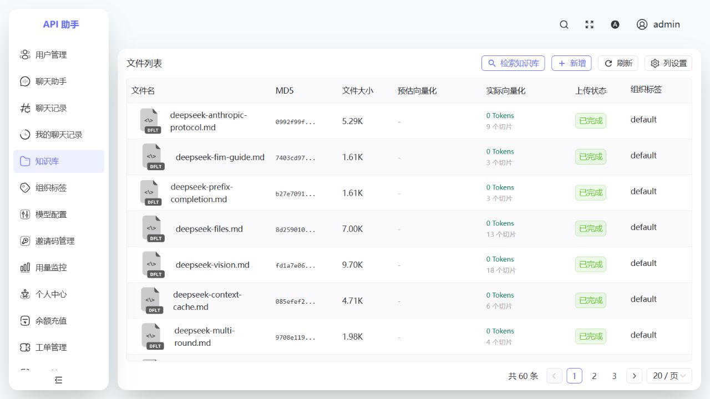
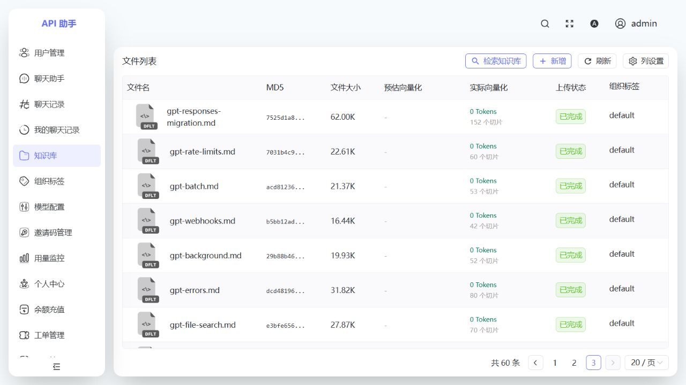

# Docker 官方知识库替换与验收

2026-10-20。Docker Demo 已将旧假想公司及测试知识替换为 DeepSeek、Qwen、GPT/OpenAI 官方正文快照；模型、密钥、代理和业务配置保留。

后续状态：本报告中的串厂商及账单安全门问题已完成修复与回归，见[后续修复验收](VENDOR_SCOPE_AND_BILLING_GATE_FIX_2026-10-20.md)。下文保留当时的实际结果，不覆盖历史失败证据。

| 检查点 | 状态 | 证据 |
| --- | --- | --- |
| V0 停写与备份 | 已完成 | API/Worker/Billing停写；MySQL逻辑备份、MinIO/ES静态卷备份、原.env副本 |
| V1 本地可复用数据 | 已完成 | 60份正文SHA、5888条千问v4/256维向量、1531父块逐项检查 |
| V2 分阶段导入与切换 | 已完成 | 新MinIO原文及ES版本全部验证后，单次DB事务发布60份并撤销精确21份旧资料 |
| V3 实际验收 | 已完成 | 原文/向量/父块完整性、120检索回放、13项HTTP/WS链路、普通用户三家检索及引用 |
| V4 清理及交付 | 已完成 | 2个临时账号及资料清理；配置/原有效环境一致；386运行时文件匹配，服务正常，交付归档 |

## 当前资料与复用范围

三家各20份，共60份，来源为`backend/vendor_knowledge/manifest.json`，快照日期2026-10-19。它们是选定页面的官方正文，不是三家全站镜像，也不是重新生成的摘要。正文保留来源URL、核对日期及适用范围。

导入只迁移文档原文、元数据、已有子块真实向量及父块；不复制本地用户、密码、业务账单、余额、计费台账或配置。Docker目标所有者通过管理员身份查找，文档设为公开，普通Demo用户可读；临时验收上传仍为私有。5888条向量的`vector_json`与本地逐条完全相同，模型仍为`text-embedding-v4`、256维，迁移编码调用为0。

为适配目标环境重新分配文档ID、构建版本、修订、存储键及ES文档身份，原文和向量不变。创建的是新的可追踪发布记录，不复用本地任务/计费身份。UI中的`0 Tokens`表示本次导入没有发生新的编码消耗，不能解读为没有真实向量。

原21份旧资料使用精确ID/所有者/旧版本/修订清单校验；新60份先写入并验证MinIO、MySQL、ES，再通过一次DB事务切换可见版本。只针对这21个ID执行物理清理；旧41向量、22父块及对象移除，文件删除标记保留，以防旧任务复活。列表、检索和普通用户可见资料只包含60份官方文档，删除标记不计入有效文档数。已有业务、用户、聊天、诊断记录保留；历史旧资料引用不再被当作当前有效知识。

## 验收实测

| 检查 | 结果 |
| --- | --- |
| MinIO原文 | 60/60与官方清单SHA一致 |
| MySQL向量 | 5888/5888与本地子块文本及向量JSON逐条相同 |
| 父块 | 1531/1531文本及子块范围一致 |
| ES | 5888条，模型、维度、所有者、发布版本及正文身份匹配 |
| 旧资料 | 有效文档0、向量0；无旧测试资料参与检索 |
| 普通用户 | 60份官方公开文档可见；三家实际查询均返回对应厂商来源，引用与下载200，下载SHA吻合 |
| 真实链路 | 登录、401/429复查、跨用户404、人工幂等恢复、WebSocket完成、Billing MCP三工具、MD/PDF/DOCX的Kafka/MinIO/Docling/Qwen/ES链路、引用权限、修订后旧引用410、删除后不召回，共13项完成 |
| 容器回归 | 228项通过、2项跳过，224.02秒；隔离SQLite和存储、禁用外部Provider，不以测试夹具覆盖Demo |
| 最终清理复核 | 两个临时账号及3份上传资料已清理，再次逐项核对60份原文、5888向量、1531父块一致 |
| 配置与启动 | 实际.env逐字节一致，原容器有效环境逐项一致；9个长期服务运行，配置健康检查的服务均healthy、重启次数0；migrate/demo-seed退出0 |

### 检索质量的实际边界

120条既有回归问题使用冻结的**真实千问查询向量**，走当前Docker真实ES及RAG流水线；没有调用Provider，也没有用合成编码。这不是盲测或生产负载测试。

| 场景 | 目标文档Top-6命中 |
| --- | ---: |
| 全部120条 | 107/120，89.17% |
| 产品+分类过滤 | 59/60，98.33% |
| 未过滤 | 48/60，80.00% |

13条未命中已保留在`corpus-acceptance.json`，其中未过滤问题存在跨厂商召回；Qwen提示工程的过滤/未过滤两条也未命中指定文档。**迁移完整性通过不等于检索质量满分**，本次没有为提高成绩改写期望、调整实际配置或替换查询集。本地SQLite曾有95%成绩，后端检索实现不同，不沿用至Docker ES。下一轮质量优化应重点处理显式厂商约束、候选配额和长文档重复父块。

### 真实模型验收中的失败记录

账单问题“请核实2026-10的套餐、用量和账单金额”第一次执行时，三项MCP均成功、路由为LOW、汇总决策不转人工，但最终安全门判定应转人工，挡住了回答。原轨迹保留为`ws-billing-blocked.json`，没有被删除或记作首次成功。

以“查询2026-10账单的具体金额、套餐当前基础价和用量记录”有界重测一次后，三项MCP和安全门均通过，答复对应夹具账单12。**这仍是需后续修复的分类/交接/安全门判定一致性问题**，不属于语料或向量迁移丢失。本次保留配置及生产运行逻辑，不把重测成功描述为该问题已消失。

临时账号合计3次真实生成、20,142个LLM Token；4次文档入库记账、90个Embedding Token。另有检索查询编码，不能把入库台账当作Provider总账。官方60份迁移及120条冻结回放均为0次编码调用。

## 备份、复现与证据

检查点：`backend/data/checkpoints/docker-vendor-20261020/`。`private/`有MySQL、.env和临时账号凭据；`volumes/`包含MinIO/ES完整备份，禁止整体公开上传。重要公开结论为：

- `source-preflight.json`：三家计数、模型形状、迁移包摘要。
- `migration-plan.json`：21份精确撤销清单及绑定的包摘要；`migration-result.json`：60份发布与复用计数。
- `corpus-acceptance.json`：完整性、120条实际ES检索轨迹和未命中列表。
- `official-http-acceptance.json`：普通用户三家查询、引用、下载校验。
- `http-acceptance.json`、`ws-*.json`：真实链路及首次安全门阻断；`container-tests.log`：隔离容器回归。
- `final-corpus-integrity.json`：最终清理后的逐项完整性复核，不重复120条检索；`delivery-audit.json`：配置、服务、临时账号及386个运行时文件匹配。

最终后端镜像为`sha256:4db28ecef692602acf327ef0d7d4accddd95436ed3ef7460b0b7c2f2704d2af0`，API/Worker/Billing共用；前端继续运行已验收镜像。`file_upload`保留21个删除标记，因此保护性初始化会统计81条历史记录；有效列表为60份，不存在旧知识仍可检索的问题。

本地SQLite和实际配置另与第四阶段起点校验，仍为60文档/5888向量/1531父块；源码及本地库交付副本保存到`backend/data/checkpoints/docker-vendor-delivery/`，源码归档排除实际.env及依赖目录。

复用工具为`export_vendor_vectors.py`与`migrate_vendor_vectors.py`。导出工具只读本地SQLite并按官方清单核对正文及向量，不导出配置或用户表；导出往返验证与本次迁移包的60份原文和全部向量载荷完全一致。迁移工具默认预检生成清单，`--apply`才写入；要求先备份并暂停API/Worker写入，预检时旧库必须严格符合21份旧资料范围，不能作为任意生产库的批量清库工具。

```powershell
# 在backend目录；输出文件必须尚不存在，父目录需预先建立
.\.venv\Scripts\python.exe scripts/export_vendor_vectors.py --output data/checkpoints/<本次目录>/official-qwen-bundle.zip
```

维护容器内绑定检查点为`/migration`，先运行下列命令生成精确清单，核对后再加`--apply`。模型/维度不匹配、目标身份冲突、旧修订变化会停止。

```text
python scripts/migrate_vendor_vectors.py --bundle /migration/official-qwen-bundle.zip --plan /migration/migration-plan.json
```

回滚须先停写，恢复本次MySQL逻辑备份与匹配的MinIO/ES卷，再启动原应用；只恢复其中一个存储会造成引用与索引版本不一致。本次没有执行破坏性回滚演练。

## 界面证据




